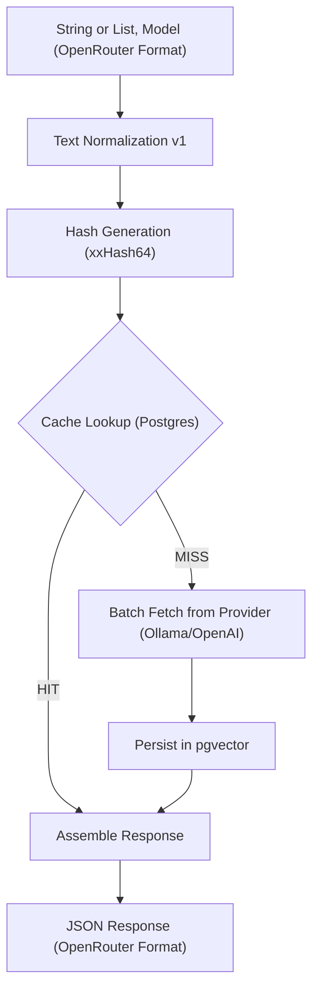

# 🚀 LA Referencia Embedding Cache

A high-performance, deterministic embedding cache microservice designed to eliminate redundant embedding generation and optimize infrastructure costs for large-scale indexing pipelines.

## 🌟 Key Features

- **Deterministic Caching:** Ensures identical input strings always map to the same cached embedding.
- **Text Normalization (v1):** Applied before hashing to prevent minor formatting discrepancies (spaces, line breaks, etc.) from causing cache misses.
- **OpenAI API Compatible:** Implements the standard OpenAI embedding response contract for seamless integration with existing AI tools.
- **Batch Support:** Handles single strings or arrays of strings in a single request, preserving original input order.
- **Persistent Storage:** Leverages **PostgreSQL** with the **pgvector** extension for efficient vector storage and auditability.
- **Read-Only Endpoints:** Easily query available provider models and perform direct cache lookups.

---

## 🛠️ Requirements

- **Java 21+**
- **Maven 3.9+**
- **PostgreSQL 16+** with the [pgvector](https://github.com/pgvector/pgvector) extension installed.
- **Embedding Provider:** An upstream API such as [Ollama](https://ollama.com/) or any OpenAI-compatible embedding service.

---

## ⚙️ Configuration

The application is configured via environment variables. Default values are provided for local development.

| Variable | Description | Default |
| :--- | :--- | :--- |
| `SERVER_PORT` | Port the application runs on | `8080` |
| `EMBEDDING_PROVIDER_URL` | Upstream embedding API endpoint | `http://localhost:11434/v1/embeddings` |
| `DB_URL` | PostgreSQL connection string | `jdbc:postgresql://localhost:5432/embeddings` |
| `DB_USER` | Database username | `embeddings` |
| `DB_PASSWORD` | Database password | `embeddings` |

---

## 📊 Data Flow Architecture

The following diagram illustrates the lifecycle of an embedding request:



---

## 🚀 Getting Started

### 1. Database Setup
Ensure PostgreSQL has the `pgvector` extension enabled:
```sql
CREATE EXTENSION IF NOT EXISTS vector;
```

### 2. Run the Application
You can run the application using Maven:
```bash
mvn spring-boot:run
```

Or build and run the JAR:
```bash
mvn clean package
java -jar target/embedding-cache-0.0.1-SNAPSHOT.jar
```

---

## 📖 API Documentation

The API is fully documented using OpenAPI 3.0. When the application is running, you can access the interactive Swagger UI at:
`http://localhost:8080/swagger-ui.html`

### 1. Generate/Retrieve Embeddings
**Endpoint:** `POST /api/v1/embeddings`

**Request (Single):**
```json
{
  "model": "qwen3-embedding:4b",
  "input": "Este es un texto académico"
}
```

**Request (Batch):**
```json
{
  "model": "qwen3-embedding:4b",
  "input": ["Texto 1", "Texto 2"]
}
```

**Response (OpenAI format):**
```json
{
  "object": "list",
  "data": [
    {
      "object": "embedding",
      "embedding": [0.0012, -0.045, ...],
      "index": 0
    }
  ],
  "model": "qwen3-embedding:4b",
  "usage": { "prompt_tokens": 0, "total_tokens": 0 }
}
```

### 2. List Available Models
**Endpoint:** `GET /api/v1/models`

Queries the upstream provider and returns the list of models currently available for inference.

### 3. Direct Cache Lookup
**Endpoint:** `GET /api/v1/embeddings/{model:hash}`

Retrieves a specific vector directly from the cache using its key.
Example: `GET /api/v1/embeddings/qwen3-embedding:4b:45ab6734b21e6968`

---

## 🧪 Testing
Run the test suite using Maven:
```bash
mvn test
```

Includes tests for:
- **Text Normalizer:** Verifies formatting rules (trimming, Unicode normalization, etc.).
- **Embedding Service:** Ensures cache-hit logic and order preservation for batch requests.
