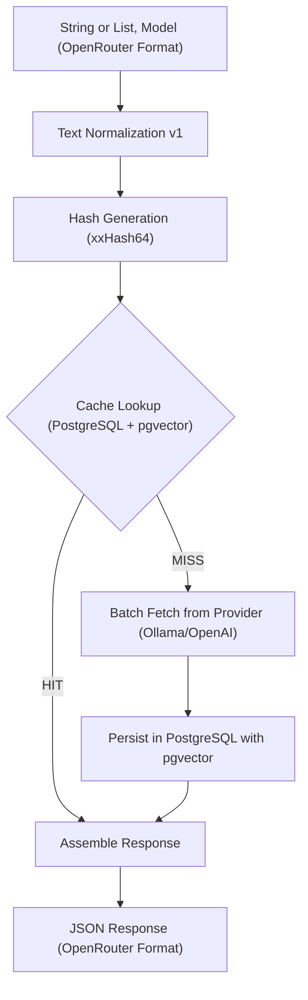

# LA Referencia Embedding Cache

A high-performance, deterministic embedding cache microservice designed to eliminate redundant embedding generation and optimize infrastructure costs for large-scale indexing pipelines.

## Key Features

- **Deterministic Caching:** Ensures identical input strings always map to the same cached embedding.
- **Text Normalization (v1):** Applied before hashing to prevent minor formatting discrepancies (spaces, line breaks, etc.) from causing cache misses.
- **OpenAI API Compatible:** Implements the standard OpenAI embedding response contract for seamless integration with existing AI tools.
- **Batch Support:** Handles single strings or arrays of strings in a single request, preserving original input order.
- **Storage-Based Architecture:** Named storages bind a model and provider to a dedicated pgvector table. Create a storage first, then reference its UUID in embedding requests.
- **Dimension-Aware PGvector Tables:** Embedding dimensions are resolved from the provider at storage creation time; the dedicated pgvector table is created immediately with the correct vector size.
- **PostgreSQL + pgvector:** Persistent, scalable vector storage with built-in SQL queryability and auditability.
- **Request Correlation IDs:** Automatic request tracing via MDC for end-to-end observability across logs.
- **HTTP Timeouts:** Configurable connection and request timeouts for external embedding providers.
- **Provider Abstraction:** Extensible interface for multiple embedding provider implementations.
- **Read-Only Endpoints:** Easily query available provider models and perform direct cache lookups.

---

## 🛠️ Requirements

- **Java 21+**
- **Maven 3.9+**
- **PostgreSQL 16+** with the [pgvector](https://github.com/pgvector/pgvector) extension installed.
- **Embedding Provider:** An upstream API such as [Ollama](https://ollama.com/) or any OpenAI-compatible embedding service.

---

## ⚙️ Configuration

The application is configured via environment variables or `application.yml`. Default values are provided for local development.

| Variable/Property                                          | Description                                          | Default                                       |
| :--------------------------------------------------------- | :--------------------------------------------------- | :-------------------------------------------- |
| `SERVER_PORT` / `server.port`                              | Port the application runs on                         | `8080`                                        |
| `EMBEDDING_PROVIDER` / `app.embedding.provider.type`       | Provider selector (`OLLAMA`, `OPENAI`, `OPENROUTER`) | `OLLAMA`                                      |
| `OLLAMA_URL` / `app.embedding.provider.ollama-url`         | Ollama embeddings endpoint                           | `http://localhost:11434/v1/embeddings`        |
| `OPENAI_URL` / `app.embedding.provider.openai-url`         | OpenAI embeddings endpoint                           | `https://api.openai.com/v1/embeddings`        |
| `OPENROUTER_URL` / `app.embedding.provider.openrouter-url` | OpenRouter embeddings endpoint                       | `https://openrouter.ai/api/v1/embeddings`     |
| `DB_URL` / `spring.datasource.url`                         | PostgreSQL connection string                         | `jdbc:postgresql://localhost:5432/embeddings` |
| `DB_USER` / `spring.datasource.username`                   | Database username                                    | `embeddings`                                  |
| `DB_PASSWORD` / `spring.datasource.password`               | Database password                                    | `embeddings`                                  |
| `app.embedding.provider.connect-timeout`                   | HTTP connection timeout (seconds)                    | `5`                                           |
| `app.embedding.provider.request-timeout`                   | HTTP request timeout (seconds)                       | `30`                                          |
| `app.embedding.max-batch-size`                             | Maximum strings per embedding request                | `100`                                         |
| `app.embedding.max-input-length`                           | Maximum characters per input string                  | `8192`                                        |

---

## 📊 Data Flow Architecture

The following diagram illustrates the lifecycle of an embedding request:



---

## 🚀 Getting Started

### 1. Database Setup

Ensure the `pgvector` extension is enabled in PostgreSQL:

```sql
CREATE EXTENSION IF NOT EXISTS vector;
```

The application uses PostgreSQL for persistent vector storage with per-storage tables created dynamically on first use. Tables are named `embeddings_<storageId>` and storage vectors in `VECTOR` columns matching the model's embedding dimensions.

**Connection Configuration** (via environment or `application.yml`):

```bash
export DB_URL="jdbc:postgresql://localhost:5432/embeddings"
export DB_USER="embeddings"
export DB_PASSWORD="embeddings"
```

Or in `application.yml`:

```yaml
spring:
  datasource:
    url: jdbc:postgresql://localhost:5432/embeddings
    username: embeddings
    password: embeddings
```

### 2. Run the Application

You can run the application using Maven:

```bash
mvn spring-boot:run
```

Or build and run the JAR:

```bash
mvn clean package
java -jar target/embedding-cache-0.0.1-SNAPSHOT.jar
```

---

## 📖 API Documentation

The API is fully documented using OpenAPI 3.0. When the application is running, you can access the interactive Swagger UI at:
`http://localhost:8080/swagger-ui.html`

### 1. Create a Storage

**Endpoint:** `POST /api/v1/storages`

Creates a named storage that binds a model to a dedicated pgvector table. Embedding dimensions are resolved from the provider at creation time.

**Request:**

```json
{
  "name": "my-storage",
  "model": "qwen3-embedding:4b"
}
```

**Response:**

```json
{
  "id": "550e8400-e29b-41d4-a716-446655440000",
  "name": "my-storage",
  "model": "qwen3-embedding:4b",
  "provider": "OLLAMA",
  "embeddingDimensions": 2560,
  "createdAt": "2026-05-12T10:00:00Z"
}
```

### 2. List Storages

**Endpoint:** `GET /api/v1/storages`

Returns all registered storages ordered by creation time.

### 3. Generate/Retrieve Embeddings

**Endpoint:** `POST /api/v1/embeddings`

The `model` field must be the **UUID of an existing storage** (returned by `POST /api/v1/storages`).

**Request (Single):**

```json
{
  "model": "550e8400-e29b-41d4-a716-446655440000",
  "input": "Este es un texto académico"
}
```

**Request (Batch):**

```json
{
  "model": "550e8400-e29b-41d4-a716-446655440000",
  "input": ["Texto 1", "Texto 2"]
}
```

**Response:**

```json
{
  "storageId": "550e8400-e29b-41d4-a716-446655440000",
  "storageName": "my-storage",
  "model": "qwen3-embedding:4b",
  "provider": "OLLAMA",
  "object": "list",
  "data": [
    {
      "object": "embedding",
      "index": 0,
      "embedding": [0.0012, -0.045, "..."]
    }
  ],
  "usage": { "prompt_tokens": 0, "total_tokens": 0 }
}
```

---

## 🧪 Testing

Run the test suite using Maven:

```bash
mvn test
```

Includes tests for:

- **Text Normalizer:** Verifies formatting rules (trimming, Unicode normalization, etc.).
- **Embedding Service:** Ensures cache-hit logic and order preservation for batch requests.
- **Storage Service:** Validates storage creation, dimension probing, and table naming.
- **PostgreSQL Integration:** Verifies pgvector storage and retrieval operations.
