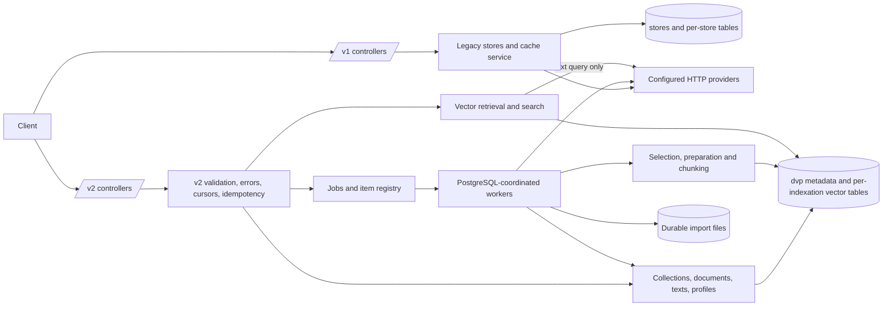

# Document and Vector Platform — Implementation Plan

**Status:** Phases 1–9 have implementation baselines; see individual records for approval history. Phase 10 is implemented and verified on the pinned database; the user authorized Phase 11. Phase 11 is implemented and verified; the user subsequently requested Phases 12–13. Phases 12 and 13 are implemented together under the user’s explicit request and have passed pinned-database regression; remaining verification and approval are recorded below. Phase 14 has not started. See the phase records for evidence.

**Baseline examined:** `main`, commit `52aadb3642a787fefdc69d2d7676122021feeefb`, 2026-11-04. The working tree already contained a change to `.gitignore`; it is outside this plan.

**Specification:** [Document and Vector Platform Specification v1.0](document-vector-platform-specification.en.md), especially §§2–13. The specification is the detailed contract; this plan orders its implementation and does not replace its normative requirements. The halfvec policy was approved on 2026-11-10 and is recorded below.

**Scope:** This repository only. No graphical interface is specified or present. Each feature phase includes its API, persistence, operational integration, OpenAPI, tests and documentation. No frontend work is assumed. Authentication remains at the existing deployment boundary; collections are not security tenants.

**Execution authorization:** The user's 2026-11-04 request authorized sequential implementation of phases 1, 2 and 3; a subsequent request explicitly authorized moving v1 code into `org.lareferencia.embedding.v1`. Those requests authorize the work recorded below, but are not recorded as approval of the completed results. Phase completion/approval gates remain unchecked pending review. On 2026-11-05 the user explicitly requested phase 4; on 2026-11-06 the user explicitly requested phase 5. Those requests authorized the respective implementation but do not record approval of earlier results. On 2026-11-11 the user explicitly requested phase 7; its implementation and verification are authorized without inferring approval of prior phases.

## How to use this plan across sessions

1. Read `AGENTS.md`, `.ai/PROJECT_PROFILE.md`, applicable skills, this plan, the specification and the current code. Inspect the branch and working-tree status, and identify the latest approved baseline. Do not assume the baseline above is still current.
2. Work on **only the first phase whose preceding phases are approved**. Prerequisites in the dependency table are technical dependencies; the sequential approval gate applies even when a later phase is technically independent. If the current phase is awaiting approval, stop implementation.
3. Before changes, record the starting commit and any pre-existing changes. Complete the phase's tasks, tests and acceptance checks, including the common gate below. Record exact commands, results, environment, evidence links, changed decisions, limitations and commit/review reference in the phase record. Do not check a box on the basis of a plan or an unexecuted test.
4. Request explicit user approval of that completed, tested and reviewable phase. Record approver, date and reference. Approval of the plan or an earlier phase does not approve the next phase. A failed or unavailable check remains open, with a reason and remediation; do not proceed until resolved and the phase explicitly approved.
5. Update this file as work progresses. Leave completed history visible; add decisions and evidence rather than rewriting history. If a requirement or design changes, record the reason, impact, migration/rollback and approval before relying on it.

**Common completion gate — applies separately to every phase:**

- [ ] Phase tasks and deliverables are complete; routes and features are functional, or deliberately unavailable behind a documented feature/role flag until their own phase.
- [ ] Relevant unit, real PostgreSQL/pgvector integration, API/functional and regression tests below pass; record commands and results, including failures and reruns. Run `mvn test`, applicable integration checks and `mvn package` when feasible; record any unavailable lint/build tool rather than inventing a result.
- [ ] Verify behavior and persisted state against the phase criteria; capture representative requests/responses and DB assertions without secrets or full sensitive text. Test actual failure and concurrency cases, not only mocks.
- [ ] OpenAPI and operational/configuration documentation match all exposed behavior. Document schema/API compatibility, migration, reindex implications and rollback for affected features. Verify v1 stays usable.
- [ ] Changes are reviewed and a stable baseline is identified; risks, unresolved decisions and test limitations are recorded.
- [ ] The user has **explicitly approved this phase** after implementation, testing and verification. Record who, when and reference. No later phase starts before this box is checked.

Each phase record uses this template; fill it in during execution:

```text
Start commit / working-tree notes:
Implementation / review reference:
Commands, results, fixtures, DB and extension versions:
Manual verification and evidence:
Decisions, migration / rollback and residual risks:
Explicit approval: pending | approver / date / reference:
```

## 1. Architecture overview

### Existing system and constraints

The repository is a Java 21, Spring Boot 3.5.14 Maven application using Spring Web, validation, JPA, JDBC, PostgreSQL and the pgvector Java driver. Controllers expose `/api/v1/stores`, `/api/v1/embeddings` and `/api/v1/status`; Springdoc provides OpenAPI. `StoreService` holds an in-memory store registry, `EmbeddingService` normalizes and hashes text, reads/writes a per-store table through `EmbeddingRepository`, and invokes the globally configured `EmbeddingProviderService` on a miss. Per-key locking is process-local. PostgreSQL stores vectors; there is no document content, durable job queue, import store, UI or v2 API. Actuator/Micrometer provide the existing instrumentation.

`TextNormalizer` actually lowercases, rejoins hyphenated line breaks, collapses whitespace and applies NFC; the older architecture document incorrectly says case is preserved. The existing v1 xxHash cache and response shapes therefore define the compatibility baseline. The example configuration uses Hibernate `ddl-auto=update`, while the active base configuration is absent from a clean checkout; Compose's convenience environment variables depend on that example being loaded. The pgvector Docker tag is not pinned to a specific extension version. Existing tests are primarily unit tests and mock JDBC/provider calls, so they cannot establish database concurrency, migration, snapshot or ANN behavior.

### Implemented Java package boundaries

- `org.lareferencia.embedding`: application entry point; `config` contains shared database wiring, OpenAPI and routing-error dispatch.
- `org.lareferencia.embedding.v1`: version-specific configuration, controllers, DTOs, entities, exceptions, repositories, services and utilities, with matching unit/integration test packages.
- `org.lareferencia.embedding.v2`: `config`, `common` contracts/resources and `collection` feature, with matching tests. Shared disposable-database helpers and cross-version migration tests remain in the root `integration` test package.

V1 and v2 controller advice is scoped to its version; shared 404 dispatch preserves their different error contracts. The move changes Java imports and class-based logger names, not HTTP paths, configuration prefixes, tables or migration versions. No v1 production class imports v2 implementation classes.

### Target components and data flows



- Keep v1 controllers, normalization, xxHash identity, store tables and successful response contracts distinct from v2. Share a provider parsing/transport abstraction only after v1 regression coverage, with profile-specific clients; do not infer equivalent vector spaces from a model name. Preserve v1 input/model limits and IVFFlat behavior.
- Add v2 controllers and DTOs with snake_case, UUID resources, scoped validation, a v2-only error handler, request IDs, opaque bound keyset cursors, and transactional idempotency. Follow the current controller/service/repository separation; use bounded JDBC queries and explicit transactions for queue, dynamic table and search SQL. Avoid a large JPA object graph or a new framework unless the phase demonstrates a need.
- PostgreSQL is the source of truth for v2. Use a separate `dvp` schema and versioned migrations. Core records are collections; documents with collection-scoped exact external IDs and multiple keyed source texts; immutable embedding profiles; collection-scoped index configurations (`indexations`); revision-bound vector units; jobs/items/files; and idempotency requests. A profile fingerprint is SHA-256 over RFC 8785 canonical JSON with specified defaults and no secrets. Content hashes are SHA-256 over exact UTF-8 content; prepared-input hashes include profile preparation and prefixes.
- Each index configuration owns one UUID-derived, validated `dvp.vec_*` table with fixed `vector(D)` storage and unit/revision associations. Immutable selection, chunking, metric and profile define its vector space. Store finite float32 vectors, reject wrong dimensions and cosine zero norm; perform no implicit precision fallback. Provision asynchronously through the job runtime; `ready` is published only after the physical table commits, independently of ANN readiness. ANN maintenance is separately coordinated and reconciled.
- Document PATCH/PUT/delete transactions serialize on the document; real text changes invalidate units and vectors across its index configurations, while metadata-only changes preserve vectors. Identical submissions are no-ops. Generation captures source revision/hash, performs provider HTTP outside DB transactions, and rechecks under the same document lock before publishing. Retrieval and search enforce current revision predicates and a bounded repeatable-read snapshot for items, coverage and optional projections.
- Roles `api`, `worker` and `all` share PostgreSQL and, where needed, a durable filesystem. Jobs and bounded items use leases, heartbeat, fencing and `FOR UPDATE SKIP LOCKED`; idempotent progress and checkpoints survive restarts. Cross-process per-indexation/document advisory locks cover overlapping inference without holding an open transaction during HTTP. A lost lease or advisory-lock connection prevents publication. HTTP calls can be repeated and billed: exactly-once external execution is not promised.
- Imports stream to an internal durable key with a byte hash before job creation; per-document transactions apply texts, units, vectors and checkpoint atomically. Search uses one indexation table at a time, either exact global document minima or explicitly approximate ANN with bounded candidate expansion and full-precision reranking. Retrieval is read-only; only text search and generation can invoke a provider.
- Establish separate resource pools/limits for search, writes and inference in phase 2, then wire and contention-test them before exposing each consuming feature. Reserve bounded database capacity for job claims/heartbeats and dedicated advisory-lock connections so slow search or inference cannot exhaust lease coordination. Phase 14 tunes and revalidates this isolation under representative load. Use `measured_at`/`is_estimate` for aggregate counters; redact bodies and secrets from errors/logs and control metric cardinality. An administrator installs/verifies the extension, manages provider secrets and determines acceptable outbound data.

### Key architectural decisions and compatibility

| Decision | Rationale / consequence |
| --- | --- |
| Phase 1 Flyway baseline and real-database test harness; phase 2 additive `dvp` schema | Phase 1 needs reproducible migrations for v1 uniqueness fixes and real PostgreSQL concurrency tests before its gate. Establish fresh/legacy migration ownership and pinned integration infrastructure there; phase 2 extends the same migration history for v2. Existing stores/vectors remain usable; no historical text exists to reconstruct documents. |
| Introduce static v2 schema in dependency order; runtime provisioning in a maintenance job | A `POST indexations` returns a job, so job creation, execution and diagnostics must exist first. Static tables may precede APIs; no partial feature route is exposed. Dynamic tables are registry-managed, not one migration per collection. |
| Explicit immutable profile/provider reference and versioned recipe | Model, revision, provider, dimensions, preparation and prefixes identify a vector space. A weights change requires a new profile/indexation and fresh generation or import; credentials can rotate. |
| Revision-bound units and current-read predicate | Deletions cascade, but correctness does not depend on asynchronous cleanup; stale HTTP responses cannot be published. Reads and search see one DB snapshot per response, not across cursor pages. |
| Per-indexation table and explicit ANN strategy | Isolates index spaces; exact search works while ANN is unavailable. pgvector extension ≥0.8.0 is required for iterative scans. `hnsw_vector` allows dimensions ≤2000, explicit `hnsw_halfvec` ≤4000, and `none` allows ≤16000; invalid combinations return 422. Store full float32 and rerank halfvec candidates. |
| PostgreSQL queue with bounded materialization and fenced leases | Survives restarts and multiple processes without a new broker. Pool sizing must include advisory-lock connections; HTTP remains at-least-once. |
| Resource isolation before feature exposure | Phase 2 creates bounded search/read and write database pools, reserved coordination capacity, and a separate inference executor/HTTP budget. Phases 5–13 wire and test their consumers before exposure; phase 14 measures and tunes the implemented limits. |
| Separate exact and approximate semantics | Exact computes the minimum over all valid units before limiting documents and must not use ANN; approximate reports candidate shortfalls and does not guarantee recall. |
| No UI, metadata filters, hybrid search, embedded inference or PDF conversion | These are explicitly outside the initial specification. Existing access controls remain deployment responsibilities. |

Reference checks: [pgvector reference and iterative scans](https://github.com/pgvector/pgvector#reference), [PostgreSQL concurrent index creation](https://www.postgresql.org/docs/16/sql-createindex.html), and [RFC 8785](https://www.rfc-editor.org/rfc/rfc8785). Verify actual pinned database and extension capabilities in integration tests; the Java driver version is not the server extension version.

### Halfvec numerical policy — approved 2026-11-10

Float32 storage validation alone does not establish that a vector or query can be converted to half precision. Conversion may overflow, or round a nonzero vector to zero so that a cosine ANN index omits it. The user approved the clarification on 2026-11-10, and it is reflected in specification §8.4. Verification against the pinned extension passed in the Phase 10 regression run; Phase 7 approval remains separately pending.

**Approved policy:** retain the original float32 vector and use the pinned extension's cast semantics to validate halfvec admission. For an indexation configured with `hnsw_halfvec`, generated/imported vectors must convert to finite halfvec components; cosine additionally requires a nonzero norm after conversion. Reject incompatible imports with 422 `halfvec_not_representable` and roll back the whole document record; generation records a permanent item error with that code and publishes no invalid vector. Apply the same checks to approximate query vectors, including provider-generated text-query vectors, returning 422 before the ANN SQL. Exact queries and `ann_strategy=none` remain governed by the existing float32/metric rules, without a halfvec restriction. Do not clamp, rescale, truncate, change strategy or omit incompatible vectors silently.

When building/reconciling an ANN over existing rows, incompatible data leaves `ann_state=failed` with sanitized diagnostics; preserve source/vector data and a ready table's exact-search capability. A build failure never reports ANN ready. Resolve the data or create an explicitly selected exact-only indexation; rebuilding does not mutate the stored float32 space. If review chooses a different policy, document its effect on source admission, queries, coverage, errors and migration before implementing it.

Required real-extension fixtures cover maximum finite half values (including 65504), float32-finite overflow candidates (for example 70000), rounding boundaries, nonzero float32 values that cast to zero (for example 1e-8), mixed-magnitude vectors and ordinary vectors. Verify cosine post-cast norm, all supported metrics, generated/imported/query paths, atomic rollback, failed ANN reconciliation and unchanged float32 retrieval/exact distances. Compare validation with the pinned extension rather than assuming Java conversion has identical rounding. Add these checks to T07/T13/T20 in the plan's traceability; later generation, import and search paths remain subject to their own phase tests.

### API and processing contracts shared by phases

- Base path `/api/v2`, UTF-8 JSON, snake_case and UTC RFC 3339 timestamps; reject unknown fields. External IDs are case-sensitive and unnormalized, supplied in JSON/query parameters, never path segments; enforce code-point and UTF-8 byte limits, including text keys. Default listings are 100, maximum 1000, with opaque selection/path-bound keyset cursors and no OFFSET or promised cross-page snapshot.
- Enforce specification §5 errors: 400 malformed/unknown fields, 404 absent/out-of-scope, 409 duplicate/unavailable, 412 revision mismatch, 413 size, 422 incompatible data/capability, 429 capacity plus `Retry-After`, 502 provider and 503 storage/query timeout. Preserve v1 error shape. Bound default document 16 MiB, 1000 texts, text 2 million code points, metadata 256 KiB and text query 8192 code points; publish configurable limits.
- Mandatory `Idempotency-Key` for resource/job/import POSTs; optional for document writes, not required for search. Scope by method and canonical path; hash canonical request/query or file bytes/options. Commit result and mutation atomically, replay same status/body, reject different content, wait ≤5 seconds before `idempotency_in_progress`, retain ≥7 days and while a job is active. ETag is document revision; optional `If-Match` applies also to delete and missing documents.
- Initial roles/limits: 120-second lease, 20-second heartbeat, max 128 inputs/provider batch, four concurrent calls per provider/instance, connect/request timeouts 5/30 seconds. Retry transient failures at most five attempts with persisted delayed availability and specified exponential backoff/jitter; obey bounded `Retry-After`. Enumerate by collection/sequence high-water mark, batches of 100 and at most 1000 active items/job; record skipped changes and no invented progress percentage.
- Exact search default timeout/concurrency 60 seconds/two per instance; approximate 10 seconds/16. Approximate candidate budget starts at `max(100, top_n*10)`, expands to 10000 with appropriate HNSW settings and returns explicit shortfall. Preserve query snapshot and limits through feature phases.

## 2. Dependencies and roadmap

Entity dependencies: `collection → document → source_text → vector_unit → vector row`; `profile + collection → indexation → dedicated vector table`; `job → item` and optional durable import file; preparation and generation require indexation, document and job runtime; import additionally uses document upsert, vector validation and checkpointing; retrieval requires current units/vectors; exact and approximate search depend on retrieval invariants and a populated index. `idempotency`, errors, cursors, config, migrations and instrumentation are shared prerequisites.

Phases 1–10 have implementation baselines; the user authorized Phase 11 after Phase 10 review. Phase 11 is implemented and verified. Phases 12–13 are implemented together and undergoing completion review; Phase 14 is not started. Check a phase completion box only after its common gate and explicit approval; no approval is inferred from passing tests.

| Complete | Phase | Focus / deliverable | Technical prerequisites | Specification acceptance | Status |
| --- | --- | --- | --- | --- | --- |
| [ ] | 1 | v1 compatibility, migration baseline, DB test harness and reproducible runtime | Existing service | T01, T14, v1 portion T17 | Implemented; verified; approval pending |
| [ ] | 2 | v2 schema, shared contracts and resource isolation | 1 | T17, shared T18, T21 | Implemented; verified; approval pending |
| [ ] | 3 | Collections | 2 | T02, T18 | Implemented; verified; approval pending |
| [ ] | 4 | Documents and source texts | 3 | T02–T04, T18 | Implemented; verified; approval pending |
| [ ] | 5 | Embedding profiles and provider registry | 2 | T14, T19, T20 | Implemented; verified; approval pending |
| [ ] | 6 | Persistent jobs and worker runtime | 2–4 | T15–T16, T18 | Implementation baseline present; approval pending |
| [ ] | 7 | Index configurations and maintenance | 3, 5, 6 | T17, T20 | Implemented; pinned regression passed; approval pending |
| [ ] | 8 | Text selection, vector units and preparation | 4, 5, 6, 7 | T04–T05, T10, T16, T19 | Implemented; locally verified; approval pending |
| [ ] | 9 | Deferred embedding generation | 5–8 | T10, T14–T16, T19 | Implemented; user authorized proceeding to Phase 10 |
| [ ] | 10 | Streaming document/vector imports | 4–9 | T06–T09, T16, T18 | Implemented; pinned regression passed; approval pending |
| [ ] | 11 | Per-document vector retrieval | 4, 7–10 | T10–T11, T19 | Implemented; pinned regression passed; approval pending |
| [ ] | 12 | Exact semantic search | 5, 7, 9–11 | T10, T12, T19–T21 | Implemented; pinned regression passed; additional checks and approval pending |
| [ ] | 13 | Approximate search and ANN | 7, 11–12 | T13, T17, T20–T21 | Implemented; pinned regression passed; additional checks and approval pending |
| [ ] | 14 | Operational readiness and measured capacity | 1–13 | T01–T21 | Not started |

The specification's six broad phases are subdivided here to keep each entity/feature reviewable. The migration baseline and real-DB harness belong to phase 1 because its fixes require them; phase 2 extends them for v2. Resource isolation belongs to the shared foundation and each consuming feature gate, rather than being deferred to final hardening. The shared schema and job runtime are foundational exceptions. Each later phase builds on an approved stable service; unavailable later capabilities are not advertised as implemented. Do not introduce a feature route that returns a fake success or silently performs a different mode.

## 3. Phase details

### Phase 1 — Preserve v1 and establish a reproducible runtime

**Depends on:** existing repository. **Components:** v1 services, repositories, provider client, lock manager, configuration, Compose, `pom.xml`, migration baseline, integration-test harness, tests, README. **Deliverable:** tested v1 baseline with fixes 1–7 in `fixes.md`, reproducible migration/testing prerequisites and clean-checkout startup.

- [x] Capture golden success/error responses, normalization/hash fixtures, provider usage/order, cached/missed inputs and existing store/table behavior before refactoring. Add failing regression tests for each identified defect.
- [x] Before applying uniqueness fixes, introduce Flyway and establish an explicit fresh-install/legacy-install baseline and versioned v1 migration path. Inventory legacy schema and case-insensitive duplicates first; do not auto-baseline incompatible databases or merge conflicting rows. Document history ownership/version, preflight, install/upgrade/rollback commands and the policy for retiring legacy `ddl-auto=update` in favor of migration-owned DDL and validation. Rehearse against an isolated populated copy before changing a real installation.
- [x] Before the concurrency/regression checks, create the real PostgreSQL/pgvector integration harness with a pinned image/extension version, isolated databases, deterministic fixtures and documented local/CI commands. Do not use application or production databases. Test fresh installation, legacy baseline, repeat upgrade and rollback/no-ghost behavior; unavailable infrastructure blocks this gate rather than deferring its evidence to phase 2.
- [x] Repair per-key lock lifecycle with safe reference ownership or a bounded lock strategy; retain ordered multi-key acquisition. Keep cross-process coordination as a separate later feature.
- [x] Reject v1 stores whose persisted provider differs from the configured provider before cache hits or writes; document the error and successful-contract compatibility. Do not mix old cache spaces.
- [x] Make store/table cache publication transaction-aware and make other instances observe committed stores. Enforce existing case-insensitive name and model/dimension rules with database constraints and targeted 409 translation. Detect existing duplicate conflicts before migration; require a non-destructive operator resolution rather than silently merging data.
- [x] Reconstruct provider response by `index`; reject missing, duplicate, non-integer or out-of-range indices and invalid counts/dimensions. Stabilize byte formatting across locales. Preserve v1 successful order and existing normalization.
- [x] Provide active secret-free base configuration, correct Compose binding and a reproducible clean-checkout startup; remove dummy API-key defaults. Document extension installation as an administrative step, env bindings and relevant health behavior.
- [x] **Tests:** barrier-driven local lock race and overlapping batches; two-instance cache visibility, rollback/no ghosts, concurrent duplicate names/models and provider mismatch with hits and misses on real PostgreSQL; mocked provider unordered/malformed data; English and Spanish/Portuguese locale cases; full v1 regression suite (T01, T14).
- [x] **Verify / accept:** start from a clean checkout without ignored config, exercise store creation, cached/repeated batches and status; database and response fixtures match v1 contracts, one duplicate wins/other returns 409, no phantom cache/table state, and no mismatched-provider vector is returned or written. Record exact image/DB/extension versions. Risks: existing conflicting rows or previously mixed provider cache require operator investigation; do not rewrite them automatically.
- [ ] Common completion gate and explicit phase approval complete. **Record:** implemented and verified; user approval pending (see execution records below).

### Phase 2 — Migration and shared v2 foundation

**Depends on:** 1, including its approved migration baseline and real-DB harness. **Components:** versioned `dvp` migrations, config/resource pools, v2 common DTO/error/validation/cursor/idempotency utilities, extended test infrastructure. **Deliverable:** additive v2 schema, reusable v2 contract and implemented resource isolation without prematurely exposed entity APIs.

- [x] Extend phase 1's Flyway history and tested fresh/legacy baseline with versioned static `dvp` schema in FK dependency order. Keep v2 outside legacy Hibernate automatic updates and recheck migration ownership/duplicate preflight; do not introduce a second baseline or recreate `stores`. Schema may include future tables but exposes no unfinished API. Keep dynamic table lifecycle in the indexation registry.
- [x] Verify an administrator-provided compatible `vector` extension and fail clearly when unavailable/too old for enabled v2; pin a PostgreSQL/pgvector test image and record both versions. Do not install the extension through HTTP.
- [x] Implement scoped v2 error mapping, request IDs, strict JSON/size checks, snake_case, timestamps and path/selection-bound opaque keyset cursors. Implement transactional idempotency including canonical body/query hash, file-hash interface, same-response replay, concurrent wait/409, retention and no incomplete reservation. Provide `If-Match` parsing shared with document writes.
- [x] Make v2 endpoints/workers separately configurable and initially disabled for deployment; implement separate bounded database pools for search/read and writes, reserved coordination capacity for claims/heartbeats and advisory-lock sessions, and a bounded inference executor/HTTP budget. Specify transaction-manager routing, pool acquisition/query timeouts, queue/rejection behavior and total connections across roles/replicas. These must be working components, not configuration placeholders. Add secret-safe logging patterns and extend phase 1's fixtures/harness; add dependencies only when needed and record versions.
- [x] Saturate the search pool and block mocked inference; assert an independent write and coordination operation still completes within its configured acquisition/operation deadline. Verify bounded queues/connections, released capacity after cancellation/timeout and predictable rejection. Later phases must repeat this test with their actual consumers before exposure.
- [x] **Tests:** fresh DB, populated copy with legacy tables, repeat migration, startup with missing/old extension, failed migration/rollback and v1 smoke (T17); strict v2 errors, cursor tampering/scope, concurrent idempotency/replay/conflict/expiry (T18), no secret in logs. Validate required indexes and schema constraints against real DB.
- [x] **Verify / accept:** existing store rows and vectors remain unchanged and usable; v2 schema is versioned and reproducible, a failed migration cannot produce a successful readiness signal, and old application rollback leaves v2 data untouched. Record migration order, backup, disabling flags, rollback and any required reindex. Risk: legacy databases may contain duplicate records or drift; stop and document resolution instead of destructive repair.
- [ ] Common completion gate and explicit phase approval complete. **Record:** implemented and verified; user approval pending (see execution records below).

### Phase 3 — Collections

**Depends on:** 2. **Components:** collection controller/DTO/service/JDBC repository, migrations as needed, OpenAPI. **Deliverable:** complete collection create/list/get contract (§6.1).

- [x] Implement `POST /collections`, paginated `GET /collections` and `GET /collections/{c}` with UUID, timestamps, `Location`, mandatory idempotency and database-backed conflict handling. Validate `slug` separately: unique, 1–100 characters and lowercase ASCII matching `^[a-z0-9][a-z0-9_-]*$`. Validate `name` as the required display string, maximum 200 PostgreSQL characters/Unicode code points; preserve Unicode and case, allow repeated display names, and impose no slug regex or name uniqueness constraint.
- [x] Implement stable UUID keyset listings with scoped cursors; no deletion or security-tenant semantics. Include configuration, OpenAPI examples and error mappings.
- [x] **Tests:** unit validation/cursors, slug regex/length and display-name code-point length; real DB concurrent same-slug and same/different idempotency keys; HTTP create/get/list pagination, missing IDs, replay and malformed inputs (T18). Round-trip mixed-case Unicode names and create two different slugs with the same name; reject duplicate slugs and names above 200 code points without conflating the two fields.
- [x] **Verify / accept:** create two collections and list them exactly once across pages, retrieve by UUID; duplicate returns 409 and idempotent replay returns original 201/body/Location without another row; v1 smoke passes. Risks: collation/slug policy must match DB constraints.
- [ ] Common completion gate and explicit phase approval complete. **Record:** implemented and verified; user approval pending (see execution records below).

### Phase 4 — Documents and source texts

**Depends on:** 3. **Components:** document/text services, transactional repositories, controllers/DTOs, migrations, OpenAPI. **Deliverable:** full §6.2 document lifecycle.

- [x] Implement PATCH/PUT upsert and GET by external ID query, GET by UUID/list, and delete document/text. Preserve exact external IDs/text keys including Unicode, `/` and `:`; enforce collection ownership, character/byte/body/metadata limits and duplicate-key validation.
- [x] Implement PATCH metadata replacement only when present and partial keyed texts; PUT requires both fields and removes omitted texts. Persist each document and its texts atomically, lock with `INSERT ... ON CONFLICT` followed by row locking, implement ETag/If-Match and optional idempotency. Increment document/text revisions only for actual changes; metadata-only updates retain vectors.
- [x] Implement text-change/deletion invalidation using unit/vector FKs and consistent lock order. Unit/vector tables may be populated by integration fixtures before their APIs exist; test cross-indexation cascades without introducing generation early. List documents by sequence keyset, excluding bodies and metadata unless requested.
- [x] **Tests:** unit PATCH/PUT/limits/revision rules; real DB concurrent creation/update/delete, If-Match, no-op and cascades using representative units/vector fixtures; HTTP cases for same external ID across collections, special IDs, 404/412/422 and cursor paging (T02–T04, T18).
- [x] **Verify / accept:** two collections retain independent same-ID documents; PATCH preserves omitted texts, PUT removes them, identical request leaves revision/time unchanged, and delete/change removes only affected representations while metadata-only update preserves them. Risks: byte limits and concurrent cascades across many dynamic tables require measurement.
- [ ] Common completion gate and explicit phase approval complete. **Record:** implemented and verified; user approval pending (see phase 4 record).

### Phase 5 — Immutable embedding profiles and provider registry

**Depends on:** 2; sequentially follows approved phase 4. **Components:** profile API/repository, provider configuration/registry, preparation fingerprint, shared provider transport, OpenAPI. **Deliverable:** §4.1 and §6.1 profile administration.

- [x] Implement create/list/get profiles with required model, administrator-assigned revision, dimensions, execution mode, provider reference and preparation. Normalize specified defaults before RFC 8785 fingerprinting; unique slug/fingerprint; no secret in API/DB response. Immutable profile and reference validation; `import_only` has no provider.
- [x] Add individually configured OLLAMA or OPENAI_COMPATIBLE HTTP provider references, endpoint, secret reference, per-provider timeouts/batch/concurrency. Resolve by profile rather than global v1 provider; credentials stay in runtime configuration. Share tested index-aware parsing only where behavior remains compatible with phase 1.
- [x] Wire provider calls through phase 2's bounded inference executor/HTTP budget and provider-specific limits; test blocked/timed-out calls and exhausted capacity without consuming the write/coordination pools. Record per-instance and aggregate replica budgets before enabling provider consumers.
- [x] Implement identity/legacy preparation and document/query prefixes as explicit versioned functions; document limits and fingerprint semantics. No inference occurs on profile creation.
- [x] **Tests:** canonicalization vectors, default equivalence, fingerprint uniqueness, duplicates and invalid refs; mock two distinct provider endpoints with unordered/invalid data, secret redaction and import-only capability; real DB concurrent creation and HTTP pagination (T14, relevant T19/T20).
- [x] **Verify / accept:** two HTTP profiles resolve to their own provider; import-only is non-executable, profile creation never calls inference, and duplicate slug/fingerprint returns 409. A deployment-label/weights change creates a new profile rather than mutating old vectors. Risk: administrators must accurately label model revision and control confidential text sent to external services.
- [ ] Common completion gate and explicit phase approval complete. **Record:** implemented and verified; user approval pending (see phase 5 record).

### Phase 6 — Persistent jobs and worker runtime

**Depends on:** 2–4. **Components:** jobs/items schema and repositories, worker roles/claim/heartbeat, job API, observability, test harness. **Deliverable:** durable general execution substrate and `GET /jobs/{j}`, `GET /jobs/{j}/errors`, `POST /jobs/{j}/retries` for supported job kinds.

- [ ] Implement atomic job creation with idempotency, statuses, parent/retry metadata, errors, counters and bounded keyset item listing. A retry rejects an active original, keeps failed-item locators and parameters, and dispatches only implemented job kinds. Do not expose a job type before its handler exists.
- [ ] Implement `api`, `worker`, `all` roles; DB claims using `FOR UPDATE SKIP LOCKED`, committed leases, heartbeat, fencing token and conditional progress commits. Recover expired claims; guard terminal status against remaining queued/leased items. Maintain counters/checkpoints transactionally and do not duplicate counts on recovery.
- [ ] Route claim/heartbeat transactions and advisory-lock sessions through the reserved coordination/lock budgets established in phase 2, with document/vector writes on the write pool. Progress, counters, checkpoints and fencing checks that must commit atomically with a document/result stay in that same write transaction; do not split one atomic unit across pools/connections. Bound worker and lock-session concurrency against total connections. With search capacity saturated and inference blocked, prove a heartbeat and independent write complete within their configured deadlines and no lease expires because it is waiting behind those workloads. Passing this contention test is required before exposing worker-backed jobs.
- [ ] Add bounded collection keyset enumeration through captured maximum `sequence_id`, at most 1000 active items, batches of 100 and no `findAll`/OFFSET. Persist next-attempt availability and transient retry schedule rather than sleeping threads; error bodies/logs are sanitized. Introduce per-indexation/document advisory-lock support on a dedicated connection for later inference.
- [ ] **Tests:** two worker processes, barriers, crash/lease expiry, stale fencing token, duplicate claim, retry errors and transactional checkpoint/counter recovery on real DB; bounded enumeration of a large synthetic collection; API job/error pagination and invalid retry (T15–T16, T18).
- [ ] **Verify / accept:** one logical item has one committed result despite worker interruption; an expired owner cannot publish; enumeration excludes inserts beyond captured high-water mark and stays within materialization limits. Job returns correct terminal state and counters. Risks: lease timing, DB pool exhaustion, advisory-connection loss and external calls are not exactly once.
- [ ] Common completion gate and explicit phase approval complete. **Record:** pending.

### Phase 7 — Index configurations and maintenance

**Depends on:** 3, 5, 6. **Components:** indexation API, registry, dynamic vector SQL, maintenance worker, migrations, OpenAPI. **Deliverable:** §3.2/§6.3 provisioning and maintenance contracts.

- [x] Implement create/list/get indexations with immutable collection/profile/selection/chunking/metric/strategy, validated defaults, unique scoped slug, idempotency, status/capabilities and asynchronous maintenance job/`Location`. Implement `reconcile` and `build_ann` maintenance requests, job status and diagnostics.
- [x] Provision validated UUID-derived table name and metadata in a short atomic transaction; use FKs to bind units, document, source revision and indexation. Publish `ready` only after commit; maintain independent `ann_state`. Expose measured/estimated counters with timestamp, not full corpus counts per request.
- [x] Enforce storage dimensions 1–16000 and explicit ANN policies at 2000/2001/4000/4001/16000 boundaries. Implement concurrent ANN build outside transactions, per-indexation maintenance lock and invalid-index detection/reconciliation. Verify configured extension supports required features. No automatic v1 table modification.
- [ ] Resolve and explicitly approve the halfvec numerical policy defined in the architecture section before accepting `hnsw_halfvec`. Implement shared cast-compatibility validation for later generation/import/query consumers and test finite overflow, underflow-to-zero, rounding boundaries and metric-specific behavior against the pinned extension (implementation and regression tests pass on pinned pgvector 0.8.0; see Phase 10 record). Reconciliation/build over incompatible rows must fail ANN readiness while preserving stored data and exact access; document errors and remediation.
- [x] Run maintenance on a bounded connection/work budget that does not consume the capacity reserved for heartbeats; test a blocked ANN build while job coordination and an independent write remain responsive. Publish the selected pool routing and limits with maintenance diagnostics.
- [ ] **Tests:** real DB transactional failure/rollback, absent table/ghost record, invalid index and reconcile, simultaneous maintenance, physical identifier safety and FK isolation; dimension/strategy boundary cases, unavailable collection/profile/duplicate slug and job/API idempotency (T17, T20).
- [ ] **Verify / accept:** create produces 202 plus durable job; successful worker yields exactly one usable owned table and ready metadata; injected failure never appears ready; invalid ANN is not reported healthy; exact-capable table may be ready before ANN. Risks: concurrent index builds require extra disk/WAL and a separate transaction boundary.
- [ ] Common completion gate and explicit phase approval complete. **Record:** implementation and pinned regression verification complete; user approval pending (see phase 7 and 10 records).

### Phase 8 — Selection, vector units and preparation jobs

**Depends on:** 4–7. **Components:** preparation/chunking service, vector units repository, preparation job handler and API. **Deliverable:** deterministic §4.2 and preparation-only §9 flow.

- [x] Implement immutable text selection by kind/language and `none` / `characters-v1` chunking using Unicode code-point offsets, paragraph boundary rule, overlap and consecutive emitted ordinals. Apply profile preparation/prefix after slicing; reject blank source or empty prepared unit as specified. Persist unit identity, source revision, offsets and prepared SHA-256 without duplicating source body.
- [x] Add idempotent preparation-job creation for up to 1000 requested document IDs or full collection, validate ownership, support `import_only`, bounded enumeration, errors, revision checks, retries and progress. Ingestion itself never starts preparation or inference.
- [x] **Tests:** deterministic golden fixtures for emoji, combining marks, CRLF, paragraphs, whitespace, overlap, edge lengths, selection and prefixes (T05); repeat preparation, source edit/delete during work, per-collection isolation, lease recovery and bounded enumeration (T04, T10, T16, T19).
- [x] **Verify / accept:** each selected current text yields the specified unique units/offsets and input hashes; re-running creates no duplicates; no provider call occurs; changed/deleted texts have no published stale units. Risks: character windows are not token limits, and Unicode code points differ from graphemes.
- [ ] Common completion gate and explicit phase approval complete. **Record:** implemented and locally verified; user approval pending (see phase 8 record).

### Phase 9 — Deferred embedding generation

**Depends on:** 5–8. **Components:** generation jobs, provider adapter/registry, vector writer, concurrency and metrics. **Deliverable:** on-demand generation with source safety (§4.3/§9).

- [x] Add generation-job API/handler: prepare missing units, compute only units without current vectors, deduplicate equal prepared inputs within a batch and reuse current vectors only within the same indexation after verifying input equality. Enforce profile execution capability; import-only returns 409.
- [x] Before HTTP acquire dedicated-connection advisory lock per `(indexation_id, document_id)` and recheck pending work; release after processing. Make calls outside DB transactions. Validate index order/count, dimension, float32 finiteness and cosine norm before storage. Reacquire document lock and check revision/hash plus live lease/fencing/advisory connection before commit; changed/deleted source is skipped with `source_changed`.
- [x] For `hnsw_halfvec`, apply phase 7's approved numeric admission policy before persisting generated/reused vectors. Invalid conversion is a permanent item error, not a partial or silently omitted vector; cover ordinary, overflowing and cosine-underflow fixtures and verify stored float32 values are unchanged.
- [x] Apply per-provider/instance concurrency, batching, timeouts, bounded retry and provider isolation; record generated/reused/skipped/retries and sanitized item errors. Model identity and preparation cannot be changed in place.
- [x] Repeat phase 6's contention test using real generation jobs and a blocked mock provider: inference remains bounded, heartbeats continue within deadlines and a write succeeds while HTTP is pending. Verify timeout/cancellation releases inference and advisory-lock capacity before this phase is exposed.
- [x] **Tests:** mocked HTTP with reversed/invalid indices, invalid numbers, failures/429/timeouts, multiple providers; real DB two-worker overlapping jobs, lease/advisory loss and changes/deletions during blocked HTTP; dedup/reuse and retry recovery (T10, T14–T15, T19). Confirm no stale vector and no writes from a stale owner.
- [x] **Verify / accept:** generation creates one current vector per eligible unit, repeated job makes no unnecessary call, import-only rejects generation, and source changes during HTTP discard the result. Demonstrate bounded queue and per-instance concurrency; report possible duplicate/billable calls under failure. Risk: provider token limits may reject character-sized inputs.
- [ ] Common completion gate and explicit phase approval complete. **Record:** user authorized proceeding to Phase 10 after Phase 9; see phase 9 record for the exact wording and remaining historical gate details.

### Phase 10 — Streaming imports and durable files

**Depends on:** 4–9. **Components:** multipart API, streaming parser, durable storage, import job, document/vector writes, reconciliation and retention. **Deliverable:** JSON/JSONL ingestion (§7).

- [x] Stream upload to a temporary internal path, hash original bytes, enforce 10 GiB default file and 16 MiB record limits, atomically rename to durable shared storage, then register job with mandatory idempotency; replay cleans only redundant upload. Never hold a transaction open during upload; never accept client filesystem paths.
- [x] Parse JSON incrementally and JSONL line by line; support BOM, empty lines and ordered repeated IDs. Merge follows PATCH and replace follows PUT for documents present in the file. Process and validate the entire record, texts, vectors and checkpoint in one transaction. Apply `expected_revision`; reject bad hashes, profiles/scopes, chunks, duplicates, dimensions/nonfinite/overflow/zero norm. `keep`/`replace` operate only on current vectors.
- [x] Apply phase 7's approved halfvec admission policy to imported vectors before committing a record; incompatible conversion returns item code `halfvec_not_representable` under the proposed policy and rolls back all of that document's changes. Exercise overflow, cosine-underflow and mixed-profile records and retain successful float32 values exactly as admitted.
- [ ] Use the bounded write pool for atomic document/vector/checkpoint/counter commits and reserved coordination capacity for independent job claims/heartbeats; test sustained import load alongside saturated search/blocked inference without unbounded queues or missed heartbeats. Keep each document's commit on one transaction/connection despite pool separation. Enforce the configured upload and worker concurrency independently.
- [x] Persist JSONL byte offset/line and JSON record ordinal with commit; retry failed locators in file order without repeating successes; malformed JSONL lines continue, global malformed JSON fails after prior committed records and requires corrected upload. Implement file/job reconciliation, temporary cleanup after 24 hours and 30-day terminal retention with descendant retries protected; expired file returns the specified 409.
- [x] **Tests:** texts-only and multi-profile imports, `keep`/`replace`, reimport, per-record rollback, malformed JSONL/global JSON, `expected_revision`, idempotency concurrency, retry and file expiry; crash after document commit before in-memory advance; memory-bounded large file and restart (T06–T09, T16, T18, T21).
- [x] **Verify / accept:** 202 only after durable file/job commit; persisted records and errors follow file order and transaction boundaries; invalid vector leaves its entire document untouched; retries do not duplicate successful writes and retain required files. Risks: filesystem must be shared and atomic rename semantics verified on the actual deployment volume; size limits must apply before buffering.
- [ ] Common completion gate and explicit phase approval complete. **Record:** implementation and pinned regression verified; approval pending. Actual deployment filesystem semantics and production-scale capacity remain unverified (see phase 10 record).

### Phase 11 — Per-document vector retrieval

**Depends on:** 4, 7–10. **Components:** vector read repositories/controllers, coverage calculation, v2 OpenAPI. **Deliverable:** all four §8.1 routes with no inference.

- [x] Implement one-indexation and all-indexations routes by internal UUID and exact external-ID query, with flat keyset pagination by `(indexation_id, unit_id)`, profile descriptors, scoped ownership and optional `include=texts,metadata`. Skip not-ready tables on all-indexations route and list their IDs; single unavailable indexation returns 409.
- [x] Calculate per-document coverage (`not_applicable`, `pending`, `partial`, `complete`) using selected texts, unprepared texts, units and current vectors; distinguish unprepared texts from missing vectors. Use one bounded repeatable-read snapshot for items, coverage and requested projections, enforcing current text/source revision in SQL. Avoid query-time provider calls.
- [x] Route all retrieval/coverage/projection queries through phase 2's bounded read/search pool and the same read transaction manager. Before exposure, saturate read capacity and verify bounded acquisition failure while writes and job heartbeats still complete within their configured deadlines.
- [ ] **Tests:** all four routes with multiple texts/configurations/dimensions, pagination/projections, empty collection/document, missing/out-of-scope and unavailable cases; deterministic concurrent update/delete snapshot test; provider mock asserts zero requests (T10–T11, T19).
- [x] **Verify / accept:** existing empty document returns 200 with coverage, nonexistent 404, unavailable scoped indexation 409, all-indexations list identifies unavailable ones, and no stale vector or unintended body/metadata is returned. Risk: many indexation tables can make aggregate reads expensive; bound queries and record timings.
- [ ] Common completion gate and explicit phase approval complete. **Record:** implementation and pinned regression verified; explicit approval pending. Detailed test gaps and capacity limits are recorded below.

### Phase 12 — Exact semantic search

**Depends on:** 5, 7, 9–11. **Components:** search API, vector query repository, provider adapter, snapshot/limits, OpenAPI. **Deliverable:** exact §8.2–§8.3 search by document or unit.

- [x] Implement explicit `mode=exact` search with exactly one query vector or text; validate profile dimensions/finite values/cosine norm, query length, `top_n` 1–100 and allowed includes. Until phase 13, the specified default `approximate` mode returns 409 `approximate_search_unavailable`; never substitute exact search. Text uses profile query preparation/prefix and provider; import-only rejects text with 409 while vector search remains available. No metadata filters/federation or returned embeddings.
- [x] Under a bounded repeatable-read snapshot, calculate all current unit distances in the selected table, choose each document's global minimum before limiting, order by distance/document UUID/unit UUID, and retrieve optional projections in the same snapshot. Ensure SQL plan excludes ANN even if present. Use timeout/concurrency limits and 503/429 responses without partial exact results.
- [ ] Wire exact SQL and projections to the bounded search/read pool and text-query HTTP to the bounded inference executor. Before exposing exact search, saturate its admission limit/pool and block inference in a concurrent request; prove independent writes and heartbeats meet their configured deadlines, excess search receives 429/defined capacity errors, and cancellation/timeout releases capacity. Exact queries retain float32 validity rules even on a halfvec-indexed table.
- [ ] **Tests:** known-corpus hand-calculated order, dominant multi-fragment document, ties and all metrics; `EXPLAIN` with ANN present proves exact scan; concurrent update/projection snapshot, vector/text validation, import-only, query timeout/concurrency and provider failures (T10, T12, T19–T21).
- [ ] **Verify / accept:** response returns the correct N distinct documents or units and `exhausted` when fewer exist, deterministic ties and same-snapshot projections; no ANN plan is used and timeout never presents partial data as exact. Risks: exact scans are intentionally expensive at scale; enforce budgets and measure.
- [ ] Common completion gate and explicit phase approval complete. **Record:** pending.

### Phase 13 — Approximate search and ANN

**Depends on:** 7, 11–12. **Components:** search service, ANN query SQL, index maintenance, performance tests, OpenAPI. **Deliverable:** approximate §8.3 search with explicit limitations.

- [x] Implement HNSW query for ready ANN only; candidate expansion begins at `max(100,top_n*10)`, doubles to at most 10000 unique units, adjusts `ef_search`/iterative scans coherently, filters stale rows, deduplicates units and groups documents. Rerank halfvec candidates with stored float32 distances; apply deterministic ordering inside the retrieved set.
- [x] Validate external and provider-generated approximate query vectors using phase 7's approved halfvec policy before casting/querying; test overflow and cosine underflow-to-zero with explicit errors and no silent strategy fallback. Re-run admission/build fixtures through generation, import, maintenance and search, verifying full float32 retrieval and exact distances remain unchanged.
- [x] Return `candidate_limit` for approximate shortfall, `recall_guaranteed=false`, and 409 when ANN is unavailable; never silently fall back to exact. Apply 10-second timeout, 16 concurrent requests/instance by default, query snapshot and projection rules. Complete default approximate search behavior and OpenAPI.
- [ ] Before exposure, saturate approximate and exact search budgets together and verify bounded candidate work, deterministic overload responses, released capacity after cancellation and successful writes/heartbeats within configured deadlines. All actual query paths must use the pools established in phase 2.
- [ ] **Tests:** real extension with fixed corpus, evaluate recall@N against phase 12 exact baseline, dominant fragments/candidate expansion, stale candidates, halfvec reranking, table isolation, unavailable/invalid/building ANN and timeout/budget boundaries (T13, T17, T20–T21).
- [ ] **Verify / accept:** `EXPLAIN` demonstrates intended ANN index use on a representative dataset, reported shortfalls/availability match conditions, halfvec is reranked against full precision, and measured recall is recorded without claiming a guarantee. Risk: approximate recall and plans depend on data, extension and index parameters; capture versions and settings.
- [ ] Common completion gate and explicit phase approval complete. **Record:** pending.

### Phase 14 — Operational readiness, recovery and measured capacity

**Depends on:** 1–13. **Components:** deployment/configuration, metrics, docs/OpenAPI, benchmark and recovery procedures. **Deliverable:** production-readiness evidence, measured capacity and operator runbooks.

- [ ] Tune and revalidate the search/write/inference pools and reserved coordination budgets already implemented and verified in phases 2, 5–7 and 9–13. Measure contention and aggregate replica connection use under representative mixed load; do not defer first implementation of isolation to this phase. Complete health/provider/extension diagnostics and metrics for latency, candidates/shortfalls, retries, progress, imported bytes, queue/leases, vectors and table/index size with controlled cardinality. Validate logs/errors contain request/job IDs but no full content or secrets.
- [ ] Document clean startup, deployment roles and shared durable volume, provider secret rotation and outbound data policy, extension management, tuning, job retry/file retention, reconciliation, ANN builds, backup/restore of registry/dynamic tables/jobs/files, and recovery after failed deployment. Ensure OpenAPI covers every delivered route, response, limit and error.
- [ ] Execute non-destructive migration rehearsal on an existing-DB copy: backup; verify extension; baseline and apply migrations; deploy v2 disabled; v1/v2 smoke; enable in stages. Rehearse application rollback by disabling v2/returning to previous release while preserving v2 data. A model, revision, preparation, metric or dimension change requires a new profile/indexation and explicit re-generation/import/reindex; never convert old hashes to documents.
- [ ] Run staged reproducible benchmarks using realistic dimensions/chunk distribution/table counts. Record hardware, DB/extension versions and settings, memory, table/index sizes, load and generation throughput, p50/p95/p99 search latency, recall@N vs exact, ANN build time, WAL/disk saturation, autovacuum and FK/cascade costs. Report tested scale and limits; 10–50 million documents is a target, not a measured SLA.
- [ ] **Tests:** full T01–T21 suite on pinned real PostgreSQL/pgvector, representative crash/restore/backup and clean-install/migration scenarios, large bounded import/enumeration, all timeout/429/expired file and redaction cases; validate published OpenAPI against exercised responses.
- [ ] **Verify / accept:** restore reproduces registry, dynamic vector tables, job state and durable files coherently; legacy behavior remains intact, rollback preserves data, OpenAPI matches live behavior and benchmark report records measured results and limits. Risks: production capacity and restoration RPO/RTO remain unproven until rehearsed on representative infrastructure; no unmeasured guarantees.
- [ ] Common completion gate and explicit phase approval complete. **Record:** pending.

## 4. Test traceability and verification strategy

Tests must record inputs, HTTP outcomes and relevant persisted state. Use deterministic vectors and mocked provider HTTP for repeatability; real PostgreSQL with a pinned pgvector extension is mandatory for DDL, vector operations, transactions, locking, snapshots, migrations and ANN. Force concurrency races with barriers and multiple workers/processes. SQL mocks alone do not satisfy integration acceptance. Each phase reruns affected earlier regressions, especially v1; full suite and build are required at the final gate.

| Specification case | Primary phases | Verification target |
| --- | --- | --- |
| T01 | 1, 2, 14 | v1 fixtures, normalization, cache/order, locale and old tables |
| T02–T04 | 3, 4, 8 | Collection-scoped exact IDs, PATCH/PUT/revisions, cascades/isolation |
| T05 | 8 | Unicode code-point chunks, paragraphs, overlap and stable offsets |
| T06–T09 | 10 | Streaming file semantics, vector atomicity, conflict/reimport, crash/checkpoint/retry |
| T10 | 8, 9, 11, 12 | Source edits/deletes during processing and same-snapshot reads/search |
| T11 | 11 | Four retrieval routes, coverage, paging, includes, empty/unavailable and zero inference |
| T12 | 12 | Exact global document minima, deterministic ties and EXPLAIN without ANN |
| T13 | 13 | ANN recall, candidate expansion, shortfalls, halfvec rerank and isolation |
| T14 | 1, 5, 9 | Provider index ordering, completeness, dimension/count and persistence |
| T15–T16 | 6, 8–10, 14 | Lease/fencing, overlapping jobs, crash recovery and bounded memory/enumeration |
| T17 | 1, 2, 7, 13, 14 | Fresh/legacy migration, rollback, provisioning/reconciliation and invalid ANN |
| T18 | 2–4, 6, 10 | Concurrent idempotency, expiration, If-Match and duplicate prevention |
| T19 | 5, 8–9, 11–12 | Import-only capabilities and provider separation |
| T20 | 5, 7, 13 | Dimensions/strategy boundary matrix, no silent fallback |
| T21 | 2, 10, 12–14 | Limits, timeouts, 429, expired files, sanitized logs and measured benchmark |

Additional review checks extend this matrix without renumbering the specification's tests:

| Check | Owning phases | Required evidence |
| --- | --- | --- |
| Phase 1 prerequisites (T01/T17) | 1; extended in 2 | Fresh/legacy baseline, versioned uniqueness migration, duplicate preflight and real-DB concurrency harness pass before phase 1 approval. |
| Resource isolation (T15/T21) | 2 foundation; 5–7, 9–13 consumer gates; 14 tuning | Search saturation and blocked inference do not consume write/coordination capacity; actual writes and heartbeats meet configured deadlines; queues/connections remain bounded and cancellation releases capacity. |
| Halfvec numerical clarification (T07/T13/T20) | 7 decision/validator/build; 9 generated/reused vectors; 10 imports; 13 approximate queries | Explicitly approved admission/error policy, pinned-extension boundary fixtures, per-document import rollback, permanent generation errors, ANN failure/reconcile behavior and unchanged full-precision exact/read paths. |
| Collection field semantics (T18 plus §6.1) | 3 | Unique lowercase ASCII slug; mixed-case Unicode and repeated display names accepted; display-name limit enforced by code points. |

## 5. Migration, rollback and reindex policy

1. Before any deployment, inventory existing stores, provider identity and case-insensitive conflicts; capture a restorable backup including legacy dynamic tables. Test against an isolated copy. Administrator installs/verifies extension ≥0.8.0; pin exact deployment/test versions and privileges.
2. Phase 1 establishes the explicit legacy/fresh baseline and migration-owned v1 uniqueness changes with repeatable test/rollback evidence. Phase 2 extends that approved history with additive versioned `dvp` migrations without recreating/renaming/deleting legacy tables. Isolate v2 entities from `ddl-auto=update`. Deploy v2 routes/workers disabled, smoke-test both contracts, then enable in the planned order. Document exact commands during implementation, with failure points and verification queries.
3. Never import old hashes as documents or automatically reuse v1 vectors: original text and full provenance are unavailable. New recipes, model weights/revisions, dimensions, providers or metric require a new profile/indexation and explicit import or generation. Build/rebuild ANN after appropriate loading; plan its time and WAL/disk cost. No global reindex is presumed for an additive upgrade.
4. Roll back application code by disabling v2 routes/workers and returning to the previously validated version; retain new schema, vector tables, jobs and files. No destructive down migration. Restore a consistent backup when recovery requires data rollback; test registry/table/file consistency and old-version behavior. Removing data, extension changes and production deployment require separate authorization.

## 6. Risks, assumptions and decisions to resolve during implementation

| Topic | Current assumption / action |
| --- | --- |
| Scope and UI | The specification explicitly excludes a graphical interface. Repository contains no frontend; API and OpenAPI are the user-facing deliverables. |
| Legacy drift and duplicates | Existing installations, `ddl-auto` history and conflicting case variants are unknown. Inventory and rehearse before imposing constraints; operator resolves conflicts without automatic data loss. |
| Provider provenance | v1 stores may already contain mixed vectors; external imports cannot be proven to originate from the declared model. Administrators/uploader attest provenance; do not silently reuse incompatible vectors. |
| Provider security | Deployment owns secrets and authorization. Confirm data classification and permission before sending confidential text to external providers; keep credentials and text out of telemetry. |
| Schema and extension | Flyway baseline/version, legacy migration ownership, pinned pgvector image and real-DB harness must be selected and tested in phase 1 before its schema/concurrency fixes can pass. Phase 2 extends the history for v2 and chooses the JCS implementation when needed; no speculative dependency upgrades. Provisioning requires appropriate DB privileges. |
| Resource isolation | Phase 2 implements bounded pools/executors and reserved coordination capacity; each consumer phase must prove its actual routing and contention behavior before exposure. Pool sizing is per role/instance plus aggregate replicas; phase 14 measures/tunes rather than introducing isolation. |
| Halfvec numerical clarification | Approved 2026-11-10 and incorporated into the specification. The policy rejects overflow and cosine post-cast zero norm and retains float32 storage. Pinned-extension verification and future generation/import/query integrations remain open. |
| Idempotency | Agree canonical query/body handling, lock timeout implementation and cleanup scheduling within §5 semantics; document chosen encoding and stable replay behavior. |
| Filesystem | Select a shared durable filesystem that supports atomic rename on the same filesystem; agree backup/retention capacity and failure behavior. Retry descendants protect source files. |
| Concurrent operations | Advisory locks consume connections; leases, source-revision checks and fencing protect publication but cannot eliminate repeated billable HTTP calls. Test lock-connection loss and aggregate limits across replicas. |
| Search quality/cost | A primary DB and per-indexation tables do not guarantee 50-million-document throughput. Exact scans, many physical tables/FKs, ANN recall and half precision require measurements and resource budgets. |
| Read consistency | Each response gets a bounded snapshot; cursor pages do not share a snapshot. Changes after processing may remain pending for a later job; no full corpus snapshot is promised. |
| Provider limits | Character chunks do not guarantee provider token limits. Model revision labels, dimensions, normalization, batches, timeouts, retries and concurrency must be documented for every deployed profile. |
| Rollout | Production deployment, destructive cleanup and external data transfer are outside this planning task; plan each separately under repository rules. |

## 7. Decision and verification log

| Date | Decision or evidence | Status / follow-up |
| --- | --- | --- |
| 2026-11-04 | Examined specification, repository guidance, README, architecture, manifests, source, test inventory and `fixes.md`; older architecture conflicts with actual v1 normalization. | Plan uses code and tests for compatibility; verify again at implementation start. |
| 2026-11-04 | `mvn -o test`: 29 tests, 0 failures/errors/skips; Java 21 and Maven 3.9.16. | Unit baseline only; no real DB, provider, clean Compose, concurrency, benchmark or migration exercised. |
| 2026-11-04 | `mvn -o -Dtest=StatusServiceTest -Duser.language=pt -Duser.country=BR test`: 1 test passed. The code still uses default-locale formatting. | The command does not establish the effective locale in the forked test JVM; phase 1 must explicitly set/restore and assert multiple locales. `fixes.md` reports a failure in its earlier environment. |
| 2026-11-04 | Split the specification's broad phases into entity/feature phases. Job substrate precedes indexation provisioning because its create response includes a maintenance job. | Proposed architecture decision; phase implementations remain subject to their gates and recorded review. |
| 2026-11-04 | Review update: moved migration baseline and real-DB harness prerequisites into phase 1; phase 2 now extends that foundation. Resource isolation is implemented in phase 2 and verified with actual consumers before their exposure; phase 14 tunes it. | Planning changes only; all implementation/test/approval boxes remain pending. |
| 2026-11-04 | Review update: separated collection slug/display-name validation, fixed the specification link after the plan moved into `docs/`, and added a proposed halfvec numeric admission policy with a phase 7 decision gate and boundary tests across generation/import/build/query paths. | Collection/link corrections incorporated. Halfvec is a specification clarification pending explicit approval at phase 7; no application behavior or specification text changed. |
| 2026-11-10 | User approved the proposed halfvec admission policy: reject conversion overflow and cosine vectors that become zero; preserve float32 storage. | Applied to phase 7 validation and documented in the specification. |
| — | Phase implementation, evidence, approval and subsequent design decisions | Pending. Add one or more entries per phase; include commit, commands, results, approver/date/reference and unresolved risks. |

## 8. Execution records — Phases 1–3

**Date / working baseline:** 2026-11-04; branch `v2`, starting commit `52aadb3642a787fefdc69d2d7676122021feeefb`. The pre-existing `.gitignore` change was not edited. This plan was already untracked at session start. Changes are reviewable in the working tree; no commit, production deployment, destructive cleanup or live-provider call was performed.

### Phase 1 record

- Implemented Flyway V1 fresh stores / explicit legacy baseline and V2 duplicate preflight/case-insensitive indexes; Hibernate validates migration-owned stores. Added pinned disposable PostgreSQL integration fixtures.
- Fixed reference-counted local locking with a deterministic owner/successor/third-caller handoff test plus overlapping-batch stress. Provider parsing reconstructs indices and validates count/dimensions/finite components; incompatible persisted provider returns 409 before either cache hits or misses. Byte formatting uses `Locale.ROOT`.
- Removed the permanent store registry in favor of indexed database lookups, avoiding pre-commit cache publication and replica staleness. Dynamic-table markers publish after commit; rollback tests cover absent/recreated tables and vectors. This intentionally adds a metadata DB lookup to the v1 hot path; model/normalization/hash/output contracts stay intact.
- Active secret-free configuration, direct Compose datasource bindings, pinned pgvector image, ignored-config exclusions and build/runtime port are documented in [operations](phases-1-3-operations.md).
- Initial `mvn -o test`: 29 passed. Added provider/locale regressions: focused run failed 6 of 12 before fixes, then passed. The first compile after removing store-cache APIs failed because old tests still referenced those APIs; test coverage was adapted to DB-backed semantics. `DVP_TEST_DB_URL=jdbc:postgresql://127.0.0.1:55439/dvp_test mvn test` then passed 41 tests with no skips; `mvn -o package` succeeded.
- `docker build -t dvp-phases-review .` succeeded with local ignored configuration excluded. Started that image against a fresh isolated `dvp_phase1_smoke` database with administrator-installed vector extension. Live health/stores were 200, store creation 201, and status reported the committed store. Later integration verification also exercised repeated HTTP batches, persisted vectors, cache hits, duplicate 409 and provider-mismatch 409 with mocked inference.
- **Approval:** pending. Existing production schema drift, case conflicts, unknown provider provenance and a rehearsal against an actual deployment copy remain pre-deployment responsibilities; no real installation was changed.

### Phase 2 record

- Added V3 static `dvp` registries without dynamic vector tables or unfinished APIs. Replay headers and optional job linkage extend the reference idempotency table so Location replay and active-job retention are durable.
- Implemented v2-scoped strict JSON/types/errors/request IDs, streamed request byte limits, route/selection-bound cursors, quoted revision helpers, RFC 8785 request/file-option hashing, atomic idempotency with a 5-second advisory-lock wait, transactional response writes, lazy expiry and bounded cleanup. Missing/incompatible extension is rejected when v2 is enabled; v2 defaults disabled.
- Implemented separate bounded read, write, coordination and advisory-lock connection budgets plus zero-backlog inference executor. Atomic result/checkpoint work remains on one write transaction. Real pool saturation and blocked-inference tests prove independent writes/coordination still finish and resources recover.
- Chose Boot-managed Flyway core/PostgreSQL modules and `io.github.erdtman:java-json-canonicalization:1.1` without upgrading existing dependencies. A compile exposed the canonicalization dependency missing from the manifest and a test exposed primitive-root handling; both were corrected. A clean rebuild resolved stale incremental classes/resources from an earlier failed compilation. The foundation baseline then passed **49 tests, 0 failures/errors/skips** with `DVP_TEST_DB_URL=jdbc:postgresql://127.0.0.1:55439/dvp_test mvn clean test`.
- Migration evidence: fresh/legacy baselines, repeat upgrade, duplicate preflight preserving rows, legacy vector preservation and injected additive-DDL failure rolling back its table. Numeric capability checks cover old/new versions; real SQL checks cover installed/missing extension. The only installed server tested was PostgreSQL **16.10** with pgvector **0.8.0**; no old extension was installed for an end-to-end startup trial.
- **Approval:** pending. Actual worker/provider/search consumers must integrate the existing resource budgets and repeat their feature-specific contention tests in later phases. The halfvec clarification remains a phase 7 decision; it is not implemented here.

### Phase 3 record

- Implemented `/api/v2/collections` create/list/get with Unicode display names, separate unique ASCII slug rules, keyset UUID pagination, scoped cursor validation, database uniqueness, mandatory idempotency, original Location replay and scoped errors. OpenAPI documents the enabled routes, DTOs, limits and response shapes.
- Collections integration tests cover concurrent duplicate slug and same-key writes, changed-content conflicts, missing resources, strict fields/scalar types, Unicode code-point limits, byte limits, pagination, v1 error-shape preservation and generated OpenAPI schemas. Initial feature baseline passed **55 tests**; added rollback, v1 HTTP, filter and deterministic lock checks brought the suite to **60 tests**.
- Live JAR check on the earlier smoke database applied V3 while retaining its v1 store: Unicode collection create 201, get/list 200, same-key body/Location replay 201 and changed-content 409. Restarting the earlier phase-1 application image against V3 history still served health/v1 stores successfully; SQL confirmed one legacy store, one v2 collection and three successful migration entries remained.
- User-requested version folders were applied to production code, test packages and configuration metadata. Root infrastructure is shared; v1 implementation no longer imports v2 types. Full verification after that move and scoped error-handler separation is recorded below.
- **Approval:** pending. At completion of phase 3 no document/profile/job/import/search API was exposed; phase 4 subsequently added documents. No UI, external-provider provenance verification or capacity SLA is claimed.

### Phase 4 record — 2026-11-05

- **Authorization and baseline:** the user explicitly requested phase 4. Starting commit `e670e7f`; earlier phase approval remains pending and is not inferred. Existing changes to the example configuration were present before this phase and were preserved.
- **Implementation:** v2 document and source-text endpoints use collection-scoped JDBC repositories, exact Unicode identifiers, transactional upsert/delete, revisions and conditional writes, optional idempotency, keyset pagination, and source/vector cascade invalidation. Document mutations serialize on the document row using READ COMMITTED; read transactions use the existing repeatable-read pool. JSON metadata preserves decimal precision. Responses and database failures redact source bodies from debug output.
- **Decisions and operations:** no migration was necessary; existing V3 tables and foreign keys are used. A separate `app.dvp.max-document-bytes` limit (16 MiB default) applies to the combined compact UTF-8 metadata/text snapshot after PATCH merges. Source changes intentionally invalidate associated representations; metadata-only changes retain them. No provider/inference request is made. See [document operations and rollback](phase-4-documents.md).
- **Verification:** focused tests cover validation, special IDs, exact hash and numeric metadata, PATCH/PUT/no-op semantics, revision/precondition behavior, replay, limits, listing, debug redaction, cross-indexation vectors, rollback and concurrent writes/deletes. A sandboxed test attempt could not connect to localhost (`Operation not permitted`); the same suite was rerun with access to the disposable database. An earlier boundary test exposed escaped surrogate byte counting and was corrected to measure actual UTF-8 bytes. Final command `DVP_TEST_DB_URL=jdbc:postgresql://127.0.0.1:55439/dvp_test mvn -o clean verify`: **81 tests, 0 failures/errors/skips**, including 17 document integration tests and 3 document validation unit tests; JAR packaging succeeded. `git diff --check` passed.
- **Approval:** pending. Review the implemented phase and its verification before phase 5. Production deployment, actual capacity/large-scale cascade measurement and restoration from backup have not been exercised.

### Phase 5 record — 2026-11-06

- **Authorization and baseline:** the user explicitly requested phase 5. Starting commit `20a17cc`; earlier phase approvals remain pending and are not inferred. The working tree was clean at the start.
- **Implementation:** profile create/list/get uses the V3 registry, transactional idempotency, UUID keyset pagination, normalized RFC 8785 fingerprints, immutable API semantics, and explicit provider references. The runtime registry resolves HTTP profiles to separate OLLAMA or OPENAI_COMPATIBLE endpoints; credentials are environment-variable references, not database or API values. Bounded per-provider and shared inference capacity and HTTP timeouts prevent provider calls from using database pools. Profile creation does not perform inference.
- **Preparation and compatibility:** `identity-v1` and a frozen `legacy-normalizer-v1` are versioned independently of future v1 changes. Prefixes and provider references participate in profile fingerprints. The existing V3 schema needs no migration or v1 reindex; v2 strict parsing rejects nonintegral or string-valued dimensions. See [profile and provider operations](phase-5-profiles.md) for configuration, replica capacity budgeting, security, migration and rollback.
- **Verification:** `DVP_TEST_DB_URL=jdbc:postgresql://127.0.0.1:55439/dvp_test mvn -o clean verify` passed **93 tests, 0 failures/errors/skips**, with JAR packaging. Focused tests cover canonical fingerprints, defaults, profile conflicts, concurrent creation, pagination, provider routing, unordered/invalid responses, sanitized errors, import-only behavior, timeouts and saturated capacity. Mock endpoints and synthetic input are used; no external model service is contacted.
- **Approval:** pending. The user must review the phase before phase 6. Actual model behavior, provider performance, live credentials and production aggregate replica capacity have not been exercised; future worker phases must integrate persistent retries and provider-specific operational limits.

### Phase 7 record — 2026-11-11

- **Authorization and baseline:** user explicitly requested phase 7. Starting commit `17c3fa7`, clean worktree; that commit already contains the job runtime, indexation endpoints, maintenance handler and a Phase 7 operations section. This request does not imply approval of earlier phases. The halfvec numerical policy was approved on 2026-11-10, as recorded above.
- **Implementation and review:** retained the existing UUID-scoped table provisioning, asynchronous maintenance, dedicated connection and advisory lock. Added strict v2 JSON handling for indexation requests, precise halfvec index-dimension checks and stronger primary-key, cascading FK and scope-constraint reconciliation. Added estimate labeling to counters, documented OpenAPI requests, and updated [operations and examples](phases-5-6-persistent-jobs.md). Fixed two stale regression-test assumptions about the provider name and worker startup.
- **Decisions and compatibility:** the V3/V4 schema remains in use; no new migration or legacy reindex. Existing physical index tables and stored vectors are retained on rollback; disable workers and deploy the prior application. Phase 7 `capabilities` describe physical readiness, not availability of future search/retrieval routes. Later generation/import/query code must apply the approved halfvec policy.
- **Verification:** result pending below. The locally installed PostgreSQL 17.11 and pgvector 0.8.6 were used in an isolated temporary cluster; Docker was unavailable, so the pinned PostgreSQL 16/pgvector 0.8.0 image was not verified in this run. Tests exercise provisioning, rollback, invalid objects, dimensional boundaries, cross-index foreign keys, idempotency, OpenAPI, strict requests, maintenance locking, and heartbeat/write isolation. The first full run exposed stale test configuration; an OpenAPI example assertion also needed correction before the successful rerun.
- **Open gate:** re-run the full suite against the pinned test image when Docker is available; verify actual deployment capacity and obtain explicit user approval before phase 8. No production database, provider or vector index was modified.

### Phase 8 record — 2026-11-11

- **Authorization and baseline:** the user requested phases 8–11. Phase 8 began at `1724c60`; `docs/IMPLEMENTATION_PLAN.md` already had uncommitted user edits, which are preserved. The Phase 7 pinned PostgreSQL 16/pgvector 0.8.0 verification remains open; the user explicitly requested Phase 8 despite that open gate. A request for later phases does not record approval of Phase 8.
- **Implementation:** added code-point chunking, an idempotent preparation-job endpoint, selection and revision-bound unit creation through fenced job transactions, and bounded selected-document enumeration. No provider is called. See [preparation operations](phase-8-preparation.md).
- **Verification:** `DVP_TEST_DB_URL=jdbc:postgresql://127.0.0.1:55449/dvp_test mvn -o clean verify` passed **134 tests, 0 failures/errors/skips**, including 7 preparation integration tests and 5 chunker unit tests. Docker was unavailable; local verification used isolated PostgreSQL 17.11/pgvector 0.8.6. The initial full-suite attempt exposed test fake-handler collisions; test configuration was isolated. The first lock fixture waited on item materialization rather than the intended document lock and was corrected.
- **Open gate:** pinned PostgreSQL 16/pgvector 0.8.0 verification is still unavailable and Phase 8 requires explicit user approval before Phase 9. Phases 9–11 remain unstarted. No v1 schema migration or reindex is required by the current changes.

### Phase 9 record — 2026-11-11

- **Authorization and baseline:** user replied “ok, now implement the Phases 9–11” after Phase 8. Phase 9 started from `1724c60` plus the uncommitted Phase 8 implementation and pre-existing plan edits, all retained. This records authorization to work on Phase 9, not a retroactive approval of earlier phases. The Phase 7 pinned PostgreSQL 16/pgvector 0.8.0 verification remains open.
- **Implementation:** generation jobs prepare missing units, enforce HTTP profile capability, use per-indexation/document advisory locks, deduplicate prepared input within bounded batches, and reuse vectors only from the same indexation after comparing complete prepared content. Provider calls occur outside database transactions. Fenced batch commits recheck the advisory session, job/item leases, document source revisions, unit identity and prepared hash. Invalid dimensions, nonfinite numbers, cosine zero vectors and incompatible halfvec values are permanent errors; 429/5xx and transient failures use persisted retries and bounded Retry-After. See [generation operations](phase-9-generation.md).
- **Verification:** `DVP_TEST_DB_URL=jdbc:postgresql://127.0.0.1:55449/dvp_test mvn -o clean verify` passed **149 tests, 0 failures/errors/skips** on isolated PostgreSQL 17.11/pgvector 0.8.6, including 13 generation integration tests and a blocked local HTTP test. Tests cover source edits/deletion while HTTP waits, lease loss, overlapping jobs, deduplication, collision-safe same-index reuse, cross-index isolation, halfvec overflow/underflow, retries, idempotency, and independent write/heartbeat capacity. A prior run exposed test fake-handler dependencies and was corrected by extracting the shared preparation service. No real model provider was called.
- **Compatibility and risks:** no migration or v1 reindex. Provider calls can repeat after timeouts or crashes, may incur charges and require data-sharing authorization. Model revision provenance and production load/capacity are operator responsibilities; the pinned extension test remains unavailable until Docker is running. Disable workers and retain tables/data for rollback.
- **Follow-up:** after review of Phase 9, the user replied “ok, implements the Phases 10 and 11”, authorizing Phase 10. This does not retroactively approve earlier phases. Pinned database regression subsequently passed; see Phase 10 record.

### Phase 10 record — 2026-11-11

- **Authorization and baseline:** the user authorized Phases 10 and 11 after Phase 9 review. Phase 10 builds on `1724c60` plus the existing uncommitted Phase 8/9 changes and plan edits. Phase 11 requires separate approval after Phase 10 is complete and reviewable.
- **Implementation:** opt-in multipart ingestion publishes a hashed durable file before registering a job; JSON and JSONL readers use bounded records and durable checkpoints. Each record's document, source texts, vectors, errors and checkpoint are protected by transactional lease fencing. Retry descendants reuse the retained file; cleanup protects active uploads and descendants. See [Phase 10 operations](phase-10-imports.md) for configuration, examples, retention and rollback.
- **Verification:** `DVP_TEST_DB_URL=jdbc:postgresql://127.0.0.1:55439/dvp_test mvn -o clean verify` passed **195 tests, 0 failures/errors/skips**, including the full earlier regression suite, on isolated PostgreSQL 16.10 and pgvector 0.8.0 (`pgvector/pgvector:0.8.0-pg16`, digest `sha256:a132765ec351c65111b5b675928a3a0515a466a40f97277329db8b8209ad8bc9`). This resolves the previously unavailable pinned-version regression. `mvn -o -Dtest=JsonDocumentReaderTest,JsonlRecordReaderTest test` passed 13 tests after increasing synthetic oversized streams to 32 MB. The tests cover multipart 413, idempotency, rollback, lease loss, retry retention, checksums, parser recovery and concurrent heartbeats/writes. No real embedding provider or production database was used.
- **Compatibility and risk:** no new schema migration or v1 reindex; import is disabled by default. Enable only with durable storage shared by all API and worker instances, after validating atomic rename, directory fsync and cross-process locks on the actual volume. The 10 GiB limit and deployment-volume throughput/capacity have not been benchmarked. Restore the application, database and durable files together on rollback; retain files needed for retry.
- **Follow-up:** the user requested “now implements the Phase 11 — Per-document vector retrieval” after Phase 10 review, authorizing Phase 11. Production-scale sustained load and deployment storage capacity remain unmeasured.

### Phase 11 record — 2026-11-11

- **Authorization and baseline:** the user requested Phase 11 after the Phase 10 review. Starting from `1724c60` plus the existing uncommitted Phase 8–10 changes and user configuration changes; all are retained.
- **Implementation:** four read-only routes use the dedicated read transaction and repeatable-read snapshot; current revisions, scoped indexation ownership and safe UUID-derived vector table names are checked. Coverage distinguishes unprepared texts and missing vectors. Keyset pages are bounded in SQL, with optional text/metadata projections; provider inference is never invoked. See [retrieval operations](phase-11-vector-retrieval.md).
- **Verification:** `DVP_TEST_DB_URL=jdbc:postgresql://127.0.0.1:55439/dvp_test mvn -o clean verify` passed **201 tests, 0 failures/errors/skips** and packaged the application on disposable PostgreSQL 16.10/pgvector 0.8.0. The focused `mvn -o -Dtest=VectorRetrievalIntegrationTest test` subsequently passed 6 tests after the transaction-error mapping and real heartbeat fixture were added. Coverage includes four HTTP routes, different vector dimensions, stale source revisions, pagination and projections, unavailable indexations, repeatable-read consistency, and read-pool exhaustion alongside an independent write and job heartbeat. A first full run failed one existing job test because local import configuration is enabled; that test now explicitly disables imports for its expected scenario. Initial test execution without socket permission failed; the isolated database run was repeated with permission.
- **Remaining checks and risks:** production-scale latency with many indexations and units has not been benchmarked. Broader multi-worker concurrency, deletion during read and explicit provider-mock assertions remain useful follow-up coverage; the retrieval service has no provider dependency. No schema migration, provider access or v1 reindex was required; deploy the previous application version for rollback while retaining data.
- **Follow-up:** the user subsequently requested implementation of Phases 12 and 13 together. That request authorizes the next work; earlier historical approval records are unchanged.

### Phases 12–13 record — 2026-11-12

- **Authorization and baseline:** the user explicitly requested phases 12 and 13 together, superseding the normal separation between those two phases. The work started on branch `v2` from the existing clean baseline, retaining earlier phase records.
- **Implementation:** search supports exact vector/text queries and HNSW approximate queries, explicit admission limits, provider preparation and isolation, current-revision filtering, snapshot projections, halfvec validation and float32 reranking. Approximate searches verify the physical index and expand the candidate budget; exact scans materialize distances before grouping and limiting. [Search operations](phases-12-13-search.md) documents requests, limits, compatibility and rollback.
- **Focused verification:** pinned PostgreSQL 16/pgvector 0.8.0 integration tests exercise exact grouping, all three metrics, HTTP route, ANN and halfvec, current revisions, query validation, optional projections, blocked mock inference, heartbeat/write isolation and exact overload. A synthetic fragment-heavy corpus achieved at least 0.8 recall@10 against exact; representative `EXPLAIN` checks select the ANN index for its candidate query and omit it from a materialized exact scan. Test failures caused by stale build artifacts were resolved by a clean build.
- **Regression and timeout verification:** `DVP_TEST_DB_URL=jdbc:postgresql://127.0.0.1:55439/dvp_test mvn -o clean verify` passed 208 tests with no failures/errors/skips on the pinned test service and built the JAR. After adding a real database timeout fixture, `mvn -o clean -Dtest=SearchIntegrationTest test` passed 8 tests, including 503 `search_timeout` and admission release. The first non-elevated clean failed because earlier test output was not writable; the clean was rerun with access to the existing build output.
- **Open verification:** production-scale recall, forced client cancellation, combined exact/approximate saturation and multi-instance capacity measurements remain unverified; representative EXPLAIN tests do not prove every deployment plan. Review and explicit approval remain necessary for phase completion.

### Final verification and resumption

- Final command: `DVP_TEST_DB_URL=jdbc:postgresql://127.0.0.1:55439/dvp_test mvn clean verify`. Recorded result after versioned-package and scoped-handler changes: **60 tests, 0 failures/errors/skips**, JAR packaging successful.
- Database fixture image: `pgvector/pgvector:0.8.0-pg16`, digest `sha256:a132765ec351c65111b5b675928a3a0515a466a40f97277329db8b8209ad8bc9`. Verification is reproducible with [test Compose and operation commands](phases-1-3-operations.md#reproducible-verification); test databases are isolated and intentionally not application data.
- `git diff --check` and JAR inspection verify whitespace, active `application.properties`/migration packaging and exclusion of ignored `application.yml`. No lint tool is configured. Test results are also available in local `target/surefire-reports` after the command; those generated reports are not committed.
- Final source-based `docker build -t dvp-phases-review .` succeeded after package separation. The resulting image served health/v1 stores and v2 Unicode collection listing, replayed the persisted 201/Location response created by the earlier JAR, and exposed both versions in OpenAPI. Both Compose files passed `docker compose ... config --quiet`.
- Follow-up on 2026-11-04: a collection POST without `Idempotency-Key` reproduced a generic 400. The v2 handler now names that missing header without exposing supplied values; the status, code and response shape remain unchanged. `mvn -o -Dtest=MissingIdempotencyHeaderTest,RequestFilterTest test` passed 3 tests. `mvn -o test` passed with 61 tests reported, 18 integration tests skipped because their opt-in database was not configured. A retry of the user's requested collection with the required header returned 201 and a subsequent GET returned 200.
- Temporary application/test services were stopped after verification; no containers, database volumes or images were deleted. The test server's isolated data is retained in its disposable container; no application/production database was touched.
- Complete and review Phases 12–13 verification; obtain explicit approval before Phase 14. Consider the remaining coverage and production capacity checks recorded above. Preserve package boundaries and migration history; do not re-baseline an upgraded installation. Check historical phase records and pending approvals independently.
