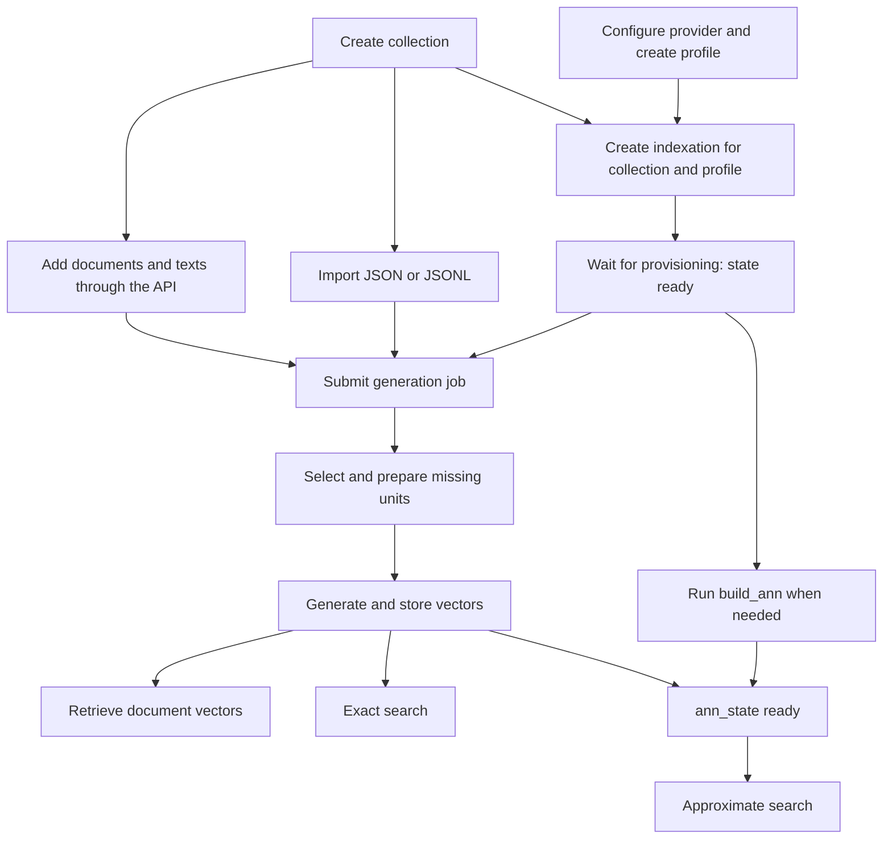

# Document and Vector Platform Guide

This guide consolidates the platform's concepts, API examples, end-to-end indexing workflow, and operational guidance. API **v1** generates and caches embeddings per store. API **v2** manages collections, documents, source texts, embedding profiles, index configurations, durable imports, vector generation, retrieval, and semantic search.

Examples use `http://localhost:8989`. UUIDs, timestamps, hashes, distances, and vectors in responses are illustrative. Response snippets show relevant fields and may omit others; use the values returned by your own server. Jobs are asynchronous. The v1 and v2 APIs remain separate: v1 stores and cached vectors are not automatically converted to v2 documents.

## 1. Concepts

| Concept | Purpose |
| --- | --- |
| Collection | Organizes documents; it is not an authorization or tenant boundary. |
| Document | Collection-scoped record with an internal UUID, exact external ID, metadata, and revision. |
| Source text | A document's title, abstract, or other text, with kind, optional language, content, and revision. |
| Embedding profile | Immutable model, declared revision, dimensions, execution mode, provider reference, and preparation recipe. |
| Indexation | Immutable binding of a profile to text selection, chunking, metric, ANN strategy, and a dedicated vector table; multiple collections can attach to the same indexation. |
| Vector unit | A document-owned representation of a selected text or chunk; stores a text snapshot, offsets, and prepared-input hash without a source-text reference. |
| Embedding | Numeric representation of a unit, generated by a provider or supplied in a validated import. |
| Job | Persisted asynchronous work processed by a worker, with status, counters, and errors. |

## 2. Configuration and access

Java 21, PostgreSQL with administrator-installed pgvector >= 0.8.0, and an appropriately configured provider are required for HTTP inference. Default HTTP port: 8989. Set these values explicitly: the active standalone properties and Docker Compose have different defaults.

| Setting | Purpose |
| --- | --- |
| `DVP_ENABLED` | Enables v2 components. |
| `DVP_ROLE=API`, `WORKER`, or `ALL` | Selects process responsibilities; a `WORKER` process does not expose the v2 API. |
| `DVP_WORKERS_ENABLED=true` | Allows a `WORKER` or `ALL` process to execute jobs. |
| `DVP_IMPORT_ENABLED=true` | Enables import processing on API and worker processes. |
| `DVP_IMPORT_FILE_ROOT` | Durable directory shared by import API and worker instances. |
| `app.dvp.providers.<reference>.*` | Provider type, endpoint, resource limits, and secret reference. |

Copy `src/main/resources/application.properties.example` to the local, ignored `application.properties` if you use Maven. Compose defaults the three feature flags to false and the role to `API`. For a local API and worker using an already configured database:

```bash
DVP_ENABLED=true DVP_IMPORT_ENABLED=true DVP_WORKERS_ENABLED=true DVP_ROLE=ALL \
  mvn spring-boot:run
```

The active configuration defines the provider reference `ollama-gpu-ibict` as `OPENAI_COMPATIBLE`; `DVP_LOCAL_PROVIDER_ENDPOINT` overrides its endpoint. A provider reference is a configuration name, not the provider type or endpoint. For credentials use `secret-ref`, the name of an environment variable; never put tokens in profiles or repository examples. Generation and text search send content to the configured provider; authorize the destination and data sharing first.

| Resource | Path |
| --- | --- |
| Service home | `GET /` |
| Swagger UI | `GET /swagger-ui/index.html` |
| OpenAPI JSON | `GET /api-docs` |
| Swagger configuration | `GET /api-docs/swagger-config` |
| Health | `GET /actuator/health` |
| Metrics | `GET /actuator/metrics` and `GET /actuator/metrics/{name}` |

The old `/v3/api-docs` path is not served by the current configuration. Restrict Actuator access and health details to operators. Exposing the `prometheus` endpoint name does not itself install a Prometheus registry.

## 3. End-to-end workflow



1. Create a collection and retain the returned UUID.
2. Add documents using PATCH/PUT or submit an import and wait for its job. An import without embeddings stores documents and texts; it does not call the model.
3. Configure a provider and create an HTTP profile with the correct model, revision, and dimensions. Use `import_only` for externally produced vectors without HTTP inference.
4. Create an independent indexation with the profile and attach it to the collection. Its response has an indexation `Location` and a provisioning `job_id`. Wait for the job and confirm `state=ready`; this does not mean vectors exist.
5. Submit a generation job per indexation for selected documents or the collection. It prepares units from the texts currently selected by the indexation and creates missing vectors for those units.
6. Inspect the job, item errors, counters, and retrieved vectors. `succeeded` alone does not mean a particular document produced a vector.
7. Retrieve vectors or search. Approximate search needs a compatible ready ANN index. PostgreSQL maintains an existing HNSW index as new vectors are inserted; do not run `build_ann` for each vector.

Empty `selection.kinds` or `selection.languages` means **all** kinds or languages. An indexation named `abstracts` with `kinds: []` also selects titles; specify `["abstract"]` to select only abstracts. `chunking.mode=none` yields one unit per selected text. `characters-v1` may yield multiple chunks; for example `{"mode":"characters-v1","max_chars":2000,"overlap_chars":200}` uses code-point windows and overlap, not a token limit.

Documents and indexations can be created in either order once their prerequisites exist. Collection-wide jobs capture a document-sequence limit at enumeration; later documents need another job. Changing or removing a text does not remove existing document vectors. Run another generation job for new content and manage stale vectors as needed.

## 4. API v2 conventions

- Resource IDs are UUIDs. `external_id` is exact and case-sensitive; URL-encode query values.
- Collection/profile/indexation creation, job creation, and imports require `Idempotency-Key`. Replaying the same key, method, path, and content returns the original result; different content with that key returns 409. Use a new key for a new job. Document writes accept an optional key.
- Document PATCH, PUT, and DELETE accept optional `If-Match: "<revision>"`; an outdated revision returns 412. Read the current `ETag` first.
- Lists generally accept `limit` 1–1000 (default 100) and an opaque `cursor`; pass `next_cursor` unchanged with the same selection. Pages do not share a snapshot.
- 202 means a job was accepted, not completed. Job states include `queued`, `running`, `succeeded`, `completed_with_errors`, and `failed`.
- v2 errors have `timestamp`, `status`, `code`, `message`, `request_id`, and `details`; `X-Request-Id` matches the response. Common statuses: 400 invalid request; 404 missing; 409 conflict/unavailable; 412 revision mismatch; 413 size; 422 incompatible data; 429 capacity; 503 unavailable/timeout. v1 retains its own error format.

```json
{"timestamp":"2026-11-12T12:00:00Z","status":409,"code":"indexation_unavailable","message":"Index configuration is not ready","request_id":"aaaaaaaa-aaaa-4aaa-8aaa-aaaaaaaaaaaa","details":[]}
```

Set variables to values returned by your service. Replace placeholders before running commands:

```bash
BASE=http://localhost:8989
C='<COLLECTION_UUID>'
P='<PROFILE_UUID>'
I='<INDEXATION_UUID>'
D='<DOCUMENT_UUID>'
J='<JOB_UUID>'
```

## 5. Collections

### `POST /api/v2/collections`

Requires `Idempotency-Key`. The response includes the collection `Location`; the lowercase ASCII slug is unique.

Request:

```bash
curl -i -X POST "$BASE/api/v2/collections" \
  -H 'Content-Type: application/json' -H 'Idempotency-Key: collection-example-001' \
  -d '{"slug":"research","name":"Open Research"}'
```

Example response **201** (fields may be omitted here for brevity):

```json
{"id":"11111111-1111-4111-8111-111111111111","slug":"research","name":"Open Research","created_at":"2026-11-12T12:00:00Z"}
```

### `GET /api/v2/collections`

Lists collections with keyset pagination.

Request:

```bash
curl "$BASE/api/v2/collections?limit=100"
```

Example response **200** (fields may be omitted here for brevity):

```json
{"items":[{"id":"11111111-1111-4111-8111-111111111111","slug":"research","name":"Open Research","created_at":"2026-11-12T12:00:00Z"}],"next_cursor":null}
```

### `GET /api/v2/collections/{id}`

Returns one collection and exact counts from the same database snapshot. `documents` counts documents in the collection; `indexations` counts its indexations in all states. Exact counts can take longer for large collections.

Request:

```bash
curl "$BASE/api/v2/collections/$C"
```

Example response **200** (fields may be omitted here for brevity):

```json
{"id":"11111111-1111-4111-8111-111111111111","slug":"research","name":"Open Research","created_at":"2026-11-12T12:00:00Z","counts":{"documents":125,"indexations":2}}
```

The `counts` object is added to the collection detail response only; collection creation and listing retain their existing shape. No migration or reindexing is needed. To roll back, deploy the previous application version; clients should tolerate the absence of `counts` during rollback.

Clients using the removed `GET /documents?external_id=...` route must switch to `/documents/by-external-id?external_id=...`. Clients using the removed indexation-scoped `/document-vectors?external_id=...` route must switch to `/vectors?external_id=...`. No database migration or reindexing is needed; rollback requires deploying the previous application version.

## 6. Documents and source texts

Document writes, reads, and imports use `texts` with `knd`, optional `lng`, and `cnt`. Texts are matched internally by kind, language, and occurrence order; keep that order stable when updating multiple texts in a group. `PATCH` preserves omitted texts, while `PUT` replaces the text list. Generated and imported vectors are retained when texts change, and may become stale.

Changing a text's kind or language selects a different internal key; a `PATCH` therefore adds a new text and retains the old one. Use `PUT` to replace entries. The individual deletion route accepts `knd`, optional `lng`, and optional zero-based `ordinal`. Older explicit-key requests and text-linked vector imports are no longer accepted; clients must use the compact document format and document-level embedding imports.

### `PATCH /api/v2/collections/{c}/documents/by-external-id`

PATCH upserts supplied text keys, preserves omitted keys, and replaces metadata if provided. The response includes `ETag`, and creation includes `Location`. Its full text objects also include SHA-256 hashes and timestamps.

Request:

```bash
curl -i -X PATCH "$BASE/api/v2/collections/$C/documents/by-external-id?external_id=example%3Aarticle-001" \
  -H 'Content-Type: application/json' \
  -d '{"metadata":{"title":"Open access to research","year":2024},"texts":[{"knd":"title","lng":"en","cnt":"Open access to research"},{"knd":"abstract","lng":"en","cnt":"A study of open access to scientific research."}]}'
```

Example response **201 for creation or 200 for update** (fields may be omitted here for brevity):

```json
{"id":"22222222-2222-4222-8222-222222222222","external_id":"example:article-001","collection_id":"11111111-1111-4111-8111-111111111111","revision":1,"metadata":{"title":"Open access to research","year":2024}}
```

### `PUT /api/v2/collections/{c}/documents/by-external-id`

PUT requires metadata and texts and removes omitted texts. This example requires revision 1 using `If-Match`.

Request:

```bash
curl -i -X PUT "$BASE/api/v2/collections/$C/documents/by-external-id?external_id=example%3Aarticle-001" \
  -H 'Content-Type: application/json' -H 'If-Match: "1"' \
  -d '{"metadata":{"title":"Open access"},"texts":[{"knd":"title","lng":"en","cnt":"Open access"}]}'
```

Example response **200 for update or 201 for creation** (fields may be omitted here for brevity):

```json
{"id":"22222222-2222-4222-8222-222222222222","external_id":"example:article-001","revision":2,"metadata":{"title":"Open access"}}
```

### `GET /api/v2/collections/{c}/documents/{d}`

Returns the full document and `ETag`.

Request:

```bash
curl -i "$BASE/api/v2/collections/$C/documents/$D"
```

Example response **200** (fields may be omitted here for brevity):

```json
{"id":"22222222-2222-4222-8222-222222222222","external_id":"example:article-001","revision":1,"metadata":{"title":"Open access to research"}}
```

### `GET /api/v2/collections/{c}/documents/by-external-id?external_id={external_id}`

Returns the same representation and `ETag` using the exact external ID.

Request:

```bash
curl --get "$BASE/api/v2/collections/$C/documents/by-external-id" \
  --data-urlencode 'external_id=example:article-001'
```

Example response **200** (fields may be omitted here for brevity):

```json
{"id":"22222222-2222-4222-8222-222222222222","external_id":"example:article-001","revision":1,"metadata":{"title":"Open access to research"}}
```

### `GET /api/v2/collections/{c}/documents`

Lists summaries; metadata is included only when requested, and text bodies are omitted.

Request:

```bash
curl "$BASE/api/v2/collections/$C/documents?limit=100&include=metadata"
```

Example response **200** (fields may be omitted here for brevity):

```json
{"items":[{"id":"22222222-2222-4222-8222-222222222222","external_id":"example:article-001","collection_id":"11111111-1111-4111-8111-111111111111","revision":1,"metadata":{"title":"Open access to research"}}],"next_cursor":null}
```

### `DELETE /api/v2/collections/{c}/documents/{d}/texts`

Deletes a source text. Existing document vectors are retained. Select the text by kind, optional language, and its zero-based occurrence in that group:

```bash
curl -i -X DELETE --get "$BASE/api/v2/collections/$C/documents/$D/texts" \
  --data-urlencode 'knd=abstract' --data-urlencode 'lng=en' --data-urlencode 'ordinal=0'
```

### `DELETE /api/v2/collections/{c}/documents/{d}`

Deletes the document and its dependent representations. Perform deletion only when intended.

Request:

```bash
curl -i -X DELETE "$BASE/api/v2/collections/$C/documents/$D" -H 'If-Match: "2"'
```

Expected response: **204**; the response has no body.

## 7. Embedding profiles

### `POST /api/v2/embedding-profiles`

Requires `Idempotency-Key` and returns the profile `Location`. Confirm that bge-m3, 1024 dimensions, and the declared revision match your provider. The fingerprint shown is illustrative.

Request:

```bash
curl -i -X POST "$BASE/api/v2/embedding-profiles" \
  -H 'Content-Type: application/json' -H 'Idempotency-Key: profile-example-001' \
  -d '{"slug":"bge-m3-v1","model":"bge-m3","model_revision":"deployment-2026-11","dimensions":1024,"execution_mode":"http","provider_ref":"ollama-gpu-ibict","preparation":{"version":"identity-v1"}}'
```

Example response **201** (fields may be omitted here for brevity):

```json
{"id":"33333333-3333-4333-8333-333333333333","slug":"bge-m3-v1","model":"bge-m3","model_revision":"deployment-2026-11","dimensions":1024,"execution_mode":"http","provider_ref":"ollama-gpu-ibict","preparation":{"version":"identity-v1","document_prefix":"","query_prefix":""},"fingerprint":"aaaaaaaaaaaaaaaaaaaaaaaaaaaaaaaaaaaaaaaaaaaaaaaaaaaaaaaaaaaaaaaa","inference_capable":true,"created_at":"2026-11-12T12:00:00Z"}
```

### `GET /api/v2/embedding-profiles`

Lists immutable profiles.

Request:

```bash
curl "$BASE/api/v2/embedding-profiles?limit=100"
```

Example response **200** (fields may be omitted here for brevity):

```json
{"items":[{"id":"33333333-3333-4333-8333-333333333333","slug":"bge-m3-v1","model":"bge-m3","model_revision":"deployment-2026-11","dimensions":1024,"execution_mode":"http"}],"next_cursor":null}
```

### `GET /api/v2/embedding-profiles/{id}`

Returns a profile; credentials are not returned.

Request:

```bash
curl "$BASE/api/v2/embedding-profiles/$P"
```

Example response **200** (fields may be omitted here for brevity):

```json
{"id":"33333333-3333-4333-8333-333333333333","slug":"bge-m3-v1","model":"bge-m3","model_revision":"deployment-2026-11","dimensions":1024,"execution_mode":"http","provider_ref":"ollama-gpu-ibict","preparation":{"version":"identity-v1","document_prefix":"","query_prefix":""},"inference_capable":true}
```

For `import_only`, omit `provider_ref`; such a profile cannot make provider calls and supports search using external vectors. Preparation versions include `identity-v1` and `legacy-normalizer-v1`; prefixes default to empty. A changed model, revision, dimension, or recipe requires a new profile and indexation.

## 8. Indexations and maintenance

### `GET /api/v2/indexations`

Lists all indexations once, including a `collection_ids` array with every attached collection. Use the optional `collection_id` query parameter to filter by an attached collection. Results use UUID keyset pagination; `limit` defaults to 100 and accepts 1–1000, and `next_cursor` is bound to the collection filter. An unknown collection returns 404.

```bash
curl "$BASE/api/v2/indexations?limit=100"
curl "$BASE/api/v2/indexations?collection_id=$C&limit=100"
```

```json
{"items":[{"id":"44444444-4444-4444-8444-444444444444","slug":"abstracts","profile_id":"33333333-3333-4333-8333-333333333333","state":"ready","collection_ids":["11111111-1111-4111-8111-111111111111","22222222-2222-4222-8222-222222222222"]}],"next_cursor":null}
```

The example omits other indexation fields for brevity. The collection-specific listing remains available. This endpoint requires the shared-indexation schema and the API role.

### `POST /api/v2/indexations`

Requires an existing profile and creates an indexation independent of any collection. `Location` identifies the indexation; `job_id` identifies its provisioning job. The provisioning job has a null `collection_id`. Attach collections separately before submitting their generation jobs.

Request:

```bash
curl -i -X POST "$BASE/api/v2/indexations" \
  -H 'Content-Type: application/json' -H 'Idempotency-Key: index-abstracts-001' \
  -d "{\"slug\":\"abstracts\",\"profile_id\":\"$P\",\"selection\":{\"kinds\":[\"abstract\"],\"languages\":[]},\"chunking\":{\"mode\":\"none\"},\"metric\":\"cosine\",\"ann_strategy\":\"hnsw_vector\"}"
```

Example response **202** (fields may be omitted here for brevity):

```json
{"id":"44444444-4444-4444-8444-444444444444","slug":"abstracts","profile_id":"33333333-3333-4333-8333-333333333333","metric":"cosine","ann_strategy":"hnsw_vector","state":"provisioning","ann_state":"pending","selection":{"kinds":["abstract"],"languages":[]},"chunking":{"mode":"none"},"job_id":"55555555-5555-4555-8555-555555555555"}
```

### `GET /api/v2/indexations/{i}` and `GET /api/v2/indexations/{i}/collections`

Read the independent indexation or list its attached collections with `limit` and `cursor` pagination:

```bash
curl "$BASE/api/v2/indexations/$I"
curl "$BASE/api/v2/indexations/$I/collections"
```

A new indexation has no attached collections. An unknown indexation returns 404.

### `PUT /api/v2/indexations/{i}/collections/{c}`

Attach a collection to an indexation. This operation is idempotent and returns 204.

```bash
curl -i -X PUT "$BASE/api/v2/indexations/$I/collections/$C"
```

Alternatively, `POST /api/v2/indexations/{i}/collections` accepts `{"collection_id":"<UUID>"}` and returns 204. Repeating the association has no effect.

### `POST /api/v2/collections/{c}/indexations`

Create an indexation and attach it to the collection in one request. The collection and profile must exist, and the indexation slug must be globally unique. The response is `202` with the indexation ID and a provisioning `job_id`; wait for that job to succeed before generating vectors.

```bash
curl -i -X POST "$BASE/api/v2/collections/$C/indexations" \
  -H 'Content-Type: application/json' \
  -H 'Idempotency-Key: collection-indexation-001' \
  -d "{\"slug\":\"collection-abstracts\",\"profile_id\":\"$P\",\"selection\":{\"kinds\":[\"abstract\"],\"languages\":[]},\"chunking\":{\"mode\":\"none\"},\"metric\":\"cosine\",\"ann_strategy\":\"hnsw_vector\"}"
```

If an existing indexation should be shared instead, use the attach endpoint; creating an indexation with an existing slug returns 409.

### `GET /api/v2/collections/{c}/indexations`

Lists indexations and their state.

Request:

```bash
curl "$BASE/api/v2/collections/$C/indexations?limit=100"
```

Example response **200** (fields may be omitted here for brevity):

```json
{"items":[{"id":"44444444-4444-4444-8444-444444444444","collection_id":"11111111-1111-4111-8111-111111111111","slug":"abstracts","profile_id":"33333333-3333-4333-8333-333333333333","state":"ready","ann_state":"pending","selection":{"kinds":["abstract"],"languages":[]},"chunking":{"mode":"none"}}],"next_cursor":null}
```

### `GET /api/v2/collections/{c}/indexations/{i}`

`state` describes the table; `ann_state` describes the approximate index. Counts can be estimates.

Request:

```bash
curl "$BASE/api/v2/collections/$C/indexations/$I"
```

Example response **200** (fields may be omitted here for brevity):

```json
{"id":"44444444-4444-4444-8444-444444444444","slug":"abstracts","profile_id":"33333333-3333-4333-8333-333333333333","metric":"cosine","ann_strategy":"hnsw_vector","state":"ready","ann_state":"ready","selection":{"kinds":["abstract"],"languages":[]},"chunking":{"mode":"none"},"capabilities":{"exact":true,"approximate":true}}
```

### `PUT /api/v2/collections/{c}/indexations/{i}`

Attach an existing indexation to another collection. This operation is idempotent and returns 204. The indexation and its profile remain shared; generation jobs are still submitted separately for each collection.

```bash
curl -i -X PUT "$BASE/api/v2/collections/$C/indexations/$I"
```

### `POST /api/v2/collections/{c}/indexations/{i}/maintenance-jobs`

`build_ann` constructs HNSW if needed. For an existing indexation with `ann_strategy: none`, specify `ann_strategy` as `hnsw_vector` or `hnsw_halfvec` to enable and build it without reimporting vectors. The worker changes the strategy while holding the indexation maintenance lock, then builds the index concurrently. Exact search remains available; approximate search is available only after `ann_state` becomes `ready`. `reconcile` checks and reconciles physical structures. The response `Location` identifies the job.

Request:

```bash
curl -i -X POST "$BASE/api/v2/collections/$C/indexations/$I/maintenance-jobs" \
  -H 'Content-Type: application/json' -H 'Idempotency-Key: build-ann-001' \
  -d '{"operation":"build_ann"}'
```

To enable HNSW on an existing indexation whose strategy is `none`:

```bash
curl -i -X POST "$BASE/api/v2/collections/$C/indexations/$I/maintenance-jobs" \
  -H 'Content-Type: application/json' -H 'Idempotency-Key: enable-hnsw-001' \
  -d '{"operation":"build_ann","ann_strategy":"hnsw_vector"}'
```

The collection must already be attached to the indexation. The strategy applies to the shared indexation and thus all attached collections. Poll the returned job and the indexation's `ann_state`; retries after failure require a new idempotency key. A failed or interrupted concurrent index build may leave an invalid PostgreSQL index requiring operator repair; inspect the job and database before retrying. A configured HNSW strategy cannot be switched to another through this operation. After enabling HNSW, subsequent imports that reuse the indexation must specify the matching ANN strategy; for `scripts/python/import_metadata_embeddings.py`, pass `--ann hnsw_vector` when that strategy was selected.

Example response **202** (fields may be omitted here for brevity):

```json
{"id":"66666666-6666-4666-8666-666666666666","kind":"maintenance","status":"queued"}
```

Metrics: `cosine`, `l2`, `inner_product`. Strategies: `hnsw_vector` up to 2000 dimensions, `hnsw_halfvec` up to 4000, or `none` for exact access up to 16000. Float32 remains the stored representation. `build_ann` requires a ready indexation; when its strategy is `none`, the request must select a supported strategy. If its index is already valid and ready, the operation does not force a rebuild. Builds consume CPU, memory, disk and WAL. No schema migration, vector regeneration or reimport is needed. On rollback, exact search continues with the previous application; enabling a different ANN strategy on the same indexation is not supported by this operation.

## 9. Streaming imports

### `POST /api/v2/collections/{c}/imports`

JSONL is UTF-8 and uncompressed, with one object per line and `schema_version: "1"` on each record:

```jsonl
{"schema_version":"1","external_id":"example:article-001","metadata":{"year":2024},"texts":[{"knd":"abstract","lng":"en","cnt":"Open access research."}]}
{"schema_version":"1","external_id":"example:article-002","metadata":{"year":2023},"texts":[{"knd":"abstract","lng":"en","cnt":"Open research data."}]}
```

A compact-text JSONL example is available at [examples/import-documents.jsonl](examples/import-documents.jsonl). From the repository root:

```bash
curl -i -X POST "$BASE/api/v2/collections/$C/imports" \
  -H 'Idempotency-Key: import-example-001' \
  -F 'options={"format":"jsonl","mode":"merge"};type=application/json' \
  -F 'file=@docs/examples/import-documents.jsonl;type=application/octet-stream'
```

Example response **202**, with `Location: /api/v2/jobs/{id}` (fields abbreviated):

```json
{"id":"77777777-7777-4777-8777-777777777777","kind":"import","status":"queued","collection_id":"11111111-1111-4111-8111-111111111111","indexation_id":null,"parameters":{"format":"jsonl","mode":"merge"},"counters":{}}
```

For JSON, use `format=json` and a top-level version and `documents` array:

```json
{"schema_version":"1","documents":[{"external_id":"example:article-003","metadata":{"year":2022},"texts":[{"knd":"abstract","lng":"en","cnt":"Digital preservation."}]}]}
```

In these import examples, `knd` is the text kind, `lng` is the optional language, and `cnt` is its content. The server assigns a deterministic internal text key by kind, language, and occurrence order; keep the order stable within each kind/language group across updates. Imported documents can be retrieved through the direct API using the same compact text attributes.

`merge` follows PATCH semantics; `replace` follows PUT for documents present in the file and does not delete omitted documents. Every record's document, texts, supplied vectors, and checkpoint commit atomically. JSONL errors are per line; malformed global JSON fails with `file_correction_required`. JSON with the schema version after the documents array is preflighted before writes.

For precomputed document-level vectors, use the inline format below: each embedding has an `id` and a `vec`, independent of any text. Invalid vectors roll back the entire record.

Defaults: 10 GiB per file, 16 MiB per record, 64 KiB options, and two concurrent uploads per API instance. Files are durably published before 202; terminal files are retained at least 30 days after the last terminal descendant. Retries reuse the original file; missing or expired files return 409 `import_file_unavailable`. Shared storage must support atomic rename, directory fsync, and cross-process locks.

### Import document-level embeddings with inline configuration

Documents without embeddings can also use `texts` with `knd`, optional `lng`, and `cnt`, as in the example file.

A separate format supplies the complete `embedding_profile` and `indexation` in each document record. Matching profile fingerprints are reused even when the supplied profile slug differs; an existing profile slug with a different fingerprint fails with `profile_conflict`. A matching indexation slug and configuration reuses the indexation and attaches the collection. A matching indexation slug with a different profile or configuration fails with `indexation_conflict`. A new indexation slug creates a new indexation for the resolved profile; if both definitions are new, both are created. An existing indexation must be ready. New indexation tables are provisioned in the same fenced record transaction, and an invalid record rolls back its profile, indexation, document and vectors together. Previously committed records are retained.

A complete three-dimensional example is available at [examples/import-document-vectors.json](examples/import-document-vectors.json). Its model and values are synthetic; they are not embeddings from an actual model. From the repository root, with `C` set to an existing collection UUID and imports enabled:

```bash
curl -i -X POST "$BASE/api/v2/collections/$C/imports" \
  -H 'Idempotency-Key: document-vector-import-001' \
  -F 'options={"format":"json","mode":"merge"};type=application/json' \
  -F 'file=@docs/examples/import-document-vectors.json;type=application/octet-stream'
```

The file's top-level JSON has `schema_version: "1"` and a `documents` array. JSONL uses one document record per line with `schema_version: "1"` on each line. In the inline format, texts use `knd`, optional `lng`, and `cnt`; embeddings use `id` and `vec`. The embedding ID is an external identifier scoped to the document and indexation; it has no relation to a text ID. Multiple distinct embedding IDs are allowed per document. The server creates internal text keys for text management; they are not used to attach document-level embeddings. Within one kind/language group, generated text keys use occurrence order, so preserve that order for stable updates. A later import of the same document, indexation and embedding ID replaces its vector. Embeddings omitted from a subsequent record are retained even in `replace` mode; document deletion removes its embeddings.

Document-level embeddings are retained when source texts or metadata change and can therefore become semantically stale; callers are responsible for replacing them when needed. They require no prepared-text hash, and the service cannot verify which content or model actually produced them. Vector dimension, finite float32 values, cosine norm and applicable halfvec constraints are still validated.

## 10. Generation and jobs

### `POST /api/v2/collections/{c}/indexations/{i}/generation-jobs`

Requires an HTTP profile. The worker prepares the current selected texts and generates or reuses their missing vectors. Pending units from earlier text revisions are skipped unless their input is selected again. Previously stored vectors remain available. Use an empty list for the collection and a separate job for each indexation.

Request:

```bash
curl -i -X POST "$BASE/api/v2/collections/$C/indexations/$I/generation-jobs" \
  -H 'Content-Type: application/json' -H 'Idempotency-Key: generate-example-001' \
  -d "{\"document_ids\":[\"$D\"]}"
```

Example response **202** (fields may be omitted here for brevity):

```json
{"id":"99999999-9999-4999-8999-999999999999","kind":"generate","status":"queued","collection_id":"11111111-1111-4111-8111-111111111111","indexation_id":"44444444-4444-4444-8444-444444444444","parameters":{"document_ids":["22222222-2222-4222-8222-222222222222"]},"counters":{}}
```

### `GET /api/v2/jobs`

Lists jobs with keyset pagination.

Request:

```bash
curl "$BASE/api/v2/jobs?limit=100"
```

Example response **200** (fields may be omitted here for brevity):

```json
{"items":[{"id":"99999999-9999-4999-8999-999999999999","kind":"generate","status":"succeeded","collection_id":"11111111-1111-4111-8111-111111111111","indexation_id":"44444444-4444-4444-8444-444444444444","parameters":{"document_ids":[]},"counters":{"documents_read":1,"documents_processed":1,"units_prepared":1,"vectors_generated":1}}],"next_cursor":null}
```

### `GET /api/v2/jobs/{j}`

Returns status, counters, parameters, and global error code.

Request:

```bash
curl "$BASE/api/v2/jobs/$J"
```

Example response **200** (fields may be omitted here for brevity):

```json
{"id":"99999999-9999-4999-8999-999999999999","kind":"generate","status":"succeeded","collection_id":"11111111-1111-4111-8111-111111111111","indexation_id":"44444444-4444-4444-8444-444444444444","parent_job_id":null,"parameters":{"document_ids":[]},"counters":{"documents_read":1,"documents_processed":1,"units_prepared":1,"vectors_generated":1},"created_at":"2026-11-12T12:00:00Z","finished_at":"2026-11-12T12:00:03Z","global_error_code":null}
```

### `GET /api/v2/jobs/{j}/errors`

Lists sanitized item errors; global failures may have no item errors.

Request:

```bash
curl "$BASE/api/v2/jobs/$J/errors?limit=100"
```

Example response **200** (fields may be omitted here for brevity):

```json
{"items":[],"next_cursor":null}
```

### `POST /api/v2/jobs/{j}/retries`

Creates a child job for failed items of a terminal job. Active jobs or jobs with no retryable failures return 409. Repeat a global maintenance failure with a new maintenance request.

Request:

```bash
curl -i -X POST "$BASE/api/v2/jobs/$J/retries" -H 'Idempotency-Key: retry-example-001'
```

Example response **202** (fields may be omitted here for brevity):

```json
{"id":"aaaaaaaa-aaaa-4aaa-8aaa-aaaaaaaaaaaa","kind":"generate","status":"queued","parent_job_id":"99999999-9999-4999-8999-999999999999","parameters":{"document_ids":[]},"counters":{}}
```

## 11. Retrieve document vectors

Retrieval requires a ready indexation and returns stored vectors in an OpenAI-style embedding list. The default response contains **all** vectors for the document and indexation. The model is the model identifier from the indexation's profile; it can differ from a provider's model alias. This endpoint does not perform inference and does not have token usage information, so `usage` is omitted. `index` is zero-based within the returned list.

### `GET /api/v2/indexations/{i}/documents/{d}/vectors`

```bash
curl "$BASE/api/v2/indexations/$I/documents/$D/vectors?collection_id=$C"
```

### `GET /api/v2/indexations/{i}/vectors?external_id={external_id}`

```bash
curl --get "$BASE/api/v2/indexations/$I/vectors?collection_id=$C" --data-urlencode 'external_id=example:article-001'
```

Both routes return the same shape; for example, for a three-dimensional profile:

```json
{"object":"list","data":[{"object":"embedding","embedding":[0.12,-0.03,0.45],"index":0},{"object":"embedding","embedding":[0.09,0.02,0.35],"index":1}],"model":"example-model"}
```

The `collection_id` query parameter is optional. With no collection filter, an external ID shared by multiple attached collections returns 409 `ambiguous_external_id`; specify `collection_id` to select one. The collection-scoped routes remain supported. An existing document without vectors returns `data: []`. A missing document or indexation returns 404; an unavailable indexation returns 409. Optionally set `limit` from 1 to 1000 to page large results: the response then includes `next_cursor`, which is null on the last page. Send the cursor and a limit on subsequent requests; `index` restarts at zero for each page. Each page uses a separate snapshot. Previously issued cursors without projections remain usable with an explicit limit.

**Compatibility:** This response replaces `document`, `indexations`, `items`, coverage, and per-vector identifiers with `object`, `data`, and `model`; `include` is no longer supported. Clients must update their parsing and use document endpoints for document details. Retrieving all vectors may produce a large response; use `limit` when necessary. No database migration or reindexing is required. Roll back by deploying the previous application version and updating clients accordingly.

## 12. Semantic search

### `POST /api/v2/indexations/{i}/search`

Searches span every attached collection unless the optional `collection_id` query parameter is supplied. Each result includes `collection_id`. Text search applies the query preparation and calls the profile provider. The response never returns embedding arrays.

Request:

```bash
curl -X POST "$BASE/api/v2/indexations/$I/search?collection_id=$C" \
  -H 'Content-Type: application/json' \
  -d '{"query":{"text":"open research data"},"top_n":10,"result_unit":"document","mode":"exact","include":["texts","metadata"]}'
```

Example response **200** (fields may be omitted here for brevity):

```json
{"indexation_id":"44444444-4444-4444-8444-444444444444","profile_id":"33333333-3333-4333-8333-333333333333","metric":"cosine","mode":"exact","result_unit":"document","requested":10,"returned":1,"shortfall_reason":"exhausted","recall_guaranteed":true,"results":[{"collection_id":"11111111-1111-4111-8111-111111111111","document_id":"22222222-2222-4222-8222-222222222222","external_id":"example:article-001","unit_id":"bbbbbbbb-bbbb-4bbb-8bbb-bbbbbbbbbbbb","distance":0.08,"text":"Open access research.","metadata":{"year":2024}}]}
```

For an indexation with an `import_only` profile, a text query can specify a separate HTTP profile in `query.profile_id`:

```bash
curl -X POST "$BASE/api/v2/indexations/$I/search?collection_id=$C" \
  -H 'Content-Type: application/json' \
  -d '{"query":{"text":"open research data","profile_id":"<HTTP_PROFILE_UUID>"},"mode":"exact","top_n":10,"result_unit":"document"}'
```

The query profile must match the indexation profile's model and dimensions. Its execution mode must be `http` and its provider must be configured. Missing profiles return 404 and incompatible profiles return 409 `incompatible_query_profile`. The query profile supplies the query preparation recipe. Revisions and preparation recipes can differ, so the caller must verify that the provider produces vectors compatible with the indexed vectors. The indexation remains bound to its original profile, which is reported as `profile_id` in the response.

When a provider uses a different model name from the profile's canonical name, configure an explicit provider-specific alias in `application.properties`:

```properties
app.dvp.providers.ollama-gpu-ibict.model-aliases[google/embeddinggemma-2]=embeddinggemma-2:270m
```

The service sends the mapped name to that provider while retaining the profile's canonical model for compatibility checks. Restart the application after changing provider configuration. The mapping asserts that both names refer to compatible model weights and output dimensions; verify the actual model and revision before using it.

Alternatively supply `query.vector` with exactly the indexation profile's dimensions. The client is responsible for matching its model, revision, and preparation space. `query.profile_id` applies only to text queries. Without it, `import_only` profiles reject text with 409 `profile_not_executable`.

Defaults: `top_n=10` (1–100), `result_unit=document` (or `unit`), `mode=approximate`, and empty `include`. Results sort by ascending distance, document UUID, then unit UUID. Exact mode evaluates current vectors and finds each document's global best unit before limiting; a shortfall is `exhausted`. Approximate mode requires ready ANN, expands candidates, reranks float32 values, reports `recall_guaranteed:false`, and reports `candidate_limit` on shortfall. It does not silently fall back to exact. Halfvec admission rejects overflow and cosine vectors that round to zero.

Initial per-instance limits are two exact and 16 approximate searches, with 60- and 10-second query timeouts; excess can return 429 and timeout 503 `search_timeout`. These are configurable starting limits, not measured capacity guarantees.

## 13. API v1

V1 stores bind a unique name, model and dimensions to a persistent cache; the same model and dimensions may be used by different stores. The service normalizes/hashes input, reuses cached vectors, and calls its configured provider for misses. The examples use a hypothetical three-dimensional model; use a provider and model that actually support its dimensions.

### `POST /api/v1/stores`

Creates a store.

Request:

```bash
curl -i -X POST "$BASE/api/v1/stores" -H 'Content-Type: application/json' \
  -d '{"name":"Example Store","model":"example-model","dimensions":3,"createVectorIndex":false}'
```

Example response **201** (fields may be omitted here for brevity):

```json
{"id":"cccccccc-cccc-4ccc-8ccc-cccccccccccc","name":"Example Store","model":"example-model","provider":"ollama","embeddingDimensions":3,"createdAt":"2026-11-12T12:00:00Z"}
```

Two stores may use the same provider model and dimensions while keeping separate caches:

```json
{"name":"embeddinggemma-2 v1","model":"embeddinggemma-2:270m","dimensions":768}
{"name":"embeddinggemma-2 v2","model":"embeddinggemma-2:270m","dimensions":768}
```

The store name is unique case-insensitively. The provider receives the model configured on the selected store. Separate stores do not select different model weights by themselves: fine-tuned versions must be exposed by the provider under the appropriate model identifiers.

### `GET /api/v1/stores`

Lists stores.

Request:

```bash
curl "$BASE/api/v1/stores"
```

Example response **200** (fields may be omitted here for brevity):

```json
[{"id":"cccccccc-cccc-4ccc-8ccc-cccccccccccc","name":"Example Store","model":"example-model","provider":"ollama","embeddingDimensions":3,"createdAt":"2026-11-12T12:00:00Z"}]
```

### `POST /api/v1/embeddings`

Generates or reuses embeddings for a string or array of strings. The request identifies the store by `model` (the store name, matched case-insensitively) and `dimensions`; the store model is sent to the provider. The field name remains OpenAI-compatible, but its meaning changed: clients that previously sent a provider model must now send the store name if they differ. A mismatched configured provider returns 409. `save` defaults to `true`; `save:false` reuses cached vectors and does not save newly generated vectors.

For a vector that is not saved, send `"save": false`:

```json
{"model":"Example Store","dimensions":3,"input":"Example text","save":false}
```

When `save` is omitted or true, existing caching and persistence remain enabled. `save:false` reads an existing cache but does not save vectors or create a vector table. The store must exist and the configured provider and dimensions must match. No database migration is needed for this parameter.


Request:

```bash
curl -X POST "$BASE/api/v1/embeddings" -H 'Content-Type: application/json' \
  -d '{"model":"Example Store","dimensions":3,"input":"Example text"}'
```

Example response **200** (fields may be omitted here for brevity):

```json
{"storeId":"cccccccc-cccc-4ccc-8ccc-cccccccccccc","storeName":"Example Store","model":"example-model","provider":"ollama","object":"list","data":[{"object":"embedding","index":0,"embedding":[0.1,0.2,0.3]}],"usage":{"prompt_tokens":0,"total_tokens":0}}
```

### `GET /api/v1/status`

Returns environment-dependent system and database information.

Request:

```bash
curl "$BASE/api/v1/status"
```

Example response **200** (fields may be omitted here for brevity):

```json
{"timestamp":"2026-11-12T12:00:00Z","system":{"cpu":{"availableProcessors":4,"usagePercent":20.0},"ram":{"totalBytes":1000,"usedBytes":400},"disk":{"totalBytes":1000,"usedBytes":400}},"database":{"name":"embeddings","sizeBytes":1000,"storeCount":1,"embeddingTableCount":1,"embeddingTables":[]}}
```

## 14. Operations, observability, and recovery

### `GET /actuator/health`

The `dvp` health component can expose the pgvector version, role, feature flags, and configured-provider count when authorized details are enabled. Provider count does not establish connectivity or model quality.

Request:

```bash
curl "$BASE/actuator/health"
```

Example response **200** (fields may be omitted here for brevity):

```json
{"status":"UP"}
```

### `GET /actuator/metrics` and `GET /actuator/metrics/{name}`

Requests:

```bash
curl "$BASE/actuator/metrics"
curl "$BASE/actuator/metrics/dvp.search.duration"
curl "$BASE/actuator/metrics/dvp.search.stage.duration?tag=stage:embedding&tag=mode:exact"
curl "$BASE/actuator/metrics/dvp.search.stage.duration?tag=stage:database&tag=mode:exact"
```

Example list response **200**:

```json
{"names":["dvp.search.duration","dvp.provider.duration","dvp.jobs.claimed"]}
```

Example metric response **200** after a search:

```json
{"name":"dvp.search.duration","measurements":[{"statistic":"COUNT","value":1.0},{"statistic":"TOTAL_TIME","value":0.01}],"availableTags":[{"tag":"mode","values":["exact"]},{"tag":"outcome","values":["success"]}]}
```

Available names depend on executed operations. Meters include search duration, rejections, shortfalls and valid approximate candidates; provider duration; registered import bytes; allowlisted API error codes; and job/lease events. They do not label by document, job, collection, indexation, or provider ID. Durable queue counts, retries, vector and table sizes, and alerting still need additional operational collection. Avoid HTTP body, JDBC bind-value, and wire logging for sensitive data.

Each admitted search also writes an INFO log line with the response's `X-Request-Id`, mode, query type, outcome and durations in milliseconds: `embedding_ms`, `database_ms` and `total_ms`. `not_run` means the stage was not reached or was unnecessary (a vector query does not call the provider). The embedding stage covers the provider invocation, including its queue and network; the database stage covers the read transaction, connection acquisition, SQL, ranking and result projections, so it is not a pure PostgreSQL execution time. Total includes initial configuration lookups and preparation but excludes HTTP handling. Failed and timed-out stages are recorded too. No query text or vectors are logged.

For example, find a request with `journalctl -u lareferencia-embedding-service | grep 'request_id=YOUR_REQUEST_ID'`. Compare its stage durations before tuning. The `dvp.search.stage.duration` meter uses bounded `stage`, `mode` and `outcome` tags; Actuator's `COUNT`, `TOTAL_TIME` and `MAX` are aggregate values in seconds, not individual requests. The embedding timer does not measure browser-side inference. The configured search SQL timeout starts after inference; a provider timeout is governed separately. Existing responses and database schema are unchanged; no migration or reindexing is needed. Roll back by deploying the previous application version.

Default pool budgets per instance are 10 write, 8 read, 2 coordination, 4 advisory-lock, and 1 maintenance connection, plus bounded inference. Check actual configuration and aggregate budgets across replicas.

### Backup, restore, and rollback

Back up PostgreSQL—including v1 data, Flyway history, the `dvp` registry, dynamic vector tables, jobs and checkpoints—and durable import files as a consistent pair. One approach is to stop new writes/uploads and workers, wait for in-flight work, then capture the database and volume; arbitrary independent snapshots do not establish consistency. Retain WAL according to the recovery strategy.

Restore first to an isolated new database and volume using compatible PostgreSQL tools. Verify extension, migrations, dynamic tables, file hashes, jobs, and synthetic smoke tests before starting workers. The synthetic PostgreSQL 16 rehearsal passed with matching version 16 tools; version 17 client tools emitted an incompatible setting. It does not establish production RPO/RTO or crash-consistent online recovery.

For application rollback, disable v2 traffic and workers, safely stop uploads, and restore a compatible earlier application while retaining schema, data, indexes, jobs, and files. Do not drop schemas, run destructive migrations, or prune volumes as an application rollback. No v1 reindex is needed for the additive changes. Model, revision, preparation, metric, or dimension changes require a new profile/indexation and explicit generation or import.

### Install v2 or upgrade from v1

For this release, create a new empty database before running the Flyway migrations. The v2 initialization migration was changed for shared indexations; an existing v2 database must not be reused without a separately designed migration and backup. Rollback requires restoring the previous compatible database and application. The distribution includes V1 and V2 bootstrap migrations and V3 for the v1 store lookup change. `V1__initialize_v1.sql` creates or verifies the v1 store registry and its case-insensitive indexes. `V2__initialize_v2.sql` creates the final v2 registry. The application provisions vector tables as needed. PostgreSQL must already have pgvector enabled in the target database. Keep Hibernate in `validate` mode.

- **New database.** Start with `SPRING_FLYWAY_BASELINE_ON_MIGRATE=false`. Flyway applies V1 on startup. Set `DVP_ENABLED=true` to expose the v2 API and configure the worker and import flags for the workflows you use.
- **v1 database without Flyway history.** Verify that `public.stores` matches the v1 schema and that neither `public.flyway_schema_history` nor `dvp` exists. Back up the database, stop v1 writers and rehearse on a copy. Enable baselining **at version 0** for the first v2 startup. This lets Flyway run V1, V2 and V3, which preserve stores and their vector tables. If case-insensitive store names or model/dimension pairs conflict, resolve them before retrying. After a successful startup, disable automatic baselining again.
- **Database initialized by a development version of v2.** Its Flyway history belongs to the old migration chain. Use a new database for this release and reimport any required data. For a database that must retain its old v2 state, keep the matching build and plan a separate migration. Deleting Flyway history, changing checksums, or baselining at V1 does not perform that upgrade.

For a verified v1 database, the first Maven startup can use the following environment overrides. Supply the existing database connection in your local configuration. With Docker Compose, use the same baseline variables and select the verified database through `DB_URL`, `DB_USER`, and `DB_PASSWORD`.

```bash
SPRING_FLYWAY_BASELINE_ON_MIGRATE=true SPRING_FLYWAY_BASELINE_VERSION=0 \
  ./mvnw spring-boot:run
```

Check that Flyway records successful version `1`, `2`, and `3` migrations with descriptions `initialize v1`, `initialize v2`, and `v1 allow shared model dimensions`. A v1 upgrade also records a version `0` baseline. Verify v1 store reads and, with v2 enabled, list collections before running the [workflows](WORKFLOWS.md). Existing v1 vectors require no reindex. For rollback, stop v2 writes and workers before restoring the pre-upgrade backup and restarting v1.

### Measured capacity and limitations

A local synthetic run on 2026-11-12 used PostgreSQL 16.10/pgvector 0.8.0, 256 documents with one 1024-dimensional vector each, one HNSW indexation, and 30 measured sequential searches after warmup. Direct JDBC insertion took 257.6 ms; HNSW build took 26.1 ms. Exact p50/p95/p99 latency was 5.460/6.152/6.182 ms; approximate was 5.733/6.405/6.443 ms. Recall@10 was 1.0 for the repeated synthetic query. The vector table including indexes used 3,645,440 bytes, including a 2,105,344-byte HNSW index.

This small synthetic run excludes HTTP and model calls and is not an SLA or a capacity claim for 10–50 million documents. Mixed load, real chunk distributions, replicas, provider/import throughput, WAL, disk, autovacuum, cascades, and production RPO/RTO remain to be measured on representative infrastructure.

The optional benchmark and backup/restore tests use only the disposable Compose server and fresh test databases:

```bash
docker compose -f docker-compose.test.yml up -d --wait
DVP_TEST_DB_URL=jdbc:postgresql://127.0.0.1:55439/dvp_test \
DVP_RECOVERY_REHEARSAL=1 DVP_BENCHMARK=1 mvn -o clean verify
docker compose -f docker-compose.test.yml stop
```

Never point these tests at application or production databases. Implementation evidence, unresolved checks, and approvals are recorded in [IMPLEMENTATION_PLAN.md](coding/IMPLEMENTATION_PLAN.md).

### Document-level storage

The consolidated schema keeps vector units scoped to a document and indexation. Generated units retain prepared snapshots, which need the same access and retention protections as the original texts. External embeddings use independent identifiers, and revision progress is stored separately. Use the compact document and import formats shown in this guide.
