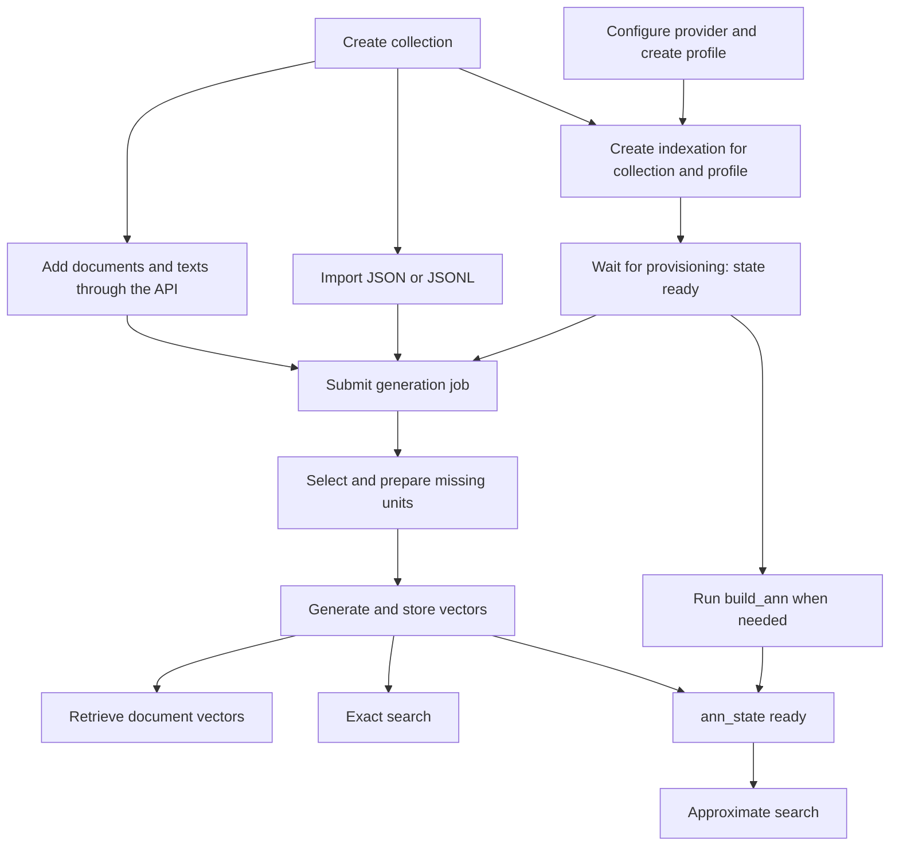

# Document and Vector Platform Guide

This guide consolidates the platform's concepts, API examples, end-to-end indexing workflow, and operational guidance. API **v1** generates and caches embeddings per store. API **v2** manages collections, documents, source texts, embedding profiles, index configurations, durable imports, vector generation, retrieval, and semantic search.

Examples use `http://localhost:8989`. UUIDs, timestamps, hashes, distances, and vectors in responses are illustrative. Response snippets show relevant fields and may omit others; use the values returned by your own server. Jobs are asynchronous. The v1 and v2 APIs remain separate: v1 stores and cached vectors are not automatically converted to v2 documents.

## 1. Concepts

| Concept | Purpose |
| --- | --- |
| Collection | Organizes documents; it is not an authorization or tenant boundary. |
| Document | Collection-scoped record with an internal UUID, exact external ID, metadata, and revision. |
| Source text | A document's title, abstract, or other text, identified by `text_id`, `kind`, optional language, and revision. |
| Embedding profile | Immutable model, declared revision, dimensions, execution mode, provider reference, and preparation recipe. |
| Indexation | Immutable binding of a collection and profile to text selection, chunking, metric, ANN strategy, and a dedicated vector table. |
| Vector unit | A whole source text or chunk selected for representation; records its offsets, source revision, and prepared-input hash. |
| Embedding | Numeric representation of a unit, generated by a provider or supplied in a validated import. |
| Job | Persisted asynchronous work processed by a worker, with status, counters, and errors. |

## 2. Configuration and access

Java 21, PostgreSQL with administrator-installed pgvector >= 0.8.0, and an appropriately configured provider are required for HTTP inference. Default HTTP port: 8989. Set these values explicitly: the active standalone properties and Docker Compose have different defaults.

| Setting | Purpose |
| --- | --- |
| `DVP_ENABLED` | Enables v2 components. |
| `DVP_ROLE=API`, `WORKER`, or `ALL` | Selects process responsibilities; a `WORKER` process does not expose the v2 API. |
| `DVP_WORKERS_ENABLED=true` | Allows a `WORKER` or `ALL` process to execute jobs. |
| `DVP_IMPORT_ENABLED=true` | Enables import processing on API and worker processes. |
| `DVP_IMPORT_FILE_ROOT` | Durable directory shared by import API and worker instances. |
| `app.dvp.providers.<reference>.*` | Provider type, endpoint, resource limits, and secret reference. |

The active standalone configuration defaults `DVP_ENABLED`, `DVP_IMPORT_ENABLED`, and `DVP_WORKERS_ENABLED` to true, and `DVP_ROLE` to `ALL`; Compose defaults them to false, false, false, and `API`. `application.properties.example` is documentation, not an automatically loaded configuration. For a local API and worker using an already configured database:

```bash
DVP_ENABLED=true DVP_IMPORT_ENABLED=true DVP_WORKERS_ENABLED=true DVP_ROLE=ALL \
  mvn spring-boot:run
```

The active configuration defines the provider reference `ollama-gpu-ibict` as `OPENAI_COMPATIBLE`; `DVP_LOCAL_PROVIDER_ENDPOINT` overrides its endpoint. A provider reference is a configuration name, not the provider type or endpoint. For credentials use `secret-ref`, the name of an environment variable; never put tokens in profiles or repository examples. Generation and text search send content to the configured provider; authorize the destination and data sharing first.

| Resource | Path |
| --- | --- |
| Swagger UI | `GET /swagger-ui/index.html` |
| OpenAPI JSON | `GET /api-docs` |
| Swagger configuration | `GET /api-docs/swagger-config` |
| Health | `GET /actuator/health` |
| Metrics | `GET /actuator/metrics` and `GET /actuator/metrics/{name}` |

The old `/v3/api-docs` path is not served by the current configuration. Restrict Actuator access and health details to operators. Exposing the `prometheus` endpoint name does not itself install a Prometheus registry.

## 3. End-to-end workflow



1. Create a collection and retain the returned UUID.
2. Add documents using PATCH/PUT or submit an import and wait for its job. An import without embeddings stores documents and texts; it does not call the model.
3. Configure a provider and create an HTTP profile with the correct model, revision, and dimensions. Use `import_only` for externally produced vectors without HTTP inference.
4. Create an indexation with the collection and profile. Its response has an indexation `Location` and a provisioning `job_id`. Wait for the job and confirm `state=ready`; this does not mean vectors exist.
5. Submit a generation job per indexation for selected documents or the collection. It prepares missing units and creates missing vectors. A separate preparation job is optional and does not invoke inference.
6. Inspect the job, item errors, counters, and document coverage. `succeeded` alone does not mean a particular document produced a vector.
7. Retrieve vectors or search. Approximate search needs a compatible ready ANN index. PostgreSQL maintains an existing HNSW index as new vectors are inserted; do not run `build_ann` for each vector.

Empty `selection.kinds` or `selection.languages` means **all** kinds or languages. An indexation named `abstracts` with `kinds: []` also selects titles; specify `["abstract"]` to select only abstracts. `chunking.mode=none` yields one unit per selected text. `characters-v1` may yield multiple chunks; for example `{"mode":"characters-v1","max_chars":2000,"overlap_chars":200}` uses code-point windows and overlap, not a token limit.

Documents and indexations can be created in either order once their prerequisites exist. Collection-wide jobs capture a document-sequence limit at enumeration; later documents need another job. Changing a text's content, kind, or language invalidates its old units and vectors; regenerate or import them. Metadata-only changes preserve them.

## 4. API v2 conventions

- Resource IDs are UUIDs. `external_id` and `text_id` are exact and case-sensitive; URL-encode query values.
- Collection/profile/indexation creation, job creation, and imports require `Idempotency-Key`. Replaying the same key, method, path, and content returns the original result; different content with that key returns 409. Use a new key for a new job. Document writes accept an optional key.
- Document PATCH, PUT, and DELETE accept optional `If-Match: "<revision>"`; an outdated revision returns 412. Read the current `ETag` first.
- Lists generally accept `limit` 1–1000 (default 100) and an opaque `cursor`; pass `next_cursor` unchanged with the same selection. Pages do not share a snapshot.
- 202 means a job was accepted, not completed. Job states include `queued`, `running`, `succeeded`, `completed_with_errors`, and `failed`.
- v2 errors have `timestamp`, `status`, `code`, `message`, `request_id`, and `details`; `X-Request-Id` matches the response. Common statuses: 400 invalid request; 404 missing; 409 conflict/unavailable; 412 revision mismatch; 413 size; 422 incompatible data; 429 capacity; 503 unavailable/timeout. v1 retains its own error format.

```json
{"timestamp":"2026-11-12T12:00:00Z","status":409,"code":"indexation_unavailable","message":"Index configuration is not ready","request_id":"aaaaaaaa-aaaa-4aaa-8aaa-aaaaaaaaaaaa","details":[]}
```

Set variables to values returned by your service. Replace placeholders before running commands:

```bash
BASE=http://localhost:8989
C='<COLLECTION_UUID>'
P='<PROFILE_UUID>'
I='<INDEXATION_UUID>'
D='<DOCUMENT_UUID>'
J='<JOB_UUID>'
```

## 5. Collections

### `POST /api/v2/collections`

Requires `Idempotency-Key`. The response includes the collection `Location`; the lowercase ASCII slug is unique.

Request:

```bash
curl -i -X POST "$BASE/api/v2/collections" \
  -H 'Content-Type: application/json' -H 'Idempotency-Key: collection-example-001' \
  -d '{"slug":"research","name":"Open Research"}'
```

Example response **201** (fields may be omitted here for brevity):

```json
{"id":"11111111-1111-4111-8111-111111111111","slug":"research","name":"Open Research","created_at":"2026-11-12T12:00:00Z"}
```

### `GET /api/v2/collections`

Lists collections with keyset pagination.

Request:

```bash
curl "$BASE/api/v2/collections?limit=100"
```

Example response **200** (fields may be omitted here for brevity):

```json
{"items":[{"id":"11111111-1111-4111-8111-111111111111","slug":"research","name":"Open Research","created_at":"2026-11-12T12:00:00Z"}],"next_cursor":null}
```

### `GET /api/v2/collections/{id}`

Returns one collection.

Request:

```bash
curl "$BASE/api/v2/collections/$C"
```

Example response **200** (fields may be omitted here for brevity):

```json
{"id":"11111111-1111-4111-8111-111111111111","slug":"research","name":"Open Research","created_at":"2026-11-12T12:00:00Z"}
```

## 6. Documents and source texts

### `PATCH /api/v2/collections/{c}/documents/by-external-id`

PATCH upserts supplied text keys, preserves omitted keys, and replaces metadata if provided. The response includes `ETag`, and creation includes `Location`. Its full text objects also include SHA-256 hashes and timestamps.

Request:

```bash
curl -i -X PATCH "$BASE/api/v2/collections/$C/documents/by-external-id?external_id=example%3Aarticle-001" \
  -H 'Content-Type: application/json' \
  -d '{"metadata":{"title":"Open access to research","year":2024},"texts":[{"text_id":"title-en","kind":"title","language":"en","content":"Open access to research"},{"text_id":"abstract-en","kind":"abstract","language":"en","content":"A study of open access to scientific research."}]}'
```

Example response **201 for creation or 200 for update** (fields may be omitted here for brevity):

```json
{"id":"22222222-2222-4222-8222-222222222222","external_id":"example:article-001","collection_id":"11111111-1111-4111-8111-111111111111","revision":1,"metadata":{"title":"Open access to research","year":2024},"texts":[{"text_id":"title-en","kind":"title","language":"en","content":"Open access to research","revision":1},{"text_id":"abstract-en","kind":"abstract","language":"en","content":"A study of open access to scientific research.","revision":1}]}
```

### `PUT /api/v2/collections/{c}/documents/by-external-id`

PUT requires metadata and texts and removes omitted texts. This example requires revision 1 using `If-Match`.

Request:

```bash
curl -i -X PUT "$BASE/api/v2/collections/$C/documents/by-external-id?external_id=example%3Aarticle-001" \
  -H 'Content-Type: application/json' -H 'If-Match: "1"' \
  -d '{"metadata":{"title":"Open access"},"texts":[{"text_id":"title-en","kind":"title","language":"en","content":"Open access"}]}'
```

Example response **200 for update or 201 for creation** (fields may be omitted here for brevity):

```json
{"id":"22222222-2222-4222-8222-222222222222","external_id":"example:article-001","revision":2,"metadata":{"title":"Open access"},"texts":[{"text_id":"title-en","kind":"title","language":"en","content":"Open access","revision":2}]}
```

### `GET /api/v2/collections/{c}/documents/{d}`

Returns the full document and `ETag`.

Request:

```bash
curl -i "$BASE/api/v2/collections/$C/documents/$D"
```

Example response **200** (fields may be omitted here for brevity):

```json
{"id":"22222222-2222-4222-8222-222222222222","external_id":"example:article-001","revision":1,"metadata":{"title":"Open access to research"},"texts":[{"text_id":"title-en","kind":"title","language":"en","content":"Open access to research","revision":1}]}
```

### `GET /api/v2/collections/{c}/documents/by-external-id`

Returns the same representation and `ETag` using the exact external ID.

Request:

```bash
curl --get "$BASE/api/v2/collections/$C/documents/by-external-id" \
  --data-urlencode 'external_id=example:article-001'
```

Example response **200** (fields may be omitted here for brevity):

```json
{"id":"22222222-2222-4222-8222-222222222222","external_id":"example:article-001","revision":1,"metadata":{"title":"Open access to research"},"texts":[{"text_id":"title-en","kind":"title","language":"en","content":"Open access to research","revision":1}]}
```

### `GET /api/v2/collections/{c}/documents`

Lists summaries; metadata is included only when requested, and text bodies are omitted.

Request:

```bash
curl "$BASE/api/v2/collections/$C/documents?limit=100&include=metadata"
```

Example response **200** (fields may be omitted here for brevity):

```json
{"items":[{"id":"22222222-2222-4222-8222-222222222222","external_id":"example:article-001","collection_id":"11111111-1111-4111-8111-111111111111","revision":1,"metadata":{"title":"Open access to research"}}],"next_cursor":null}
```

### `DELETE /api/v2/collections/{c}/documents/{d}/texts`

Deletes the specified text and dependent representations; the response includes the new `ETag`.

Request:

```bash
curl -i -X DELETE "$BASE/api/v2/collections/$C/documents/$D/texts?text_id=abstract-en" \
  -H 'If-Match: "1"'
```

Expected response: **204**; the response has no body.

### `DELETE /api/v2/collections/{c}/documents/{d}`

Deletes the document and its dependent representations. Perform deletion only when intended.

Request:

```bash
curl -i -X DELETE "$BASE/api/v2/collections/$C/documents/$D" -H 'If-Match: "2"'
```

Expected response: **204**; the response has no body.

## 7. Embedding profiles

### `POST /api/v2/embedding-profiles`

Requires `Idempotency-Key` and returns the profile `Location`. Confirm that bge-m3, 1024 dimensions, and the declared revision match your provider. The fingerprint shown is illustrative.

Request:

```bash
curl -i -X POST "$BASE/api/v2/embedding-profiles" \
  -H 'Content-Type: application/json' -H 'Idempotency-Key: profile-example-001' \
  -d '{"slug":"bge-m3-v1","model":"bge-m3","model_revision":"deployment-2026-11","dimensions":1024,"execution_mode":"http","provider_ref":"ollama-gpu-ibict","preparation":{"version":"identity-v1"}}'
```

Example response **201** (fields may be omitted here for brevity):

```json
{"id":"33333333-3333-4333-8333-333333333333","slug":"bge-m3-v1","model":"bge-m3","model_revision":"deployment-2026-11","dimensions":1024,"execution_mode":"http","provider_ref":"ollama-gpu-ibict","preparation":{"version":"identity-v1","document_prefix":"","query_prefix":""},"fingerprint":"aaaaaaaaaaaaaaaaaaaaaaaaaaaaaaaaaaaaaaaaaaaaaaaaaaaaaaaaaaaaaaaa","inference_capable":true,"created_at":"2026-11-12T12:00:00Z"}
```

### `GET /api/v2/embedding-profiles`

Lists immutable profiles.

Request:

```bash
curl "$BASE/api/v2/embedding-profiles?limit=100"
```

Example response **200** (fields may be omitted here for brevity):

```json
{"items":[{"id":"33333333-3333-4333-8333-333333333333","slug":"bge-m3-v1","model":"bge-m3","model_revision":"deployment-2026-11","dimensions":1024,"execution_mode":"http"}],"next_cursor":null}
```

### `GET /api/v2/embedding-profiles/{id}`

Returns a profile; credentials are not returned.

Request:

```bash
curl "$BASE/api/v2/embedding-profiles/$P"
```

Example response **200** (fields may be omitted here for brevity):

```json
{"id":"33333333-3333-4333-8333-333333333333","slug":"bge-m3-v1","model":"bge-m3","model_revision":"deployment-2026-11","dimensions":1024,"execution_mode":"http","provider_ref":"ollama-gpu-ibict","preparation":{"version":"identity-v1","document_prefix":"","query_prefix":""},"inference_capable":true}
```

For `import_only`, omit `provider_ref`; such a profile cannot make provider calls and supports search using external vectors. Preparation versions include `identity-v1` and `legacy-normalizer-v1`; prefixes default to empty. A changed model, revision, dimension, or recipe requires a new profile and indexation.

## 8. Indexations and maintenance

### `POST /api/v2/collections/{c}/indexations`

Requires an existing collection and profile. `Location` identifies the indexation; `job_id` identifies its provisioning job.

Request:

```bash
curl -i -X POST "$BASE/api/v2/collections/$C/indexations" \
  -H 'Content-Type: application/json' -H 'Idempotency-Key: index-abstracts-001' \
  -d "{\"slug\":\"abstracts\",\"profile_id\":\"$P\",\"selection\":{\"kinds\":[\"abstract\"],\"languages\":[]},\"chunking\":{\"mode\":\"none\"},\"metric\":\"cosine\",\"ann_strategy\":\"hnsw_vector\"}"
```

Example response **202** (fields may be omitted here for brevity):

```json
{"id":"44444444-4444-4444-8444-444444444444","collection_id":"11111111-1111-4111-8111-111111111111","slug":"abstracts","profile_id":"33333333-3333-4333-8333-333333333333","metric":"cosine","ann_strategy":"hnsw_vector","state":"provisioning","ann_state":"pending","selection":{"kinds":["abstract"],"languages":[]},"chunking":{"mode":"none"},"job_id":"55555555-5555-4555-8555-555555555555"}
```

### `GET /api/v2/collections/{c}/indexations`

Lists indexations and their state.

Request:

```bash
curl "$BASE/api/v2/collections/$C/indexations?limit=100"
```

Example response **200** (fields may be omitted here for brevity):

```json
{"items":[{"id":"44444444-4444-4444-8444-444444444444","collection_id":"11111111-1111-4111-8111-111111111111","slug":"abstracts","profile_id":"33333333-3333-4333-8333-333333333333","state":"ready","ann_state":"pending","selection":{"kinds":["abstract"],"languages":[]},"chunking":{"mode":"none"}}],"next_cursor":null}
```

### `GET /api/v2/collections/{c}/indexations/{i}`

`state` describes the table; `ann_state` describes the approximate index. Counts can be estimates.

Request:

```bash
curl "$BASE/api/v2/collections/$C/indexations/$I"
```

Example response **200** (fields may be omitted here for brevity):

```json
{"id":"44444444-4444-4444-8444-444444444444","slug":"abstracts","profile_id":"33333333-3333-4333-8333-333333333333","metric":"cosine","ann_strategy":"hnsw_vector","state":"ready","ann_state":"ready","selection":{"kinds":["abstract"],"languages":[]},"chunking":{"mode":"none"},"capabilities":{"exact":true,"approximate":true}}
```

### `POST /api/v2/collections/{c}/indexations/{i}/maintenance-jobs`

`build_ann` constructs HNSW if needed. `reconcile` checks and reconciles physical structures. The response `Location` identifies the job.

Request:

```bash
curl -i -X POST "$BASE/api/v2/collections/$C/indexations/$I/maintenance-jobs" \
  -H 'Content-Type: application/json' -H 'Idempotency-Key: build-ann-001' \
  -d '{"operation":"build_ann"}'
```

Example response **202** (fields may be omitted here for brevity):

```json
{"id":"66666666-6666-4666-8666-666666666666","kind":"maintenance","status":"queued"}
```

Metrics: `cosine`, `l2`, `inner_product`. Strategies: `hnsw_vector` up to 2000 dimensions, `hnsw_halfvec` up to 4000, or `none` for exact access up to 16000. Float32 remains the stored representation. `build_ann` requires a ready indexation and a strategy other than `none`; if its index is already valid and ready, the operation does not force a rebuild. Builds consume disk and WAL.

## 9. Streaming imports

### `POST /api/v2/collections/{c}/imports`

JSONL is UTF-8 and uncompressed, with one object per line and `schema_version: "1"` on each record:

```jsonl
{"schema_version":"1","external_id":"example:article-001","metadata":{"year":2024},"texts":[{"text_id":"abstract-en","kind":"abstract","language":"en","content":"Open access research."}]}
{"schema_version":"1","external_id":"example:article-002","metadata":{"year":2023},"texts":[{"text_id":"abstract-en","kind":"abstract","language":"en","content":"Open research data."}]}
```

An example file is available at [examples/import-records.jsonl](examples/import-records.jsonl). From the repository root:

```bash
curl -i -X POST "$BASE/api/v2/collections/$C/imports" \
  -H 'Idempotency-Key: import-example-001' \
  -F 'options={"format":"jsonl","mode":"merge"};type=application/json' \
  -F 'file=@docs/examples/import-records.jsonl;type=application/octet-stream'
```

Example response **202**, with `Location: /api/v2/jobs/{id}` (fields abbreviated):

```json
{"id":"77777777-7777-4777-8777-777777777777","kind":"import","status":"queued","collection_id":"11111111-1111-4111-8111-111111111111","indexation_id":null,"parameters":{"format":"jsonl","mode":"merge"},"counters":{}}
```

For JSON, use `format=json` and a top-level version and `documents` array:

```json
{"schema_version":"1","documents":[{"external_id":"example:article-003","metadata":{"year":2022},"texts":[{"text_id":"abstract-en","kind":"abstract","language":"en","content":"Digital preservation."}]}]}
```

`merge` follows PATCH semantics; `replace` follows PUT for documents present in the file and does not delete omitted documents. Every record's document, texts, supplied vectors, and checkpoint commit atomically. JSONL errors are per line; malformed global JSON fails with `file_correction_required`. JSON with the schema version after the documents array is preflighted before writes.

Precomputed vectors are optional and require `indexation_id`, `profile_id`, `text_id`, `input_hash` (SHA-256 of prepared input), and `values`; `on_conflict` is `keep` or `replace`. The source text must be in the record, and the indexation must belong to the collection, be ready, and use `chunking.mode=none`. The importer validates vectors and does not call a provider or verify provenance. Invalid vectors roll back the entire record.

Defaults: 10 GiB per file, 16 MiB per record, 64 KiB options, and two concurrent uploads per API instance. Files are durably published before 202; terminal files are retained at least 30 days after the last terminal descendant. Retries reuse the original file; missing or expired files return 409 `import_file_unavailable`. Shared storage must support atomic rename, directory fsync, and cross-process locks.

## 10. Preparation, generation, and jobs

### `POST /api/v2/collections/{c}/indexations/{i}/preparation-jobs`

Creates units without inference. A missing or empty `document_ids` selects the collection; a nonempty list accepts at most 1000 distinct document UUIDs.

Request:

```bash
curl -i -X POST "$BASE/api/v2/collections/$C/indexations/$I/preparation-jobs" \
  -H 'Content-Type: application/json' -H 'Idempotency-Key: prepare-example-001' \
  -d "{\"document_ids\":[\"$D\"]}"
```

Example response **202** (fields may be omitted here for brevity):

```json
{"id":"88888888-8888-4888-8888-888888888888","kind":"prepare","status":"queued","collection_id":"11111111-1111-4111-8111-111111111111","indexation_id":"44444444-4444-4444-8444-444444444444","parameters":{"document_ids":["22222222-2222-4222-8222-222222222222"]},"counters":{}}
```

### `POST /api/v2/collections/{c}/indexations/{i}/generation-jobs`

Requires an HTTP profile. It prepares missing units and generates/reuses eligible vectors. Use an empty list for the collection and a separate job for each indexation.

Request:

```bash
curl -i -X POST "$BASE/api/v2/collections/$C/indexations/$I/generation-jobs" \
  -H 'Content-Type: application/json' -H 'Idempotency-Key: generate-example-001' \
  -d "{\"document_ids\":[\"$D\"]}"
```

Example response **202** (fields may be omitted here for brevity):

```json
{"id":"99999999-9999-4999-8999-999999999999","kind":"generate","status":"queued","collection_id":"11111111-1111-4111-8111-111111111111","indexation_id":"44444444-4444-4444-8444-444444444444","parameters":{"document_ids":["22222222-2222-4222-8222-222222222222"]},"counters":{}}
```

### `GET /api/v2/jobs`

Lists jobs with keyset pagination.

Request:

```bash
curl "$BASE/api/v2/jobs?limit=100"
```

Example response **200** (fields may be omitted here for brevity):

```json
{"items":[{"id":"99999999-9999-4999-8999-999999999999","kind":"generate","status":"succeeded","collection_id":"11111111-1111-4111-8111-111111111111","indexation_id":"44444444-4444-4444-8444-444444444444","parameters":{"document_ids":[]},"counters":{"documents_read":1,"documents_processed":1,"units_prepared":1,"vectors_generated":1}}],"next_cursor":null}
```

### `GET /api/v2/jobs/{j}`

Returns status, counters, parameters, and global error code.

Request:

```bash
curl "$BASE/api/v2/jobs/$J"
```

Example response **200** (fields may be omitted here for brevity):

```json
{"id":"99999999-9999-4999-8999-999999999999","kind":"generate","status":"succeeded","collection_id":"11111111-1111-4111-8111-111111111111","indexation_id":"44444444-4444-4444-8444-444444444444","parent_job_id":null,"parameters":{"document_ids":[]},"counters":{"documents_read":1,"documents_processed":1,"units_prepared":1,"vectors_generated":1},"created_at":"2026-11-12T12:00:00Z","finished_at":"2026-11-12T12:00:03Z","global_error_code":null}
```

### `GET /api/v2/jobs/{j}/errors`

Lists sanitized item errors; global failures may have no item errors.

Request:

```bash
curl "$BASE/api/v2/jobs/$J/errors?limit=100"
```

Example response **200** (fields may be omitted here for brevity):

```json
{"items":[],"next_cursor":null}
```

### `POST /api/v2/jobs/{j}/retries`

Creates a child job for failed items of a terminal job. Active jobs or jobs with no retryable failures return 409. Repeat a global maintenance failure with a new maintenance request.

Request:

```bash
curl -i -X POST "$BASE/api/v2/jobs/$J/retries" -H 'Idempotency-Key: retry-example-001'
```

Example response **202** (fields may be omitted here for brevity):

```json
{"id":"aaaaaaaa-aaaa-4aaa-8aaa-aaaaaaaaaaaa","kind":"generate","status":"queued","parent_job_id":"99999999-9999-4999-8999-999999999999","parameters":{"document_ids":[]},"counters":{}}
```

## 11. Retrieve document vectors

These read-only endpoints never generate or prepare vectors. They accept `limit`, `cursor`, and `include=texts,metadata`; embeddings are always returned. Without `include`, text bodies and metadata are omitted. Each response uses one snapshot; pages can observe later changes.

The following abbreviated response illustrates the shape for all four routes. Its `embedding` is omitted because the example profile has 1024 dimensions; each real item includes that array:

```json
{"document":{"id":"22222222-2222-4222-8222-222222222222","external_id":"example:article-001","revision":1},"indexations":{"44444444-4444-4444-8444-444444444444":{"profile_id":"33333333-3333-4333-8333-333333333333","model":"bge-m3","model_revision":"deployment-2026-11","dimensions":1024,"coverage":{"state":"complete","eligible_texts":1,"unprepared_texts":0,"prepared_units":1,"current_vectors":1,"missing_vectors":0}}},"items":[{"indexation_id":"44444444-4444-4444-8444-444444444444","profile_id":"33333333-3333-4333-8333-333333333333","unit_id":"bbbbbbbb-bbbb-4bbb-8bbb-bbbbbbbbbbbb","text_id":"abstract-en","source_revision":1,"ordinal":0,"start_cp":0,"end_cp":18,"origin":"generated"}],"next_cursor":null}
```

For the format of `embedding`, this separate item illustrates a three-dimensional profile, not the 1024-dimensional bge-m3 profile:

```json
{"indexation_id":"44444444-4444-4444-8444-444444444444","profile_id":"33333333-3333-4333-8333-333333333333","unit_id":"bbbbbbbb-bbbb-4bbb-8bbb-bbbbbbbbbbbb","text_id":"abstract-en","source_revision":1,"ordinal":0,"start_cp":0,"end_cp":18,"origin":"generated","embedding":[0.12,-0.03,0.45]}
```

### `GET /api/v2/collections/{c}/documents/{d}/vectors`

Request:

```bash
curl "$BASE/api/v2/collections/$C/documents/$D/vectors?include=texts,metadata"
```

Response **200** uses the shape above and includes `unavailable_indexation_ids` for the all-indexations route.

### `GET /api/v2/collections/{c}/document-vectors`

Request:

```bash
curl --get "$BASE/api/v2/collections/$C/document-vectors" --data-urlencode 'external_id=example:article-001'
```

Response **200** uses the shape above and includes `unavailable_indexation_ids` for the all-indexations route.

### `GET /api/v2/collections/{c}/indexations/{i}/documents/{d}/vectors`

Request:

```bash
curl "$BASE/api/v2/collections/$C/indexations/$I/documents/$D/vectors"
```

Response **200** uses the shape above; an unavailable indexation returns 409.

### `GET /api/v2/collections/{c}/indexations/{i}/document-vectors`

Request:

```bash
curl --get "$BASE/api/v2/collections/$C/indexations/$I/document-vectors" --data-urlencode 'external_id=example:article-001'
```

Response **200** uses the shape above; an unavailable indexation returns 409.

Coverage is `not_applicable` when no texts are selected, `pending` when no vectors exist but work remains, `partial` when some are missing, and `complete` when all units of selected texts have vectors. `unprepared_texts` counts texts without units; `missing_vectors` counts prepared units without vectors. An existing document with no vectors returns 200 and empty `items`; a missing document returns 404.

## 12. Semantic search

### `POST /api/v2/collections/{c}/indexations/{i}/search`

Text search applies the query preparation and calls the profile provider. The response never returns embedding arrays.

Request:

```bash
curl -X POST "$BASE/api/v2/collections/$C/indexations/$I/search" \
  -H 'Content-Type: application/json' \
  -d '{"query":{"text":"open research data"},"top_n":10,"result_unit":"document","mode":"exact","include":["texts","metadata"]}'
```

Example response **200** (fields may be omitted here for brevity):

```json
{"indexation_id":"44444444-4444-4444-8444-444444444444","profile_id":"33333333-3333-4333-8333-333333333333","metric":"cosine","mode":"exact","result_unit":"document","requested":10,"returned":1,"shortfall_reason":"exhausted","recall_guaranteed":true,"results":[{"document_id":"22222222-2222-4222-8222-222222222222","external_id":"example:article-001","unit_id":"bbbbbbbb-bbbb-4bbb-8bbb-bbbbbbbbbbbb","text_id":"abstract-en","source_revision":1,"distance":0.08,"text":"Open access research.","metadata":{"year":2024}}]}
```

Alternatively supply `query.vector` with exactly the profile's dimensions. The client is responsible for matching its model, revision, and preparation space. `import_only` profiles accept external vectors but reject text with 409 `profile_not_executable`.

Defaults: `top_n=10` (1–100), `result_unit=document` (or `unit`), `mode=approximate`, and empty `include`. Results sort by ascending distance, document UUID, then unit UUID. Exact mode evaluates current vectors and finds each document's global best unit before limiting; a shortfall is `exhausted`. Approximate mode requires ready ANN, expands candidates, reranks float32 values, reports `recall_guaranteed:false`, and reports `candidate_limit` on shortfall. It does not silently fall back to exact. Halfvec admission rejects overflow and cosine vectors that round to zero.

Initial per-instance limits are two exact and 16 approximate searches, with 60- and 10-second query timeouts; excess can return 429 and timeout 503 `search_timeout`. These are configurable starting limits, not measured capacity guarantees.

## 13. API v1

V1 stores bind model and dimensions to a persistent cache. The service normalizes/hashes input, reuses cached vectors, and calls its configured provider for misses. The examples use a hypothetical three-dimensional model; use a provider and model that actually support its dimensions.

### `POST /api/v1/stores`

Creates a store.

Request:

```bash
curl -i -X POST "$BASE/api/v1/stores" -H 'Content-Type: application/json' \
  -d '{"name":"Example Store","model":"example-model","dimensions":3,"createVectorIndex":false}'
```

Example response **201** (fields may be omitted here for brevity):

```json
{"id":"cccccccc-cccc-4ccc-8ccc-cccccccccccc","name":"Example Store","model":"example-model","provider":"ollama","embeddingDimensions":3,"createdAt":"2026-11-12T12:00:00Z"}
```

### `GET /api/v1/stores`

Lists stores.

Request:

```bash
curl "$BASE/api/v1/stores"
```

Example response **200** (fields may be omitted here for brevity):

```json
[{"id":"cccccccc-cccc-4ccc-8ccc-cccccccccccc","name":"Example Store","model":"example-model","provider":"ollama","embeddingDimensions":3,"createdAt":"2026-11-12T12:00:00Z"}]
```

### `POST /api/v1/embeddings`

Generates or reuses embeddings for a string or array of strings. A mismatched configured provider returns 409.

Request:

```bash
curl -X POST "$BASE/api/v1/embeddings" -H 'Content-Type: application/json' \
  -d '{"model":"example-model","dimensions":3,"input":"Example text"}'
```

Example response **200** (fields may be omitted here for brevity):

```json
{"storeId":"cccccccc-cccc-4ccc-8ccc-cccccccccccc","storeName":"Example Store","model":"example-model","provider":"ollama","object":"list","data":[{"object":"embedding","index":0,"embedding":[0.1,0.2,0.3]}],"usage":{"prompt_tokens":0,"total_tokens":0}}
```

### `GET /api/v1/status`

Returns environment-dependent system and database information.

Request:

```bash
curl "$BASE/api/v1/status"
```

Example response **200** (fields may be omitted here for brevity):

```json
{"timestamp":"2026-11-12T12:00:00Z","system":{"cpu":{"availableProcessors":4,"usagePercent":20.0},"ram":{"totalBytes":1000,"usedBytes":400},"disk":{"totalBytes":1000,"usedBytes":400}},"database":{"name":"embeddings","sizeBytes":1000,"storeCount":1,"embeddingTableCount":1,"embeddingTables":[]}}
```

## 14. Operations, observability, and recovery

### `GET /actuator/health`

The `dvp` health component can expose the pgvector version, role, feature flags, and configured-provider count when authorized details are enabled. Provider count does not establish connectivity or model quality.

Request:

```bash
curl "$BASE/actuator/health"
```

Example response **200** (fields may be omitted here for brevity):

```json
{"status":"UP"}
```

### `GET /actuator/metrics` and `GET /actuator/metrics/{name}`

Requests:

```bash
curl "$BASE/actuator/metrics"
curl "$BASE/actuator/metrics/dvp.search.duration"
```

Example list response **200**:

```json
{"names":["dvp.search.duration","dvp.provider.duration","dvp.jobs.claimed"]}
```

Example metric response **200** after a search:

```json
{"name":"dvp.search.duration","measurements":[{"statistic":"COUNT","value":1.0},{"statistic":"TOTAL_TIME","value":0.01}],"availableTags":[{"tag":"mode","values":["exact"]},{"tag":"outcome","values":["success"]}]}
```

Available names depend on executed operations. Meters include search duration, rejections, shortfalls and valid approximate candidates; provider duration; registered import bytes; allowlisted API error codes; and job/lease events. They do not label by document, job, collection, indexation, or provider ID. Durable queue counts, retries, vector and table sizes, and alerting still need additional operational collection. Avoid HTTP body, JDBC bind-value, and wire logging for sensitive data.

Default pool budgets per instance are 10 write, 8 read, 2 coordination, 4 advisory-lock, and 1 maintenance connection, plus bounded inference. Check actual configuration and aggregate budgets across replicas.

### Backup, restore, and rollback

Back up PostgreSQL—including v1 data, Flyway history, the `dvp` registry, dynamic vector tables, jobs and checkpoints—and durable import files as a consistent pair. One approach is to stop new writes/uploads and workers, wait for in-flight work, then capture the database and volume; arbitrary independent snapshots do not establish consistency. Retain WAL according to the recovery strategy.

Restore first to an isolated new database and volume using compatible PostgreSQL tools. Verify extension, migrations, dynamic tables, file hashes, jobs, and synthetic smoke tests before starting workers. The synthetic PostgreSQL 16 rehearsal passed with matching version 16 tools; version 17 client tools emitted an incompatible setting. It does not establish production RPO/RTO or crash-consistent online recovery.

For application rollback, disable v2 traffic and workers, safely stop uploads, and restore a compatible earlier application while retaining schema, data, indexes, jobs, and files. Do not drop schemas, run destructive migrations, or prune volumes as an application rollback. No v1 reindex is needed for the additive changes. Model, revision, preparation, metric, or dimension changes require a new profile/indexation and explicit generation or import.

Before upgrading a legacy database without Flyway history, rehearse on an authorized copy: back up, inspect `stores`, check duplicates, verify the extension, and plan version-1 baseline and V2–V4 migrations. **The active configuration currently sets `spring.flyway.baseline-on-migrate=true` and `baseline-version=1`**, so startup can automatically baseline a nonempty database without history. Do not start against an existing database until its schema and these settings are explicitly verified. Set `spring.flyway.baseline-on-migrate=false` during inspection if automatic baselining must be prevented. Start with v2 disabled, test v1, enable v2 in stages, and verify rollback while preserving data.

### Measured capacity and limitations

A local synthetic run on 2026-11-12 used PostgreSQL 16.10/pgvector 0.8.0, 256 documents with one 1024-dimensional vector each, one HNSW indexation, and 30 measured sequential searches after warmup. Direct JDBC insertion took 257.6 ms; HNSW build took 26.1 ms. Exact p50/p95/p99 latency was 5.460/6.152/6.182 ms; approximate was 5.733/6.405/6.443 ms. Recall@10 was 1.0 for the repeated synthetic query. The vector table including indexes used 3,645,440 bytes, including a 2,105,344-byte HNSW index.

This small synthetic run excludes HTTP and model calls and is not an SLA or a capacity claim for 10–50 million documents. Mixed load, real chunk distributions, replicas, provider/import throughput, WAL, disk, autovacuum, cascades, and production RPO/RTO remain to be measured on representative infrastructure.

The optional benchmark and backup/restore tests use only the disposable Compose server and fresh test databases:

```bash
docker compose -f docker-compose.test.yml up -d --wait
DVP_TEST_DB_URL=jdbc:postgresql://127.0.0.1:55439/dvp_test \
DVP_RECOVERY_REHEARSAL=1 DVP_BENCHMARK=1 mvn -o clean verify
docker compose -f docker-compose.test.yml stop
```

Never point these tests at application or production databases. Implementation evidence, unresolved checks, and approvals are recorded in [IMPLEMENTATION_PLAN.md](IMPLEMENTATION_PLAN.md).
