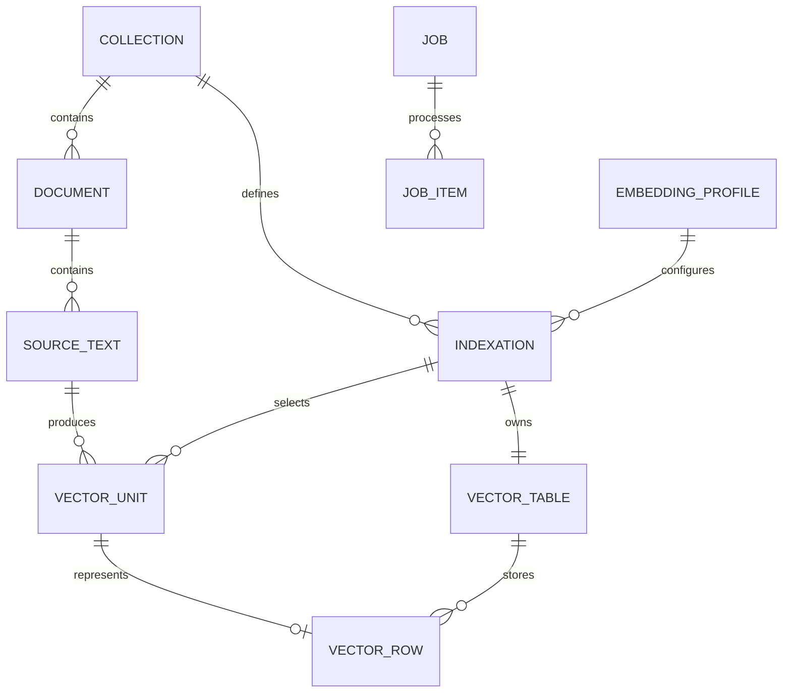

# Document and Vector Platform Specification

**Version:** 1.0 · **Date:** November 3, 2026 · **Status:** implementation specification.

## 1. Purpose, scope, and normative language

Extend LA Referencia Embedding Service to store documents, their source texts, and multiple vector representations; import externally prepared content and vectors; generate embeddings on demand after ingestion; retrieve vectors by document; and search within a specific index configuration. Preserve the existing embedding generation and caching service.

**MUST** denotes a mandatory acceptance requirement. **Proposal** denotes a recommended implementation approach. An equivalent approach may be used if it preserves the contracts and invariants and the decision is documented. The defaults in this document define the initial implementation and configuration; they are not capacity measurements.

### 1.1 Agreed decisions

| Topic | Decision |
| --- | --- |
| Technology | Java 21, Spring Boot, PostgreSQL and pgvector. |
| Compatibility | `/api/v1`, existing stores and vectors are preserved in parallel. |
| Identity | Document identified by collection + external ID; internal UUID. |
| Content | Multiple texts per document, each with a stable key. |
| Vectorization | Full text or automatic character-based chunking. |
| Computation | On demand; ingestion never triggers inference automatically. |
| Models | Local or remote HTTP services; no models are loaded inside Java. |
| Isolation | One physical vector table per index configuration. |
| Ingestion | API, JSON and JSONL; texts with optional vectors. |
| Update | Explicit partial update and full replacement. |
| Search | Text or vector, results by document or vectorized unit; approximate and exact. |
| Validity | Only vectors representing the current source revision are served. |
| Metadata | Stored and may be returned; no search filters initially. |
| Design scale | 10–50 million documents per collection, multiple texts and index configurations. |

The initial release excludes: hybrid search, reranking with other models, arbitrary filters, aggregated vectors without text, embedded inference, graphical interface, or PDF transformation. Authentication and authorization preserve the existing deployment boundary; a collection is not equivalent to a multi-user security mechanism.

This document specifies future work; it does not modify the application or run migrations. The implementation MUST provide a verifiable OpenAPI specification matching the contracts below.

### 1.2 Current repository behavior

The current code exposes `/api/v1/stores`, `/api/v1/embeddings` and `/api/v1/status`. `StoreService` selects stores by model and dimensions; `EmbeddingRepository` creates a table for each store UUID, storing a hash, vector, and timestamp. Original texts and document IDs are not stored. `EmbeddingProviderService` uses a global provider and `TextNormalizer` converts to lowercase, rejoins words split across a hyphenated line break, collapses whitespace and applies NFC.

The previous architecture states that letter case is preserved and describes a flow with store UUIDs; those claims do not represent the current behavior. Its capacity estimates are likewise not adopted as guarantees. Compatibility must be assessed against the code, tests, and observed responses rather than those descriptions.

Examples retain Spanish source content and identifiers to illustrate multilingual ingestion; these values are intentional sample data. SQL comments, diagram labels, and explanatory messages are translated.

Internal references: [README](../README.md), [previous architecture](lareferencia-embedding-service-architecture.md) and [pending fixes](../fixes.md).

## 2. Architecture and invariants



Separate v1/v2 controllers, the document domain, preparation/chunking, providers, vector repositories, and workers. Providers and instrumentation may be shared; the identity, normalization, and storage rules of v1 and v2 are not conflated.

**Terminology:** An **index configuration** is the resource called *indexación* in the Spanish specification: it binds a collection to an embedding profile, text-selection rules, chunking policy, distance metric, and a dedicated vector table. API and schema identifiers such as `indexations` and `indexation_id` are unchanged. **Chunking** means splitting source text into vectorizable units. **Current** means that a vector represents the current source revision.

**Mandatory invariants:**

1. A document belongs to a collection; its external ID is unique only within it.
2. A text has a unique key within the document. Two identical texts remain distinct entities.
3. An index configuration belongs to a collection and an immutable profile. It has immutable selection, chunking, and metric.
4. Each index configuration has its own table, even if another uses the same model. A query does not join tables of different index configurations to search for neighbors.
5. A unit represents a concrete version of a text in an index configuration. There is at most one active vector per unit.
6. A hash detects identical inputs and enables reuse of computed embeddings; it never replaces the document identifier.
7. The vector length matches the profile; all its components must be finite and representable in float32. For cosine distance, vectors with zero norm are rejected.
8. Matching model names alone must not be used to treat profiles, revisions, text preparation rules, or dimensions as interchangeable.
9. Reading vectors never generates embeddings. A search with a text query may call the inference provider to embed that query.
10. Searches, associated metadata, and retrieved vectors correspond to the same PostgreSQL read snapshot. They are not guaranteed to remain current after the response completes.

## 3. Proposed relational schema

### 3.1 Conventions

Proposal: `dvp` schema for the new tables, leaving the old ones intact. UUIDs generated by the application; UTC timestamps; UTF-8 content; SHA-256 hash in hexadecimal over the exact UTF-8 bytes, without implicit normalization. External IDs and text keys are case-sensitive, without silent trimming. Administrative slugs are lowercase ASCII, unique within their scope.

The following DDL is a reference for future migrations, not a production upgrade script. The program MUST also validate the cross-table rules and the typed JSON that these CHECK constraints do not express. The `vector` extension must be installed by the administrator; do not install extensions automatically from HTTP requests.

```sql
CREATE SCHEMA dvp;

CREATE TABLE dvp.collections (
    id uuid PRIMARY KEY,
    slug varchar(100) NOT NULL UNIQUE CHECK (slug ~ '^[a-z0-9][a-z0-9_-]*$'),
    name varchar(200) NOT NULL,
    created_at timestamptz NOT NULL DEFAULT now()
);

CREATE TABLE dvp.documents (
    id uuid PRIMARY KEY,
    collection_id uuid NOT NULL REFERENCES dvp.collections(id),
    sequence_id bigint GENERATED ALWAYS AS IDENTITY UNIQUE,
    external_id varchar(512) COLLATE "C" NOT NULL CHECK (length(external_id) > 0),
    metadata jsonb NOT NULL DEFAULT '{}' CHECK (jsonb_typeof(metadata) = 'object'),
    revision bigint NOT NULL DEFAULT 1 CHECK (revision > 0),
    created_at timestamptz NOT NULL DEFAULT now(),
    updated_at timestamptz NOT NULL DEFAULT now(),
    UNIQUE (collection_id, external_id),
    UNIQUE (id, collection_id)
);
CREATE INDEX documents_collection_scan ON dvp.documents(collection_id, sequence_id);

CREATE TABLE dvp.source_texts (
    id uuid PRIMARY KEY,
    document_id uuid NOT NULL REFERENCES dvp.documents(id) ON DELETE CASCADE,
    text_key varchar(200) COLLATE "C" NOT NULL,
    kind varchar(60) NOT NULL,
    language varchar(35),
    content text NOT NULL CHECK (length(content) > 0),
    content_hash char(64) NOT NULL CHECK (content_hash ~ '^[0-9a-f]{64}$'),
    revision bigint NOT NULL DEFAULT 1 CHECK (revision > 0),
    updated_at timestamptz NOT NULL DEFAULT now(),
    UNIQUE (document_id, text_key),
    UNIQUE (id, document_id)
);

CREATE TABLE dvp.embedding_profiles (
    id uuid PRIMARY KEY,
    slug varchar(100) NOT NULL UNIQUE CHECK (slug ~ '^[a-z0-9][a-z0-9_-]*$'),
    model varchar(255) NOT NULL,
    model_revision varchar(255) NOT NULL,
    dimensions integer NOT NULL CHECK (dimensions BETWEEN 1 AND 16000),
    execution_mode varchar(20) NOT NULL CHECK (execution_mode IN ('http', 'import_only')),
    provider_ref varchar(100),
    preparation jsonb NOT NULL CHECK (jsonb_typeof(preparation) = 'object'),
    fingerprint char(64) NOT NULL UNIQUE,
    created_at timestamptz NOT NULL DEFAULT now(),
    CHECK ((execution_mode = 'http' AND provider_ref IS NOT NULL)
        OR (execution_mode = 'import_only' AND provider_ref IS NULL))
);

CREATE TABLE dvp.indexations (
    id uuid PRIMARY KEY,
    collection_id uuid NOT NULL REFERENCES dvp.collections(id),
    slug varchar(100) NOT NULL CHECK (slug ~ '^[a-z0-9][a-z0-9_-]*$'),
    profile_id uuid NOT NULL REFERENCES dvp.embedding_profiles(id),
    selection jsonb NOT NULL,
    chunking jsonb NOT NULL,
    metric varchar(20) NOT NULL CHECK (metric IN ('cosine', 'l2', 'inner_product')),
    ann_strategy varchar(30) NOT NULL CHECK (ann_strategy IN ('hnsw_vector', 'hnsw_halfvec', 'none')),
    vector_table varchar(63) NOT NULL UNIQUE,
    state varchar(20) NOT NULL CHECK (state IN ('provisioning', 'ready', 'failed')),
    ann_state varchar(20) NOT NULL CHECK (ann_state IN ('disabled', 'pending', 'building', 'ready', 'failed')),
    created_at timestamptz NOT NULL DEFAULT now(),
    UNIQUE (collection_id, slug),
    UNIQUE (id, collection_id)
);

CREATE TABLE dvp.vector_units (
    id uuid PRIMARY KEY,
    collection_id uuid NOT NULL,
    indexation_id uuid NOT NULL,
    document_id uuid NOT NULL,
    source_text_id uuid NOT NULL,
    source_revision bigint NOT NULL CHECK (source_revision > 0),
    ordinal integer NOT NULL CHECK (ordinal >= 0),
    start_cp integer NOT NULL CHECK (start_cp >= 0),
    end_cp integer NOT NULL CHECK (end_cp > start_cp),
    input_hash char(64) NOT NULL,
    FOREIGN KEY (indexation_id, collection_id) REFERENCES dvp.indexations(id, collection_id),
    FOREIGN KEY (document_id, collection_id) REFERENCES dvp.documents(id, collection_id) ON DELETE CASCADE,
    FOREIGN KEY (source_text_id, document_id) REFERENCES dvp.source_texts(id, document_id) ON DELETE CASCADE,
    UNIQUE (indexation_id, source_text_id, source_revision, ordinal),
    UNIQUE (id, document_id, source_text_id, source_revision, indexation_id)
);
CREATE INDEX units_source ON dvp.vector_units(source_text_id);
CREATE INDEX units_document ON dvp.vector_units(document_id, indexation_id);
CREATE INDEX units_indexation ON dvp.vector_units(indexation_id, id);
```

A unit stores offsets, not another copy of the full body. `input_hash` is computed over the input prepared for the provider; it does not necessarily equal the hash of the source text. `source_revision` and the immutable recipe allow reconstructing that input.

The profile fingerprint is the SHA-256 of the RFC 8785 canonical JSON with `model`, `model_revision`, `dimensions`, `execution_mode`, `provider_ref` and `preparation`. It does not include the slug or secrets. Different provider references are not automatically considered equivalent. An importing client MUST declare the provenance; the platform validates structure, but cannot prove which model computed an external vector.

Before computing that fingerprint, defaults are filled in: empty prefixes in `preparation` and `provider_ref:null` in imported profiles. An omitted field and its explicit default must produce the same fingerprint. The original content hash, on the other hand, never uses JSON canonicalization: it uses only the bytes of the text.

### 3.2 Physical table per index configuration

The following example uses a three-dimensional index configuration to keep the DDL and JSON examples small. The implementation substitutes name, dimension, UUID and operator from a validated internal registry; never from SQL sent by the client.

```sql
CREATE TABLE dvp.vec_11111111111111111111111111111111 (
    unit_id uuid PRIMARY KEY,
    document_id uuid NOT NULL,
    source_text_id uuid NOT NULL,
    source_revision bigint NOT NULL,
    indexation_id uuid NOT NULL CHECK (indexation_id = '11111111-1111-1111-1111-111111111111'),
    embedding vector(3) NOT NULL,
    input_hash char(64) NOT NULL,
    origin varchar(10) NOT NULL CHECK (origin IN ('generated', 'imported', 'reused')),
    origin_job_id uuid,
    created_at timestamptz NOT NULL DEFAULT now(),
    FOREIGN KEY (unit_id, document_id, source_text_id, source_revision, indexation_id)
        REFERENCES dvp.vector_units(id, document_id, source_text_id, source_revision, indexation_id)
        ON DELETE CASCADE
);
CREATE INDEX vec_11111111111111111111111111111111_doc
    ON dvp.vec_11111111111111111111111111111111(document_id, unit_id);
CREATE INDEX vec_11111111111111111111111111111111_hash
    ON dvp.vec_11111111111111111111111111111111(input_hash);
CREATE INDEX vec_11111111111111111111111111111111_ann
    ON dvp.vec_11111111111111111111111111111111 USING hnsw (embedding vector_cosine_ops);
```

`origin_job_id` is optional traceability, not an FK: job retention must not delete vectors. The application validates `input_hash` against the unit and checks the vector norm as required by the metric. The PK and FK guarantee association and uniqueness; source-revision validity requires the read predicate of §8. It is not enough to rely on an asynchronous cleanup having finished.

### 3.3 Jobs, files and idempotency

```sql
CREATE TABLE dvp.jobs (
    id uuid PRIMARY KEY,
    collection_id uuid NOT NULL REFERENCES dvp.collections(id),
    indexation_id uuid REFERENCES dvp.indexations(id),
    parent_job_id uuid REFERENCES dvp.jobs(id),
    kind varchar(20) NOT NULL CHECK (kind IN ('import', 'prepare', 'generate', 'maintenance')),
    status varchar(30) NOT NULL CHECK (status IN
        ('queued', 'running', 'succeeded', 'completed_with_errors', 'failed')),
    parameters jsonb NOT NULL,
    checkpoint jsonb NOT NULL DEFAULT '{}',
    counters jsonb NOT NULL DEFAULT '{}',
    lease_owner varchar(200),
    lease_until timestamptz,
    fencing_token bigint NOT NULL DEFAULT 0,
    attempts integer NOT NULL DEFAULT 0,
    available_at timestamptz NOT NULL DEFAULT now(),
    created_at timestamptz NOT NULL DEFAULT now(),
    finished_at timestamptz
);
CREATE INDEX jobs_claim ON dvp.jobs(status, available_at, lease_until);

CREATE TABLE dvp.import_files (
    job_id uuid PRIMARY KEY REFERENCES dvp.jobs(id),
    storage_key text NOT NULL UNIQUE,
    sha256 char(64) NOT NULL,
    format varchar(10) NOT NULL CHECK (format IN ('json', 'jsonl')),
    byte_size bigint NOT NULL CHECK (byte_size >= 0),
    expires_at timestamptz
);

CREATE TABLE dvp.job_items (
    job_id uuid NOT NULL REFERENCES dvp.jobs(id) ON DELETE CASCADE,
    item_key varchar(512) NOT NULL,
    document_id uuid REFERENCES dvp.documents(id) ON DELETE SET NULL,
    status varchar(20) NOT NULL CHECK (status IN ('queued', 'running', 'succeeded', 'failed', 'skipped')),
    locator jsonb NOT NULL DEFAULT '{}',
    error_code varchar(80),
    error_details jsonb,
    lease_owner varchar(200),
    lease_until timestamptz,
    fencing_token bigint NOT NULL DEFAULT 0,
    attempts integer NOT NULL DEFAULT 0,
    PRIMARY KEY (job_id, item_key)
);
CREATE INDEX job_items_claim ON dvp.job_items(job_id, status, lease_until);

CREATE TABLE dvp.idempotency_requests (
    scope varchar(200) NOT NULL,
    request_key varchar(200) NOT NULL,
    request_hash char(64) NOT NULL,
    response_status integer NOT NULL,
    response_body jsonb NOT NULL,
    created_at timestamptz NOT NULL DEFAULT now(),
    PRIMARY KEY (scope, request_key)
);
```

`job_items` represents in-progress work and failures; tens of millions of pending items are not materialized when creating a job. Successes can be compacted to checkpoints and counters when they are no longer needed for recovery. Failures keep the locator and code until retention expires. The job/index configuration/collection relationship is validated when creating the job.

Full historical versions and obsolete vectors are not exposed as queryable data. Hashes, counters and job events are kept during their retention.

## 4. Preparation, chunking, and versioning

### 4.1 Profile and provider

Provider connections are configured separately from document data and referenced through `provider_ref`: type `OLLAMA` or `OPENAI_COMPATIBLE`, full endpoint, secret reference, timeouts, concurrency, and batch size. OpenAI and OpenRouter are `OPENAI_COMPATIBLE` configurations. Administrative responses do not return keys. Two profiles may use different providers simultaneously.

The model and revision do not change within a profile. If the server does not expose a verifiable revision, the administrator MUST assign a deployment label and create a new profile when the weights change. Secret rotation is allowed; silently changing the vector space is not.

Supported preparation: `{"version":"identity-v1"}` by default or `{"version":"legacy-normalizer-v1"}` explicitly. It is applied to the content of each unit after chunking. The profile also supports `document_prefix` and `query_prefix`, empty strings by default; they are part of the fingerprint and are applied before hashing and before sending to the provider. They allow models with different instructions for documents and queries.

A search with a text query applies preparation and `query_prefix`; it does not chunk the query. A text too long for the profile's operational limit produces 422, not silent truncation. Character-based chunking does not guarantee that inputs fit within the provider's token limit. Provider rejections are recorded as item-level errors.

### 4.2 Selection and chunking

Immutable selection: `{"kinds":[],"languages":[]}`; an empty list allows all values for that field. When both lists are non-empty, a text must match both. A null language matches only when `languages` is empty. These rules select texts for embedding; they are not search-time filters.

Each text has a type; client-prepared chunks are independent texts. In `chunking.mode=none` index configurations, each selected text produces a unit with ordinal 0. This mode is required when importing vectors for those texts: texts submitted with vectors must not be chunked again.

Automatic chunking `characters-v1`:

1. Measure positions in Unicode code points, not bytes, UTF-16 units, or graphemes. Do not modify the original.
2. Parameters `max_chars=2000`, `overlap_chars=200` by default; `max_chars > 0` and `0 <= overlap_chars < max_chars`.
3. Starting at `start`, propose `end=min(start+max_chars,length)`. If it is not the end, search for the last `\n\n` separator whose end lies between `start+ceil(max_chars/2)` and `end`; if it exists, cut right after it. CRLF is not transformed and does not count as that separator.
4. Emit the interval `[start,end)` if it contains non-whitespace characters. Apply the preparation and reject an empty prepared input as a text error.
5. If the end was reached, finish. If not, `start=max(start+1,end-overlap_chars)`. Consecutive ordinals only for emitted intervals.

Blank source text is rejected during ingestion. The algorithm's boundary behavior MUST be covered by test fixtures with emojis, combining characters, paragraphs, and large overlaps. Derived chunks are identified with a persisted UUID and offsets, not with the text as ID.

### 4.3 Changes and concurrency

An actual change to content, type, or language increments the text's revision. Before the commit, its units are deleted in all index configurations; the FKs delete their vectors. A document-metadata-only change increments the document revision but preserves the vectors. An identical submission is a no-op and does not invalidate any vectors.

Workers capture the revision and hash, make HTTP calls outside a database transaction, then lock and revalidate the source text before persisting the result. If it changed or disappeared, they discard the result and record `source_changed`; they never associate it with the new text. Update and persistence take the same document locks in a consistent order. Deleted sources are not recreated from a late result.

Generation may reuse a current vector from the same index configuration with equal `input_hash` and prepared input, verifying the equality of the prepared content before reusing. Each document maintains its own row. Reusing across index configurations or from v1 remains a later optimization; it is not a requirement nor should profile equivalence be inferred. Deduplicating within the batch is mandatory.

## 5. API v2 Conventions

### 5.1 Identifiers, fields and pagination

Base `/api/v2`; JSON UTF-8 and `snake_case` names. Dates RFC 3339 UTC. `{c}`, `{i}`, `{p}`, `{d}` and `{j}` are UUIDs of collection, index configuration, profile, internal document and job. The examples use symbolic names in paths; in real requests they are replaced by UUIDs.

The external ID is supplied in JSON or a query parameter, never as a path segment. It is encoded as a normal URL parameter; `/`, `:` and spaces are admissible, NUL is not. `external_id`: 1–512 code points and maximum 2048 UTF-8 bytes; `text_id`: 1–200 and maximum 800 bytes; they are not normalized. The program enforces the byte limits in addition to the character limits of the DDL.

All listings use `limit` (100 by default, 1–1000) and an opaque cursor bound to path and selection. Order by ascending UUID, except documents by `sequence_id`, errors by `item_key` and vectors by `(indexation_id, unit_id)`. There is no OFFSET pagination nor implicit exact global counts.

Listing response: `{"items":[],"next_cursor":null}`. Cursors do not promise a snapshot between requests: concurrent changes are documented and duplicates are removed on each page. Retrieving the complete result set while data is changing requires the client to pause or otherwise stabilize ingestion.

Unknown fields are rejected with 400. `include` allows only the values defined per endpoint. The maximum operational sizes are published in configuration; defaults: document 16 MiB, 1000 texts/document, text 2 million code points, metadata 256 KiB, textual query 8192 code points. Increasing limits with testing is supported; 2000 characters is not interpreted as the universal capacity of the models.

### 5.2 Errors and idempotency

The v2 error format is shown below. The v1 format remains unchanged:

```json
{
  "timestamp": "2026-11-03T10:00:00Z",
  "status": 422,
  "code": "embedding_dimensions_mismatch",
  "message": "The profile expects 3 dimensions",
  "request_id": "req-123",
  "details": [{"field": "embeddings[0].values", "expected": 3, "actual": 2}]
}
```

| HTTP | Meaning |
| --- | --- |
| 400 | Invalid JSON, fields, cursor or combination of parameters. |
| 404 | Collection, profile, document or index configuration nonexistent or from another scope. |
| 409 | Duplicate, idempotency key with different content, index configuration not yet available or profile without inference capability. |
| 412 | `If-Match` revision different from the current one. |
| 413 | Byte limit of request, record or file exceeded. |
| 422 | Incompatible content, dimensions, vector, chunking or capabilities. |
| 429 | Concurrency limit; includes `Retry-After`. |
| 502 | Provider failure in synchronous search. |
| 503 | Database/storage unavailable, or query timeout; never a partial response passed off as exact. |

`Idempotency-Key` is mandatory in POSTs that create resources, jobs or imports; optional in document writes. Search POST does not require it. Scope: method + canonical path; fingerprint includes normalized query and canonical body (file: options + SHA-256 of bytes). The idempotency record and its response are committed atomically with the write or job creation. Same key/content returns the same code and body; different content returns 409. A concurrent request waits up to 5 s for the first one and then returns 409 `idempotency_in_progress` with `Retry-After`.

Minimum key retention: 7 days and while its job is active. Afterwards replay is not guaranteed; natural keys and unchanged writes still avoid duplicates. Document revisions are returned as ETag `"<revision>"`; optional `If-Match` prevents unintentional overwrites. Without it, the order of commits serialized per document governs.

Reservation proposal: transactional advisory lock per scope/key before reading or writing `idempotency_requests`, with the indicated maximum wait; insert the complete result at commit. Do not insert an incomplete reservation incompatible with the DDL. In uploads, store the file first and acquire that lock afterwards; if it turns out to be a replay, clean up the redundant copy without altering the file of the original job.

## 6. Administrative and document contracts

### 6.1 Collections and profiles

| Method and route | Input | Response |
| --- | --- | --- |
| `POST /collections` | `slug`, `name` | 201, collection with `id`, fields and `created_at`; `Location`. |
| `GET /collections` | Pagination | 200, listing. |
| `GET /collections/{c}` | — | 200, collection. |
| `POST /embedding-profiles` | Contract below | 201, full profile without secrets; `Location`. |
| `GET /embedding-profiles` | Pagination | 200, listing. |
| `GET /embedding-profiles/{p}` | — | 200, profile, fingerprint and inference capability. |

The routes in this and the following tables are relative to `/api/v2`.

```json
{
  "slug": "bge-m3-local-v1",
  "model": "bge-m3",
  "model_revision": "deployment-2026-11-03",
  "dimensions": 1024,
  "execution_mode": "http",
  "provider_ref": "ollama-local",
  "preparation": {
    "version": "identity-v1",
    "document_prefix": "",
    "query_prefix": ""
  }
}
```

All fields are required except the prefixes. In `import_only`, `provider_ref` must be absent. Unknown operational reference: 422. For import-only profiles, model and declared revision are likewise required; no inference provider is implicitly created. Profiles are immutable; duplicate slug or fingerprint: 409 with a reference to the existing one.

### 6.2 Documents

| Method and route | Semantics | Result |
| --- | --- | --- |
| `PATCH /collections/{c}/documents/by-external-id?external_id=...` | Partial upsert by text key. | 201 if created, 200 if it exists. |
| `PUT /collections/{c}/documents/by-external-id?external_id=...` | Full-snapshot upsert. | 201 if created, 200 if it exists. |
| `GET /collections/{c}/documents/by-external-id?external_id=...` | Resolve by external ID. | 200 document or 404. |
| `GET /collections/{c}/documents/{d}` | Query by internal UUID. | 200 document or 404. |
| `GET /collections/{c}/documents` | Paginated listing, without text bodies. | 200 listing. |
| `DELETE /collections/{c}/documents/{d}` | Full deletion. | 204; if it no longer exists, 404. |
| `DELETE /collections/{c}/documents/{d}/texts?text_id=...` | Delete text and representations. | 204 or 404. |

Write request body (the external ID supplied in the query parameter is not repeated in JSON):

```json
{
  "metadata": {"year": 2025, "repository": "institucion"},
  "texts": [
    {"text_id": "title-es", "kind": "title", "language": "es", "content": "Ciencia abierta"},
    {"text_id": "abstract-es", "kind": "abstract", "language": "es", "content": "Texto del resumen."}
  ]
}
```

PATCH: `metadata`, if present, replaces the entire metadata object; if missing, it is preserved. `texts`, if present, updates only the sent keys, with complete objects; the rest are preserved. Both fields absent: 400. PUT requires `metadata` and `texts`; it deletes omitted texts. An empty list allows a document without texts. Repeated keys in a request: 422. `language` may be missing or null; `text_id`, `kind` and `content` are required.

A document and all changes to its texts are committed in a single transaction. A submission without changes does not increment revision or `updated_at`. Individual responses include `id`, `external_id`, `collection_id`, `revision`, `metadata`, `texts` and timestamps; each text includes `revision` and `content_hash`. Document listings omit `texts` and only include `metadata` if `include=metadata`. Vectors are not accepted in these endpoints; import is used.

For a concurrent creation, first resolve the unique key `(collection_id,external_id)` with INSERT/ON CONFLICT and lock the document row before applying the payload; do not use a pre-insertion lookup as a uniqueness guarantee. The update and the inference use that same row as the serialization point. `If-Match` on a missing document returns 412; if it creates without a precondition, the initial revision is 1. Deletions also accept `If-Match`.

### 6.3 Index configurations

| Method and route | Result |
| --- | --- |
| `POST /collections/{c}/indexations` | 202, index configuration in `provisioning`, maintenance `job_id` and `Location`. |
| `GET /collections/{c}/indexations` | 200, paginated listing. |
| `GET /collections/{c}/indexations/{i}` | 200, configuration, profile, `state`, `ann_state`, capabilities and counters with a measurement timestamp. |
| `POST /collections/{c}/indexations/{i}/maintenance-jobs` | 202, job; `operation` = `reconcile` or `build_ann`. |

```json
{
  "slug": "abstracts-bge",
  "profile_id": "22222222-2222-2222-2222-222222222222",
  "selection": {"kinds": ["abstract"], "languages": []},
  "chunking": {"mode": "characters-v1", "max_chars": 2000, "overlap_chars": 200},
  "metric": "cosine",
  "ann_strategy": "hnsw_vector"
}
```

`slug` and `profile_id` are required; empty selection, `chunking={"mode":"none"}`, cosine and `hnsw_vector` are defaults. The contract explicitly accepts `hnsw_halfvec` or `none`. If the default is incompatible with the dimensions, it returns 422 and indicates the options; it does not silently change the precision.

`ready` means the table is operational, not that the collection is fully vectorized. `ann_state` expresses whether approximate search can be used. Creating an index configuration does not prepare texts or generate vectors. During ANN construction, exact search can be used if the table is already ready. The processing recipe cannot be updated in place; create another index configuration instead. Deletion of collections/profiles/index configurations is out of scope for the first API; their administrative maintenance must not touch old stores.

## 7. File Ingestion

### 7.1 Contract

`POST /collections/{c}/imports`, `multipart/form-data`:

- `file`: uncompressed UTF-8 file, JSON or JSONL.
- `options`: `application/json` part, required: `{"format":"jsonl","mode":"merge"}` or `mode=replace`.
- `Idempotency-Key`: required.

Returns 202 only after durably storing the complete file and registering the job. Common job response of §9 and `Location`. Default file limit 10 GiB, configurable; per-record limit 16 MiB. The upload is streamed to a temporary location, the hash is computed, limits are checked, and the file is renamed atomically. No database transaction remains open during the upload. An incomplete file is never enqueued.

JSON: object `{"schema_version":"1","documents":[...]}`. The array is processed with an incremental parser. JSONL: each non-empty line is a record with `schema_version:"1"`; empty lines are ignored and the rest must be objects. A leading BOM is supported and excluded only from parsing; the file hash always uses the original bytes.

Example JSONL record using a three-dimensional profile and index configuration:

```json
{
  "schema_version": "1",
  "external_id": "oai:institucion/12345",
  "metadata": {"year": 2025},
  "texts": [
    {"text_id": "abstract-es", "kind": "abstract", "language": "es", "content": "Texto del resumen."}
  ],
  "embeddings": [
    {
      "indexation_id": "11111111-1111-1111-1111-111111111111",
      "profile_id": "22222222-2222-2222-2222-222222222222",
      "text_id": "abstract-es",
      "input_hash": "aaaaaaaaaaaaaaaaaaaaaaaaaaaaaaaaaaaaaaaaaaaaaaaaaaaaaaaaaaaaaaaa",
      "values": [0.12, -0.03, 0.45],
      "on_conflict": "keep"
    }
  ]
}
```

The illustrative hash MUST be replaced by the real SHA-256 of the input prepared according to the profile. Vectors are omitted entirely when only content is imported. In JSON the record has the same fields except `schema_version`, inherited from the container.

Per vector, `indexation_id`, `profile_id`, `text_id`, `input_hash` and `values` are required; `on_conflict` is `keep` by default or `replace`. The index configuration must be ready, belong to the collection, use that profile and `chunking.mode=none`. The text must appear in the same record and satisfy the selection. A text may have vectors in several different index configurations; repeating `(indexation_id,text_id)` within the record produces 422.

Vectors without text and references to internal automatic fragments are not admitted in this version. Declaring an import profile does not establish semantic equivalence; the uploader attests to the model, preparation rules, and model revision. For `keep`, if there is already a current vector it is kept; `replace` substitutes it atomically for that unit. After changing the content there is no current vector to retain. Vectors not re-sent are kept only if their sources did not change.

### 7.2 Atomicity, errors and resubmission

Each document record is validated and applied in a transaction with its texts, units and all its vectors. An invalid vector rolls back that entire record. `merge` uses the PATCH rules; `replace`, those of PUT. The mode replaces only documents present in the file, never deletes other documents of the collection.

The import processes records in file order. If the same ID appears several times, each record is applied to the state committed by the previous one. Changes from other jobs are serialized per document; no ordering is promised between distinct files. An identical reimport with `keep` does not create duplicate documents, units or vectors nor increase revisions.

JSONL with a malformed line: log the line error and continue. JSON with malformed global syntax: job `failed`, retaining already committed documents and the error locator; there is no rollback of the entire file. Semantic errors of valid records do not stop the rest: final state `completed_with_errors`. File without records: `succeeded`, zero counters. Previous commits are not hidden when the job fails.

Checkpoint and document result are saved in the same transaction. JSONL stores the byte offset at the start of the next record and the line number; JSON stores the ordinal and allows reparsing from the beginning, skipping committed records. Restarting does not repeat an already-committed write. To retry only failures, their locator is kept; optional per-record `If-Match` (`expected_revision`) avoids applying an old failure over a new version. If that precondition fails, the item ends with `revision_conflict`.

`expected_revision` is an optional positive integer field of the import record, equivalent to the document precondition; it is not admitted in the `options` object. An absent document does not satisfy a positive revision. The retry job references the original file and keeps the order of the failed records; it does not need to upload or duplicate the file. For JSON global syntax errors, the client must correct and re-upload the file: `POST /jobs/{j}/retries` returns 409 `file_correction_required` in that case.

## 8. Vector retrieval and search

### 8.1 Retrieving vectors from a document: mandatory requirement

All four read-only routes MUST be implemented:

| GET Route | Selection |
| --- | --- |
| `/collections/{c}/indexations/{i}/documents/{d}/vectors` | A single internal document within one index configuration. |
| `/collections/{c}/indexations/{i}/document-vectors?external_id=...` | Same, resolved by external ID. |
| `/collections/{c}/documents/{d}/vectors` | The document's vectors across all ready index configurations of the collection. |
| `/collections/{c}/document-vectors?external_id=...` | Same, resolved by external ID. |

Common parameters: `limit`, `cursor`, `include=texts,metadata` (empty by default). Vectors are always included. The route covering all index configurations delivers a flat page ordered by `(indexation_id,unit_id)`; `indexations` is a map of descriptors and coverage that allows grouping results without vectors of mixed dimensions in the same object. Each item carries its index configuration and profile.

```json
{
  "document": {
    "id": "33333333-3333-3333-3333-333333333333",
    "external_id": "oai:institucion/12345",
    "revision": 2
  },
  "indexations": {
    "11111111-1111-1111-1111-111111111111": {
      "profile_id": "22222222-2222-2222-2222-222222222222",
      "model": "example-model",
      "model_revision": "v1",
      "dimensions": 3,
      "coverage": {
        "state": "complete",
        "eligible_texts": 1,
        "unprepared_texts": 0,
        "prepared_units": 1,
        "current_vectors": 1,
        "missing_vectors": 0
      }
    }
  },
  "items": [
    {
      "indexation_id": "11111111-1111-1111-1111-111111111111",
      "profile_id": "22222222-2222-2222-2222-222222222222",
      "unit_id": "44444444-4444-4444-4444-444444444444",
      "text_id": "abstract-es",
      "source_revision": 1,
      "ordinal": 0,
      "start_cp": 0,
      "end_cp": 18,
      "origin": "imported",
      "embedding": [0.12, -0.03, 0.45]
    }
  ],
  "next_cursor": null
}
```

Coverage per document/index configuration: `not_applicable` if there are no selected texts; `pending` if there are no vectors and texts/units remain to be prepared or computed; `partial` if some vectors exist and others are missing; `complete` if every unit of every selected text has a vector. `missing_vectors` counts only prepared units without a vector; it must not be confused with texts not yet prepared. `unprepared_texts` makes that difference visible. Preparation errors can be consulted in jobs and keep coverage incomplete.

Existing document without vectors: **200**, `items:[]` and corresponding coverage; nonexistent document: **404**. An index configuration that is not ready returns 409 on the configuration-specific route. The route covering all index configurations adds `unavailable_indexation_ids` for the not-ready ones and does not fail because of them. Collection without index configurations: empty map and items. `include=texts` adds the exact text of each unit and source text data; `include=metadata` adds metadata to the document. Without `include`, neither bodies nor metadata are transferred. Nothing is recomputed, not even if coverage is `pending`.

The minimum source-revision validity predicate used by these routes and by search is:

```sql
-- v is a row in the requested index configuration's vector table.
JOIN dvp.vector_units u ON u.id = v.unit_id
JOIN dvp.source_texts s ON s.id = u.source_text_id AND s.revision = u.source_revision
JOIN dvp.documents d ON d.id = u.document_id
-- Also verify the requested collection/index configuration and v.source_revision = u.source_revision.
```

Read items, coverage, and projections under a bounded-duration `REPEATABLE READ` transaction. Pagination across responses does not keep that transaction open.

### 8.2 Search

`POST /collections/{c}/indexations/{i}/search`:

```json
{
  "query": {"text": "infraestructuras abiertas para investigación"},
  "top_n": 10,
  "result_unit": "document",
  "mode": "approximate",
  "include": ["texts", "metadata"]
}
```

External query alternative:

```json
{
  "query": {"vector": [0.12, -0.03, 0.45]},
  "top_n": 10,
  "result_unit": "unit",
  "mode": "exact",
  "include": []
}
```

`query` is required and exactly one of `text` or `vector`. Defaults: `top_n=10` (1–100), `result_unit=document`, `mode=approximate`, `include=[]`. `text` requires an available HTTP profile; `import_only` returns 409 `profile_not_executable`. The external vector must belong to the profile's space: the platform validates dimension and numbers, the client guarantees provenance. Federated search and metadata filtering are not allowed. `include` only accepts `texts` and `metadata`; embeddings are not returned from search.

Response:

```json
{
  "indexation_id": "11111111-1111-1111-1111-111111111111",
  "profile_id": "22222222-2222-2222-2222-222222222222",
  "metric": "cosine",
  "mode": "approximate",
  "result_unit": "document",
  "requested": 10,
  "returned": 1,
  "shortfall_reason": "candidate_limit",
  "recall_guaranteed": false,
  "results": [
    {
      "document_id": "33333333-3333-3333-3333-333333333333",
      "external_id": "oai:institucion/12345",
      "unit_id": "44444444-4444-4444-4444-444444444444",
      "text_id": "abstract-es",
      "source_revision": 1,
      "distance": 0.08,
      "text": "Texto del resumen.",
      "metadata": {"year": 2025}
    }
  ]
}
```

`text` and `metadata` only appear if requested. In document results, unit and text are the best match found for that document. In approximate mode it is not guaranteed to be its globally best unit, but the best among candidates. In exact mode its global minimum is used.

Ascending order by distance; ties broken by `document_id` and `unit_id`. Cosine distance, L2, or negative inner product depending on the index configuration profile; lower is better, without turning it into an ambiguously meaningful score. `shortfall_reason`: null when `top_n` was reached; `exhausted` in exact mode with fewer eligible items; `candidate_limit` in approximate with fewer results, without asserting that no more exist. There is no neighbor pagination in this version.

### 8.3 Algorithms and limits

**Exact:** evaluate all valid vectors of that table. For documents, compute distances, select the closest unit for each document, and order documents before LIMIT. Never limit fragments before grouping. SQL proposal: `MATERIALIZED` CTE of distances over valid rows, `row_number() over (partition by document_id order by distance, unit_id)`, and filter `rn=1`. The plan MUST exclude ANN; verify with EXPLAIN. This avoids declaring an approximate query exact even when HNSW exists.

**Approximate:** initially obtain `max(100,top_n*10)` candidates via ANN, discard stale vectors, re-sort by float32 distance, and group if applicable. If fewer than the requested number of results remain, double the candidate budget up to 10000 unique candidates; configure `ef_search`/iterative scan coherently with that budget, not just the SQL LIMIT. Accumulate by `unit_id` and re-sort each round. Ties are deterministic within the retrieved set, not a guarantee of retrieving all ties in the table.

For `halfvec` ANN, retrieve candidates via the halfvec expression and recompute distances with the full float32 vectors before grouping. If `ann_state` is not `ready`, respond 409 `approximate_search_unavailable`; do not perform an expensive exact scan as a silent fallback. `mode=exact` can be requested explicitly.

Read under a bounded snapshot and fetch texts/metadata after selecting candidates, within the same snapshot. Initial SQL timeout: exact 60 s, approximate 10 s, configurable; timeout => 503 `search_timeout`, never a partial list labeled exact. Initial concurrency per instance: 2 exact searches and 16 approximate; excess => 429. These must be reviewed with measurements.

### 8.4 Verified pgvector limits

The [official pgvector documentation](https://github.com/pgvector/pgvector#reference) distinguishes `vector` storage up to 16000 dimensions from ANN `vector` up to 2000 and `halfvec` up to 4000. HNSW and IVFFlat share these dimensional limits. A halfvec expression allows keeping the original vector. Cosine does not index zero vectors. Iterative scans require version 0.8.0 or later. References: [HNSW](https://github.com/pgvector/pgvector#hnsw), [IVFFlat](https://github.com/pgvector/pgvector#ivfflat), [half precision](https://github.com/pgvector/pgvector#half-precision-indexing), and [iterative scans](https://github.com/pgvector/pgvector#iterative-index-scans). Consulted on November 3, 2026.

**This platform's own policy:** pgvector >= 0.8.0, float32 `vector(D)` storage always. Native ANN up to 2000; between 2001 and 4000 only explicit `hnsw_halfvec`; above 4000 up to 16000 exact only. Outside the range, 422. IVFFlat is not implemented as an initial v2 strategy; its availability in v1 is not changed. Do not truncate dimensions. Binary quantization and subvectors are left for another version.

Expression proposal for 3072 dimensions and cosine:

```sql
-- Replace the table name with the validated internal name.
CREATE INDEX vec_example_ann ON dvp.vec_example
    USING hnsw ((embedding::halfvec(3072)) halfvec_cosine_ops);
-- The ANN query must order by the same expression; rerank using the original embedding.
```

At startup, query `pg_extension.extversion`; verify capability in integration against the version pinned in deployment. Record that version and the index parameters in diagnostics. Do not confuse the Java client version `com.pgvector` with the server extension.

## 9. Preparation, generation, and maintenance jobs

### 9.1 Contracts

| Method and route | Input/result |
| --- | --- |
| `POST /collections/{c}/indexations/{i}/preparation-jobs` | Prepare units without inference; 202. |
| `POST /collections/{c}/indexations/{i}/generation-jobs` | Prepare missing units and compute pending vectors; 202. |
| `GET /jobs/{j}` | Status, parameters, counters, and timestamps; 200 or 404. |
| `GET /jobs/{j}/errors` | Paginated listing of failures with document/locator and code. |
| `POST /jobs/{j}/retries` | Create child job with the original's failures; 202; active original => 409. |

Preparation/generation accept `{"document_ids":[]}`: absent or empty means the entire collection; maximum 1000 UUIDs if specified. All must belong to the collection. Only units without a current vector are computed; recomputation with a different model or recipe requires a new index configuration. `import_only` allows preparation but rejects generation with 409. Child job uses original parameters and current revisions; import failures with `expected_revision` preserve the precondition.

Job 202 response:

```json
{
  "id": "55555555-5555-5555-5555-555555555555",
  "kind": "generate",
  "status": "queued",
  "collection_id": "66666666-6666-6666-6666-666666666666",
  "indexation_id": "11111111-1111-1111-1111-111111111111",
  "created_at": "2026-11-03T10:00:00Z"
}
```

`GET /jobs/{j}` adds `parent_job_id`, `parameters`, `counters`, `finished_at`, the last global error, and the lease only as administrative diagnostics without secrets. Counters: documents read/processed/failed, units prepared, vectors generated/imported/reused, items skipped due to change, and retries. `total_documents` may be null during enumeration; do not invent exact percentages.

Item-level errors include `external_id` if it could be read, `text_id` if applicable, `item_key`, file locator, code, sanitized message, and attempts. Do not include full bodies or provider keys.

### 9.2 Persistent execution

Proposal: Spring Boot workers in processes with role `api`, `worker`, or `all`, coordinated exclusively by PostgreSQL. Claim jobs/items with `FOR UPDATE SKIP LOCKED`, update the lease, and commit before HTTP. PostgreSQL documents this usage for queue consumers in [SELECT, locking clauses](https://www.postgresql.org/docs/16/sql-select.html#SQL-FOR-UPDATE-SHARE).

Initial lease 120 s, heartbeat every 20 s, and fencing token incremented on each claim. Each progress commit checks owner, token, and validity; an old worker does not publish results after losing the lease. Initial HTTP timeout: connection 5 s, request 30 s; maximum batch 128 and 4 concurrent calls per provider/instance, configurable. Do not assert a global per-provider limit if there are multiple instances; size the aggregate of workers.

Retry network errors, timeouts, 429, and 5xx up to 5 attempts, backoff 1, 2, 4, and 8 seconds plus jitter 0–1 s, respecting `Retry-After` up to 300 s without occupying a sleeping thread. Persist next availability (for items, in their `locator.next_attempt_at` or an equivalent typed column). Validation-related 4xx responses and invalid vectors are permanent failures. A timeout may have caused a billable call: exactly-once HTTP execution is not guaranteed.

Writes are idempotent via unique keys, source revision, and lease checking. Cross-process coordination is needed to avoid routine duplicate processing, not just `PerKeyLockManager`. If two jobs overlap, before inference they claim an advisory lock per `(indexation_id,document_id)` on a dedicated connection, released upon completion; do not keep transactions open during HTTP. If that connection is lost, abort publication and let another worker take over. The final revision check remains mandatory.

Keyset enumeration by `(collection_id,sequence_id)`. Capture the maximum `sequence_id` at start; later insertions require another job. No snapshot of the entire corpus is promised: each document is processed at its current revision when claimed. Changes after processing and results discarded due to change remain pending for another request.

Materialize at most 1000 active items per job and process them in batches of 100 documents. Advance the checkpoint upon committing the creation of the items; on restart, finish the already-created pending ones first. A job is marked terminal only after enumeration is exhausted and no pending items or active leases remain. Counters are not incremented twice when recovering an item. With permanent failures => `completed_with_errors`; unrecoverable global file/infrastructure failure => `failed`; without failures => `succeeded`. `source_changed` counts as skipped, not as a current vector nor as coverage success.

### 9.3 Files and maintenance

Persistent volume shared by API and workers when they are on different hosts; `storage_key` is internal and does not accept client paths. Orphaned temporary uploads are cleaned up after 24 h. Files and job details are retained for 30 days from terminal state; they are never deleted while a retry job descended from the original job still needs them. A retry after expiration returns 409 `import_file_expired`; the file must be uploaded again. A scanner reconciles files without jobs and jobs without files.

Provision the table and publish `ready` status only after commit. Physical names are derived from UUIDs without dashes and are validated as identifiers. Proposal: table and metadata in a short transaction; build ANN via separate maintenance. For a large initial load, import first and request `build_ann` afterwards.

On tables with traffic, build the ANN concurrently outside the metadata transaction, detect invalid indexes, and retry under a lock per index configuration. `IF NOT EXISTS` does not prove that an index is valid. Reference: [PostgreSQL CREATE INDEX CONCURRENTLY](https://www.postgresql.org/docs/16/sql-createindex.html#SQL-CREATEINDEX-CONCURRENTLY). `reconcile` checks table, dimension, index, and status; it does not mark an object absent after rollback as ready.

## 10. Scale, observability, and configuration

The capacity unit is the number of vectors: documents × selected texts × chunks × index configurations, not just documents. The separate table isolates search, but does not distribute CPU, RAM, or I/O across servers. The first implementation uses a primary database; partitioning, sharding, and read replicas require another evaluation and are not assumed to be solved.

There MUST be separate pools and limits for search, writing, and inference; streaming of imports, keyset cursors, ANN budgets, and queries with timeout. Do not use `findAll()` for collections or jobs. Avoid metadata joins over all corpus candidates and JPA loads of complete graphs. Measure the cost of FKs and cascades with several tables per index configuration.

Global counters will be incremental or estimated and will expose `measured_at` and `is_estimate`. Exact coverage per document is computed over its texts/units; the global status of an index configuration does not run a full COUNT on every request.

Metrics: search times by mode, visited candidates, shortfalls, provider latency, retry rate, progress, imported bytes, errors by code, queue/lease expired, vectors, and table/index size. Do not label metrics with document or text IDs; use collection/index configuration IDs only with controlled cardinality. Logs with request/job ID, never full text or secrets. Expose provider status and extension version without credentials.

Initial configuration MUST include limits from §5/§8/§9, file root, retention, roles, concurrency, and providers. The base configuration must be loaded from a clean checkout without depending on an ignored `application.yml`. Adjust Compose for shared volume and correct Spring variables; do not keep dummy keys as API defaults.

The acceptance benchmark records DB/extension version, hardware, dimensions, chunk distribution, number of tables, memory, index sizes, load/generation throughput, search p50/p95/p99, and recall@N against exact. Start with reproducible fixtures and scale in stages; do not publish SLAs or 50-million estimates as facts without running the corresponding trial. Report disk/WAL saturation, autovacuum, and ANN build times.

## 11. Migration and relationship with the fixes

Proposal: Flyway for the v2 schema and its history; do not introduce `ddl-auto=update` as a mechanism for new tables. Introducing Flyway MUST include an explicit baseline for existing installations without recreating `stores`. Separate new entities from any automatic update of the legacy schema before retiring that mechanism; test against a copy of the existing database. Dynamic indexes/tables are managed with the index configuration registry and reconciliation, not by generating a Flyway file for each collection.

Additive migration: install/verify a compatible extension, create the v2 schema, deploy v2 endpoints and workers initially disabled, run smoke tests and enable them. Do not rename or delete v1 tables. Do not convert historical hashes into documents: their original content is unknown. Do not automatically reuse their vectors with new profiles.

Application rollback: disable v2 routes/workers and return to the previous version while preserving the new schema and data; do not run destructive down migrations. Ensure the old version does not attempt to manage v2 entities. Backup and restore include the index configuration registry, dynamic tables, jobs, and durable files.

| Fix from `fixes.md` | Required treatment and phase |
| --- | --- |
| 1. Race condition in local locking | Fix for v1 before sharing the engine; use leases and inter-process coordination for v2. Phase 1/3. |
| 2. Docker configuration | Reproducible startup without an ignored file and durable storage. Phase 1. |
| 3. Provider mixing | Immutable profiles and explicit resolution; v1 rejects an incompatible store/provider with a documented error. Phase 1/3. |
| 4. Cache/transaction/replicas | Publication after commit and coherent invalidation; v2 uses the DB as the source of truth and no permanent cache of listings. Phase 1/2. |
| 5. Uniqueness | DB constraints and 409 translation; v1 rules preserved and v2 uniqueness explicit. Phase 1/2. |
| 6. Embedding indices in provider responses | Rebuild by `index`, validate range/completeness/duplicates; do not associate by arrival order. Phase 1/3. |
| 7. Locale-dependent size formatting | Stable formatting and tests with several locales. Phase 1. |

Bug fixes must preserve the contract for successful v1 responses and its normalization behavior. Add regression tests before extracting services. The new v2 model length or normalization limits are not applied retroactively to v1.

## 12. Acceptance criteria and tests

Each test must record inputs, responses, and persisted state. Integration tests use real PostgreSQL with pgvector at a pinned version, not a SQL mock as the sole evidence. Concurrency tests use barriers to force the races.

| ID | Scenario and required result |
| --- | --- |
| T01 | v1 test suite and reference responses: same contract, order, normalization, and cache hits; old tables intact. Test and fix the identified locale failure. |
| T02 | Equal IDs in two collections are independent; an ID with `/`, `:`, and Unicode is resolved via query, without truncation or implicit normalization. |
| T03 | PATCH preserves omitted texts; PUT removes them; metadata follows the defined semantics; identical submission does not increase the revision. |
| T04 | Deleting a text/document removes units and vectors; no table belonging to another collection is modified. |
| T05 | Deterministic chunking with Unicode, offsets, paragraphs, overlap, and limits; no window cuts a code point. |
| T06 | JSON/JSONL with texts only, vectors of several profiles, invalid record, malformed line, and incomplete global JSON: commits and errors per §7. |
| T07 | A vector with incorrect dimension, NaN/infinity, float32 overflow, zero norm for cosine, wrong hash, or profile from another scope reverts its entire document. |
| T08 | Resending a file/request does not duplicate; `keep` and `replace` verify persisted values; changing the source invalidates the old ones. |
| T09 | Crash after committing a document and before advancing in memory: recovery uses a transactional checkpoint without double application. Retrying failures does not repeat successes. |
| T10 | Change/deletion during HTTP: late result discarded; vector retrieval and search do not return a stale vector. Test concurrent snapshot. |
| T11 | All per-document vector routes: one/several texts, several index configurations/dimensions, pagination, includes, empty 200, nonexistent 404, and unavailable 409. No HTTP call to the provider. |
| T12 | Exact against a known corpus: correct order and N distinct documents using global minimum, with many dominant fragments and ties. EXPLAIN without ANN. |
| T13 | Approximate: measure recall@N against exact, candidate expansion, explicit reporting of result shortfalls, halfvec reranking, and absence of leakage between tables. |
| T14 | Provider with unordered `data`, duplicate/missing/out-of-range index, incoherent count/dimensions: no wrong association is persisted. |
| T15 | Two workers, lease loss, stopped process, and overlapping jobs: persisted uniqueness, valid fencing, and resumption; measure redundant calls. |
| T16 | Large import and collection enumeration: memory bounded per record/batch, bounded queue, no `findAll`, OFFSET, or materialization of all IDs. |
| T17 | Install from scratch and migrate a copy with existing stores; failed provisioning, rollback, and invalid ANN are reconciled without ghost entries. |
| T18 | Concurrent Idempotency-Key/same content/different content, expiration, and If-Match; codes and absence of duplicate writes. |
| T19 | The import_only profile allows reading and vector search, rejects text and generation; multiple HTTP providers are not mixed. |
| T20 | Dimensions 2000/2001/4000/4001/16000 and out of range: strategy accepted/rejected per policy, without silent fallback. |
| T21 | Limits, timeouts, 429, expired file, and logs without secrets; reproducible benchmark and no unmeasured SLA claims. |

## 13. Implementation phases and traceability

| Phase | Deliverable | Dependencies | Verifiable output |
| --- | --- | --- | --- |
| 1 | v1 regression contracts, base fixes, reproducible configuration, and migration baseline. | Current repository, DB copy for testing. | T01, T14, T17; review of fixes 1–7. |
| 2 | v2 schema, collections, documents, texts, profiles, and index configurations with provisioning. | Phase 1. | T02–T04, T17–T18 and migratable DDL. |
| 3 | Chunking, per-profile providers, and persistent workers for preparation/generation/maintenance. | Phase 2. | T05, T10, T14–T15, T19–T20. |
| 4 | JSON/JSONL import, durable files, checkpoint, and retries. | Phases 2–3. | T06–T09, T16, T18 and recovery after crash. |
| 5 | Per-document retrieval and exact/approximate search with projections. | Phases 2–4. | T11–T13, T19–T20. |
| 6 | Load testing, observability, backup/restore, and operational documentation/final OpenAPI. | Phases 1–5. | T16–T17, T21 and measured capacity report. |

| Requirement | Contract/section | Entities | Tests |
| --- | --- | --- | --- |
| Preserve current service | §1.2, §11 | stores and v1 tables | T01, T17 |
| Document identity and multiple texts | §6.2 | collections, documents, source_texts | T02–T04 |
| Table per collection/index configuration | §3.2, §6.3 | `indexations`, `vec_*` tables | T13, T17, T20 |
| Prepared texts and chunking | §4.2, §9.1 | source_texts, vector_units | T05, T10 |
| Import texts and vectors | §7 | import_files, jobs, units and vectors | T06–T09 |
| Deferred embedding generation over HTTP | §4.1, §9 | embedding_profiles, jobs | T10, T14–T15, T19 |
| Vectors per document, one/all index configurations | §8.1 | documents, units, vec_* tables | T11 |
| Top N with IDs/texts/metadata | §8.2–§8.3 | vec_* tables, documents, source_texts | T12–T13 |
| Only current representations | §4.3, §8.1 | revisions and FK | T04, T10–T13 |
| Scale and recovery | §9–§10 | jobs, job_items, files | T09, T15–T16, T21 |
| Non-destructive migration | §11 | v2 schema + preserved legacy | T01, T17 |

The implementation is complete when the contracts are reflected in OpenAPI, the migrations and provisioning are reproducible, the above tests pass, and the operational report states measured capacity and limits. The target number of documents is a design and testing target, not an automatic guarantee derived from using pgvector.
