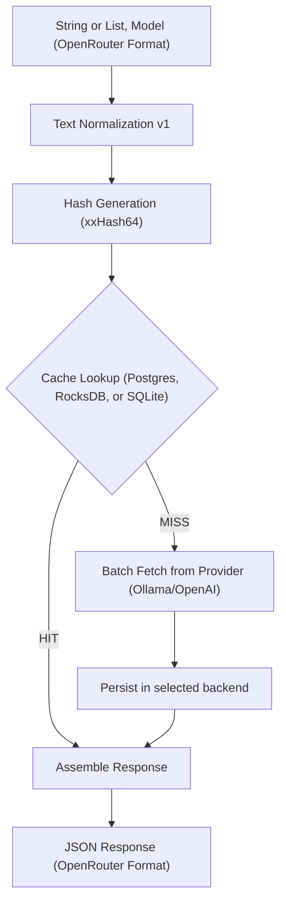

# 🏗️ LA Referencia Embedding Cache Architecture

## 1. Overview

The **LA Referencia Embedding Cache** is a high-performance microservice designed to optimize the semantic indexing pipeline. It acts as a deterministic proxy between the indexing system and the embedding model provider (e.g., Ollama/Qwen). By caching embeddings in a persistent backend, the system eliminates redundant computations for identical strings, significantly reducing infrastructure costs and increasing overall throughput.

---

## 2. Core Features

### 🚀 Performance & Efficiency

- **Deterministic Caching:** Guarantees that identical input strings always yield the same cached vector.
- **Batch Processing:** Supports array-based inputs in a single request while maintaining strict order preservation.
- **Selectable Persistence:** Uses PostgreSQL with `pgvector`, RocksDB, or SQLite for efficient, disk-based vector storage depending on deployment needs.

### 🛠️ Data Integrity

- **Text Normalization (v1):** Pre-processes text (trimming, Unicode normalization, whitespace collapsing) to ensure hashing is resistant to minor formatting variations.
- **xxHash64:** Uses `XXHashFactory.fastestInstance().hash64()` to derive deterministic cache keys from normalized UTF-8 input.
- **Model Isolation:** Embeddings are strictly scoped to the specific model used, preventing incompatible vector reuse.

### 🌐 Interoperability

- **OpenAI API Alignment:** Implements an OpenAI-compatible embedding request/response contract, exposed by this service under `/api/v1/embeddings`.
- **Read-Only Endpoints:** Includes utility endpoints to list available provider models and perform direct cache lookups by key.
- **Swagger/OpenAPI Documentation:** Fully documented interactive API accessible at `/swagger-ui.html`.

---

## 3. Data Flow Architecture

The following diagram illustrates the lifecycle of an embedding request:

---

## 4. Normalization Rules (v1)

To ensure deterministic hashing, the following rules are applied in order:

1.  **Trim:** Remove leading and trailing whitespace.
2.  **Unicode Normalization (NFC):** Standardize characters.
3.  **Collapse Spaces:** Replace multiple consecutive spaces with a single one.
4.  **Replace Line Breaks:** Replace repeated line breaks with a single space.
    _Note: Case and accents are preserved in version 1._

---

## 5. API Strategy

The application follows a versioned API approach (`/api/v1`) to ensure long-term stability.

- **`POST /api/v1/embeddings`**: Main entry point for generation/caching.
- **`GET /api/v1/models`**: Proxies available models from the underlying provider.
- **`GET /api/v1/embeddings/{key}`**: Direct retrieval for debugging and audit purposes.

---

## 6. Storage & Scalability (Scale: 15 Million Vectors)

PostgreSQL with `pgvector` provides native vector operations and dimension enforcement. RocksDB provides a lighter embedded option when operational simplicity matters more than SQL-level inspection. SQLite provides a simple file-backed relational option when you want SQL queries without a separate database server.

In the current implementation:

- PostgreSQL stores embeddings in a `VECTOR(2560)` column and uses direct JDBC.
- RocksDB stores serialized embeddings as binary values with LZ4 compression enabled.
- SQLite stores serialized embeddings as BLOB values in a local `.db` file via JDBC.

| Quantity   | Disk Space | Recommended RAM |
| :--------- | :--------- | :-------------- |
| 1 Million  | ~10 GB     | ~2 GB           |
| 15 Million | ~150 GB    | ~24 GB - 32 GB  |

---

## 7. Operational Benefits

- **Backend Flexibility:** PostgreSQL favors auditability and operational SQL tooling; RocksDB favors embedded deployment and lower infrastructure overhead; SQLite favors a single-file SQL store with minimal operational overhead.
- **Auditability:** PostgreSQL keeps human-readable SQL audit paths when that matters operationally.
- **Consistency:** All three backends persist cache entries across restarts.
- **Observability:** Built-in Prometheus metrics and health checks via Spring Actuator.

## 8. Backend Selection

The cache backend is selected with `CACHE_TYPE`.

- Default: `sqlite`
- `postgres`: Enables the PostgreSQL-backed cache and uses `spring.datasource.*` properties.
- `rocksdb`: Uses an embedded RocksDB database stored at `ROCKSDB_PATH` and does not require PostgreSQL.
- `sqlite`: Uses a local SQLite database file stored at `SQLITE_PATH` and does not require PostgreSQL.

The application disables Spring's default datasource auto-configuration and creates the JDBC datasource only when `CACHE_TYPE=postgres`.

## References

- https://www.linkedin.com/posts/rponte_hey-mysql-redis-ugcPost-7120111858719600641-mRF_/
