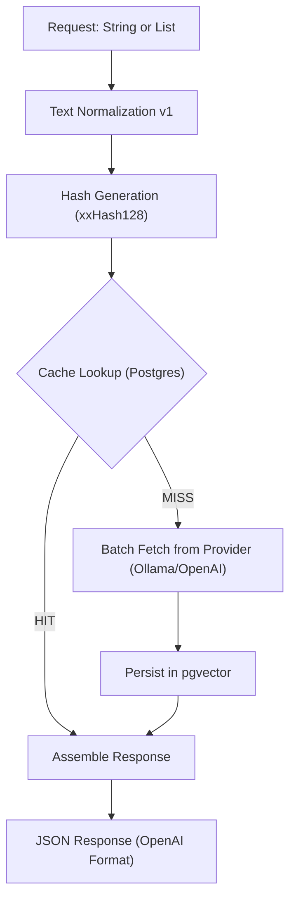

# 🏗️ LA Referencia Embedding Cache Architecture

## 1. Overview
The **LA Referencia Embedding Cache** is a high-performance microservice designed to optimize the semantic indexing pipeline. It acts as a deterministic proxy between the indexing system and the embedding model provider (e.g., Ollama/Qwen). By caching embeddings in a persistent database, the system eliminates redundant computations for identical strings, significantly reducing infrastructure costs and increasing overall throughput.

---

## 2. Core Features

### 🚀 Performance & Efficiency
- **Deterministic Caching:** Guarantees that identical input strings always yield the same cached vector.
- **Batch Processing:** Supports array-based inputs in a single request while maintaining strict order preservation.
- **pgvector Persistence:** Uses PostgreSQL with `pgvector` for efficient, disk-based vector storage, supporting millions of embeddings without high RAM overhead.

### 🛠️ Data Integrity
- **Text Normalization (v1):** Pre-processes text (trimming, Unicode normalization, whitespace collapsing) to ensure hashing is resistant to minor formatting variations.
- **xxHash128 (XXH3):** Utilizes a state-of-the-art hashing algorithm for ultra-fast fingerprinting with negligible collision risk.
- **Model Isolation:** Embeddings are strictly scoped to the specific model used, preventing incompatible vector reuse.

### 🌐 Interoperability
- **OpenAI API Alignment:** Implements the standard OpenAI embedding contract (`/v1/embeddings`), making it a drop-in replacement for standard tools.
- **Read-Only Endpoints:** Includes utility endpoints to list available provider models and perform direct cache lookups by key.
- **Swagger/OpenAPI Documentation:** Fully documented interactive API accessible at `/swagger-ui.html`.

---

## 3. Data Flow Architecture

The following diagram illustrates the lifecycle of an embedding request:

---

## 4. Normalization Rules (v1)
To ensure deterministic hashing, the following rules are applied in order:
1.  **Trim:** Remove leading and trailing whitespace.
2.  **Unicode Normalization (NFC):** Standardize characters.
3.  **Collapse Spaces:** Replace multiple consecutive spaces with a single one.
4.  **Replace Line Breaks:** Replace repeated line breaks with a single space.
*Note: Case and accents are preserved in version 1.*

---

## 5. API Strategy
The application follows a versioned API approach (`/api/v1`) to ensure long-term stability.

- **`POST /api/v1/embeddings`**: Main entry point for generation/caching.
- **`GET /api/v1/models`**: Proxies available models from the underlying provider.
- **`GET /api/v1/embeddings/{key}`**: Direct retrieval for debugging and audit purposes.

---

## 6. Storage & Scalability (Scale: 15 Million Vectors)
Leveraging `pgvector` allows for native vector operations and dimension enforcement.

| Quantity | Disk Space | Recommended RAM |
| :--- | :--- | :--- |
| 1 Million | ~10 GB | ~2 GB |
| 15 Million | ~150 GB | ~24 GB - 32 GB |

---

## 7. Operational Benefits
- **Auditability:** Native types allow for human-readable SQL audits.
- **ACID Compliance:** Ensures cache consistency even during system failures.
- **Observability:** Built-in Prometheus metrics and health checks via Spring Actuator.