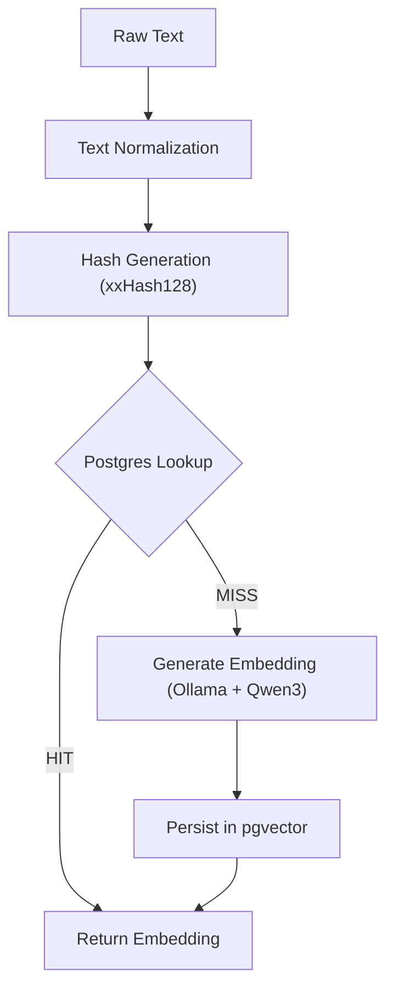

# 🏗️ Embedding Cache Architecture Plan

## 1. Context and Objective

The current indexing pipeline regenerates embeddings for identical strings during reindexing, introducing unnecessary computational overhead and increased processing time.

This architecture introduces a **deterministic embedding cache** to:
- Eliminate redundant embedding generation.
- Reduce dependency on Ollama/Qwen inference.
- Improve indexing throughput.
- Optimize infrastructure cost (CPU/GPU vs Disk).

---

## 2. Core Design Principles

### Deterministic Processing
The system ensures that the same input always leads to the same normalized string, resulting in the same hash and retrieval of the same embedding.

### Model Isolation
Cache entries are strictly scoped by model name and version to prevent the reuse of incompatible embeddings across different neural architectures.

### Data Integrity & Auditability
By utilizing native vector types, the database enforces dimension constraints at the schema level. This allows for human-readable SQL audits and ensures that all stored data meets the model's requirements.

### Scalability
The strategy prioritizes disk-based storage to support **15 million+** embeddings (~150 GB) without the prohibitive RAM costs associated with in-memory databases.

---

## 3. Data Flow Diagram

---

## 4. Normalization & Hashing Strategy

### Step 1: Text Normalization
The text normalization component prepares the input text before hashing. The goal is to avoid generating different hashes for semantically identical or operationally equivalent text strings caused by minor formatting differences.

The normalization strategy must have an explicit version.

**Normalization Version: `v1`**

**Initial normalization rules (v1):**
- **Trim whitespace:** Remove leading and trailing whitespace.
- **Normalize Unicode:** Standardize Unicode characters.
- **Collapse spaces:** Reduce multiple spaces into a single space.
- **Convert line breaks:** Replace repeated line breaks with a single space.
- **Preserve Case:** Casing is preserved in version 1.
- **Preserve Accents:** Accents and diacritics are preserved in version 1.

**Example:**
- **Input:** `"  Este   es un texto\n\nacadémico  "`
- **Normalized:** `"Este es un texto académico"`

### Step 2: Hashing (xxHash128)
- **Algorithm:** xxHash128 (XXH3) is used for its exceptional speed and low collision probability.
- **Implementation:** The output is stored as a 32-character hexadecimal string, providing a unique fingerprint for the normalized text.

---

## 5. Storage Strategy: PostgreSQL + pgvector

### Role
PostgreSQL serves as the primary persistent embedding cache, leveraging the `pgvector` extension for specialized vector operations.

### Resource Requirements (Scale: 15 Million Vectors)
For 2560-dimensional vectors using standard floating-point precision, each entry occupies approximately 10 KB of storage.

| Quantity | Disk Space | Recommended RAM |
| :--- | :--- | :--- |
| 1 Million | ~10 GB | ~2 GB |
| 10 Million | ~100 GB | ~16 GB |
| **15 Million** | **~150 GB** | **~24 GB - 32 GB** |

### Comparative Analysis: Why pgvector?

| Feature | pgvector | BYTEA (Binary) |
| :--- | :--- | :--- |
| **Integrity** | Enforces 2560 dimensions | None (accepts any binary data) |
| **Audit/Test** | Readable via SQL (`SELECT`) | Binary blobs (requires deserialization) |
| **Performance** | Native serialization via Driver | Manual conversion overhead in App |
| **Infrastructure** | Standard SSD (Low Cost) | Standard SSD (Low Cost) |

---

## 6. Operational Considerations

### Performance & Reliability
- **Serialization:** Offloads the heavy lifting of data conversion to the database driver, minimizing CPU spikes in the application layer.
- **ACID Compliance:** Uses PostgreSQL’s transactional guarantees to ensure that the cache remains consistent even after system failures.

### Auditability & Observability
Storing embeddings in a native format allows for direct inspection. Administrators can run SQL queries to identify anomalies, such as zero-vectors or null entries, without needing to invoke the application logic.

### Testing Efficiency
The use of native types simplifies the CI/CD pipeline. Test vectors can be managed through standard SQL migration scripts, and validation can be performed directly against the database state.

---

## 7. Summary Pros & Cons

*   **Pros:** 
    *   Significant cost savings by utilizing SSD storage over RAM.
    *   Automatic validation of vector dimensions at the database level.
    *   Transparent data management and easier debugging through standard SQL.
    *   Simplified architecture by reusing existing relational database infrastructure.
*   **Cons:** 
    *   Requires the `pgvector` extension to be installed on the database server.
    *   Slightly higher latency than pure in-memory solutions (though typically negligible for indexing pipelines).