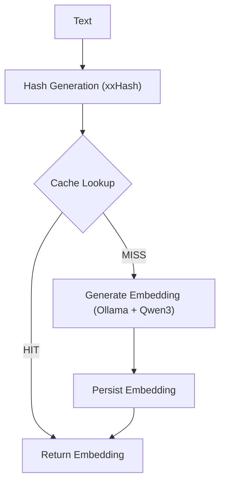

# 🏗️ Embedding Cache Architecture Plan

## 1. Context and Objective

The current indexing pipeline regenerates embeddings for identical strings during reindexing, introducing unnecessary computational overhead and increased processing time.

This architecture introduces a **deterministic embedding cache** to:

- Eliminate redundant embedding generation  
- Reduce dependency on Ollama/Qwen inference  
- Improve indexing throughput  
- Optimize infrastructure cost (CPU/GPU vs RAM vs disk)  

---

## 2. Core Design Principles

### Deterministic Processing
Same input → same normalized string → same hash → same embedding  

### Model Isolation
Cache scoped by model: `qwen3-embedding:4b`  

### Storage Efficiency
Binary serialization (no JSON)  

### Scalability First
Designed to support millions of embeddings  

---

## 3. Data Flow Diagram



---

## 4. Hashing Strategy

### Algorithm: xxHash (xxHash64 or xxHash128)

- High-performance, low-latency hashing  
- Suitable for high-throughput pipelines  

### Cache Key Format

```
embedding:qwen3-embedding:4b:{hash}
```

---
## 5. Storage Strategy Options

## Option A — Redis (Primary Cache with RDB Persistence)

### Characteristics

- In-memory cache (low latency)  
- Configured with **RDB snapshots** for persistence  
- Suitable for small to medium datasets  

### Data Representation (Mandatory)

Use **binary serialization**:

```java
ByteBuffer buffer = ByteBuffer.allocate(embedding.length * 4);
for (float value : embedding) {
    buffer.putFloat(value);
}
byte[] bytes = buffer.array();
```

### Memory Profile

- 2560 dimensions × 4 bytes = ~10 KB per embedding  

| Volume        | Memory |
|--------------|--------|
| 100k         | ~1 GB  |
| 1M           | ~10 GB |

### Optimization Options

- Enable RDB snapshots  
- Apply quantization:
  - float32 → float16 (50% reduction)  
  - float32 → int8 (75% reduction, lower precision)  

### Trade-offs

| Advantage        | Limitation        |
|-----------------|------------------|
| Ultra-fast      | RAM expensive     |
| Simple setup    | Limited scalability |

---

## Option B — PostgreSQL + pgvector (Recommended for Scale)

### Role

Primary persistent embedding cache.

### Schema

```sql
CREATE TABLE embedding_cache (
    hash_key CHAR(32) PRIMARY KEY,
    model TEXT NOT NULL,
    content_text TEXT,
    embedding VECTOR(2560)
);
```

### Characteristics

- Disk-based storage (scales to millions)  
- Native vector support via `pgvector`  
- PostgreSQL manages caching automatically (buffer pool)  
- Lower cost compared to Redis RAM scaling  

### Trade-offs

| Advantage        | Limitation        |
|-----------------|------------------|
| Scalable        | Higher latency    |
| Cost-efficient  | Requires tuning   |

---

## 6. Lookup Strategy

```
1. Normalize input text
2. Generate xxHash
3. Lookup in cache (Redis OR PostgreSQL)
4. If HIT → return embedding
5. If MISS → generate via Ollama (Qwen3)
6. Persist embedding
7. Return embedding
```

---

## 7. Spring Boot Service Design

```java
@Service
public class EmbeddingService {

    public float[] getEmbedding(String rawText) {
        String normalized = normalize(rawText);
        String hash = xxHash(normalized);

        float[] embedding = cache.get(hash);
        if (embedding != null) {
            return embedding;
        }

        embedding = ollamaClient.generate(normalized);

        cache.put(hash, embedding);

        return embedding;
    }
}
```

---

## 8. Operational Considerations

### Model Versioning

- Include model name in cache key  
- Prevent reuse of incompatible embeddings  

---

### Memory vs Scale Decision

| Dataset Size | Recommendation |
|-------------|---------------|
| < 500k      | Redis         |
| ≥ millions  | PostgreSQL    |

---

### Failure Handling

| Scenario            | Behavior                         |
|--------------------|----------------------------------|
| Cache unavailable  | Fallback to generation           |
| Ollama failure     | Retry + circuit breaker          |

---

## 9. Final Recommendation

- Use **xxHash** for hashing  
- Use **binary serialization** for embeddings  
- Choose storage based on dataset size:

> Redis (with RDB) for smaller datasets  
> PostgreSQL + pgvector for large-scale systems  
