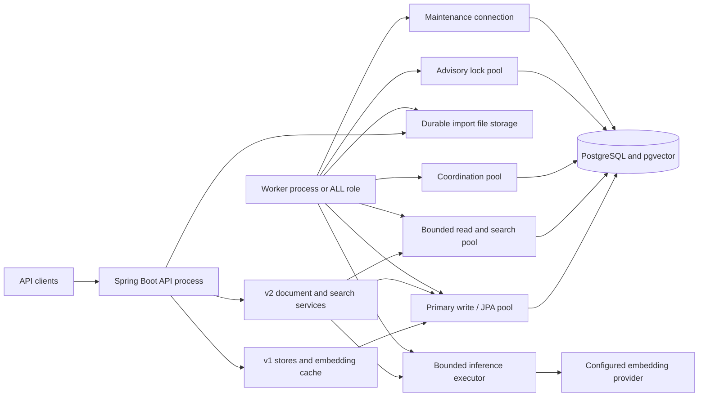
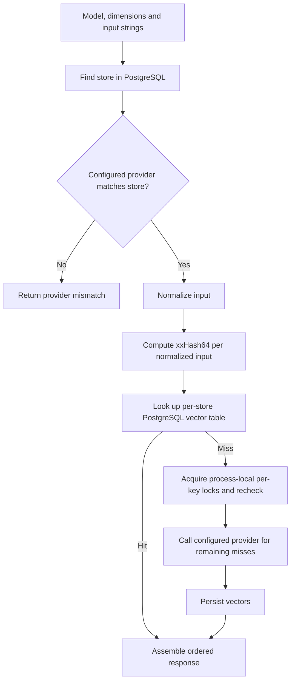
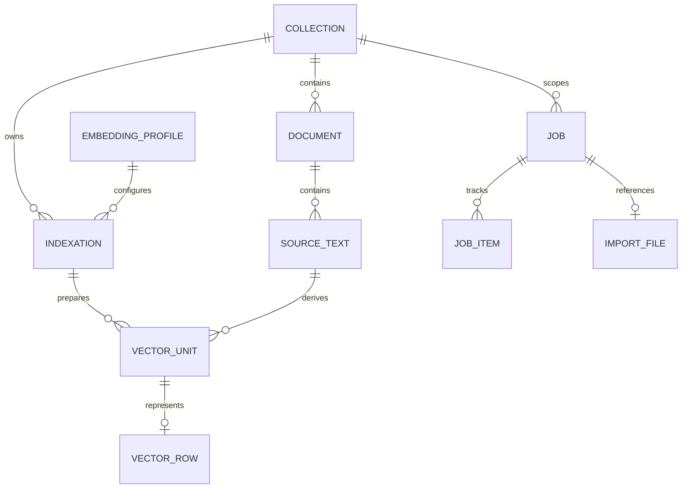
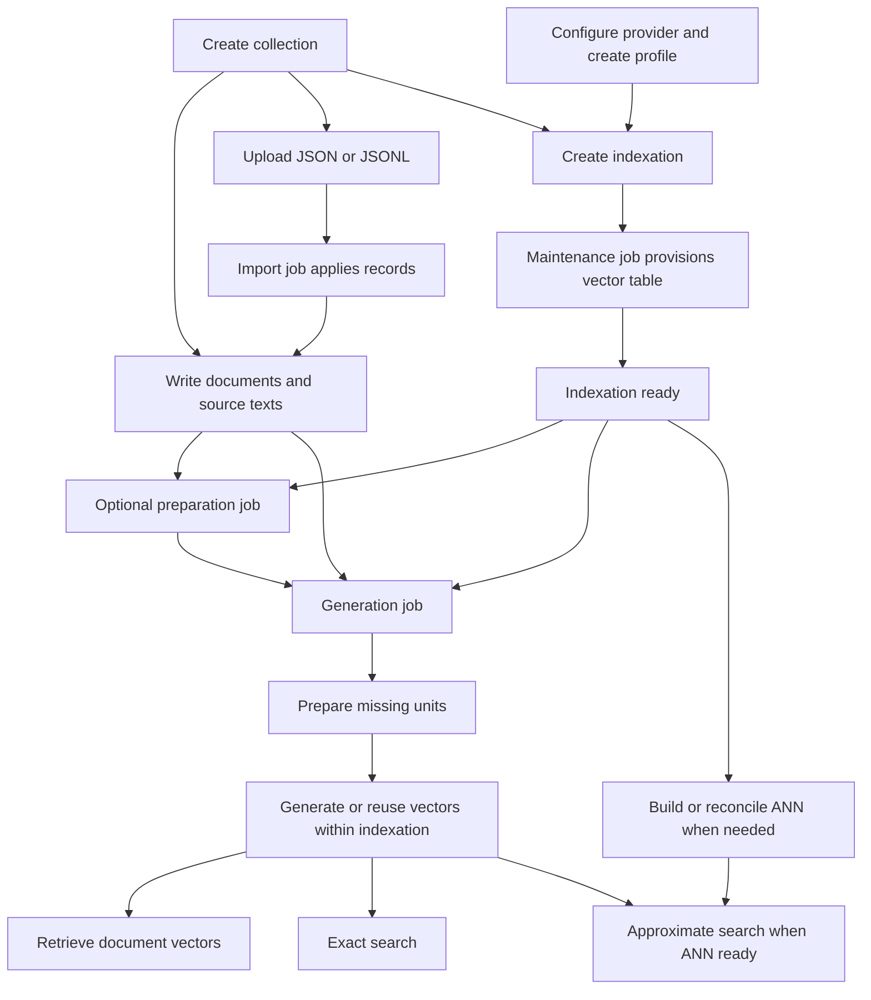

# LA Referencia Embedding Service Architecture

## 1. Purpose and scope

LA Referencia Embedding Service is a Java 21 / Spring Boot application backed by PostgreSQL and pgvector. It exposes two distinct API versions:

- **v1** provides named stores and a persistent embedding cache. A request selects a store by model and dimensions; cache misses are sent to the configured embedding provider.
- **v2** manages collections, documents and source texts, immutable embedding profiles, indexations, durable asynchronous jobs, imports, vector retrieval, and semantic search.

The APIs share a process and database infrastructure but retain separate controllers, service code, storage models and error contracts. V1 cache hashes are not automatically converted into v2 documents or vectors: the original source text and complete embedding provenance cannot be reconstructed reliably from those hashes. A collection is an organizational scope, not a security tenant; deploy the service behind an appropriate access-control boundary.

This document describes the implementation present in the repository. API examples and operational procedures are in the [Platform Guide](PLATFORM-GUIDE.md); end-to-end examples are in [Workflows](WORKFLOWS.md). The [v2 specification](document-vector-platform-specification.en.md) describes the intended contract. Implementation progress and remaining checks are recorded in [the implementation plan](coding/IMPLEMENTATION_PLAN.md).

## 2. System context

`API`, `WORKER`, and `ALL` are process roles; `DVP_WORKERS_ENABLED` independently controls worker startup. The v2 filter rejects requests on a worker-only process. An `ALL` process combines API and worker responsibilities. An API process can use the inference executor for text search; workers use it for generation. A shared PostgreSQL instance and a shared durable import directory allow separate API and worker instances to cooperate. The supplied Compose named volume is local to its Docker host and is not, by itself, multi-host shared storage.

The main package contains shared configuration and routing. Version-specific code is under `org.lareferencia.embedding.v1` and `org.lareferencia.embedding.v2`; v2 is organized by collection, document, profile, indexation, preparation, generation, import, job, retrieval, search and operations.

## 3. V1 embedding cache

### Request path

Stores are looked up from the database by model and dimensions; there is no long-lived in-memory registry of all stores. The repository keeps process-local table-readiness markers, and the per-key lock manager reduces duplicate work **within a process**. These locks do not provide a cross-process exactly-once provider guarantee. Database constraints and transaction behavior govern persisted state. An existing store whose provider differs from the currently configured v1 provider is rejected instead of serving an incompatible cache entry.

The v1 normalizer trims input, rejoins hyphenated line breaks, lowercases using `Locale.ROOT`, replaces remaining line breaks, collapses whitespace, and applies Unicode NFC. Accents are not intentionally stripped; **case is not preserved**. The normalized UTF-8 text is hashed with xxHash64. The cache key and existing v1 response shape are compatibility behavior; a hash is not proof that original texts can be recovered or that external model weights have not changed.

V1 exposes store creation/listing, embedding generation/cache access and status under `/api/v1`. Provider selection and endpoint configuration are runtime settings; batch result order is preserved. Store creation can request a vector index, but v1 cached vectors remain separate from v2 indexations.

## 4. V2 domain and storage

- A **collection** groups documents. Each document has an internal UUID, a collection-scoped exact `external_id`, metadata and a revision.
- A **source text** has a document-scoped `text_id`, kind, optional language, content, SHA-256 and revision. Multiple texts can belong to one document.
- An immutable **embedding profile** specifies model, declared revision, dimensions, execution mode, provider reference and versioned preparation/prefixes. `http` profiles support inference; `import_only` profiles carry declared provenance but cannot call a provider.
- An immutable **indexation** binds a collection and profile to selection, chunking, distance metric and ANN strategy. Each indexation has a UUID-derived `dvp.vec_*` table. `state` describes table provisioning; `ann_state` independently describes approximate-index readiness.
- A **vector unit** identifies a selected whole text or chunk, its current source revision, code-point offsets, ordinal and prepared-input hash. A vector row refers back to its unit, source, document and indexation. The original source remains in `source_texts`; units do not duplicate source bodies.
- **Jobs**, job items, idempotency records and import-file metadata are persisted in `dvp`. Long-running work is not held only in process memory.

Static registry tables and constraints are owned by Flyway migrations V1–V4; dynamic per-store/per-indexation vector tables are provisioned by the application. Physical v2 table names are derived from UUIDs and checked before dynamic SQL. V2 vectors retain float32 values. A `hnsw_halfvec` index uses an explicit half-precision index expression and validation; it does not replace the stored float32 vector.

Document writes serialize changes on the document. Changing a text's content, kind or language advances its source/document revisions and invalidates the affected units and vectors; metadata-only changes preserve representations. Retrieval and search require current source revisions and use a bounded repeatable-read snapshot for data and optional projections. A snapshot is limited to one response; cursor pages do not share a transaction.

## 5. V2 lifecycle and processing

### Ingestion and imports

Document PATCH and PUT write metadata and source texts; they do not automatically invoke inference. PATCH updates supplied text keys and preserves omitted keys; PUT replaces the document snapshot. Optional revision preconditions use `If-Match`/ETag. V2 resource/job/import creation uses scoped `Idempotency-Key` records; matching replays return the recorded response, and conflicting requests are rejected.

The multipart import path accepts JSON or JSONL. The API streams a bounded upload to an internally generated temporary file, hashes the original bytes, flushes the file, atomically publishes it and records the job/file metadata and idempotency response. It does not keep a database transaction open while uploading. Servlet multipart spooling may also consume temporary disk. The registered file is checked against recorded size and SHA-256 before processing; a bounded in-process file-stamp cache avoids rehashing unchanged files for every batch and is not a substitute for restricting write access to the import directory.

The worker parses records incrementally. Each record's document, texts, supplied vectors, job counters and checkpoint are committed atomically under lease fencing. JSONL checkpoints use byte offset and line; JSON uses a record ordinal. Individual malformed JSONL records can fail while later records continue; globally malformed JSON requires correction and a new upload. Retry descendants reuse the original file and process failed locators. The importer does not call an embedding provider or verify the provenance claimed for externally supplied vectors.

Import files require durable storage shared by API and worker instances with atomic same-filesystem rename, directory fsync and cross-process file locking. Defaults include a 10 GiB file limit, 16 MiB record limit, 24-hour temporary/orphan threshold and at least 30 days after the latest terminal job in a retry chain. Active descendants and locked files are protected from cleanup. Actual deployment-volume semantics and large-file performance require separate validation.

### Preparation and generation

A preparation job applies the indexation's kind/language selection, chunks selected texts, applies the profile's document preparation and records units. Empty selection lists match all values; `none` produces a whole-text unit and `characters-v1` uses code-point windows and overlap. Preparation does not call a provider. Character limits are not model token limits.

A generation job prepares missing units and generates vectors that are not current. It uses a per-indexation/document advisory lock, deduplicates prepared input within a batch and may reuse an equal prepared input's vector **within the same indexation**. The worker does not hold a write transaction open across provider HTTP. Before publishing, it rechecks the document/source revisions, unit identity and hash, lease/fencing token and advisory-lock session; changed or deleted sources are skipped rather than publishing stale results. Provider calls can repeat after timeouts or failures, so database fencing is not an exactly-once external inference guarantee.

The provider registry supports `OLLAMA` and `OPENAI_COMPATIBLE` runtime connections, referenced by a profile's `provider_ref`. The reference is not a URL or a credential. A secret reference names an environment variable resolved for a call. Profile model and revision are declarations; the service cannot prove that a provider has not changed its weights. Provider concurrency and batch limits are per instance and per provider, within a shared bounded executor. Configure aggregate limits across replicas and authorize outbound content sharing.

### Jobs, retries and coordination

Workers claim eligible jobs with PostgreSQL row locking, leases, heartbeats and fencing tokens. Job enumeration is bounded: a collection-wide operation captures an upper document sequence and materializes items in batches rather than loading an entire collection into memory. Documents created later require another job. Job progress, results and checkpoints are persisted, allowing lease recovery without blindly repeating committed work.

Transient provider failures, 429 and server errors can be retried with persisted bounded exponential backoff and jitter; `Retry-After` is capped. Permanent errors remain visible on job items. A retry endpoint creates a child job for eligible failed items. APIs expose public status, counters and sanitized diagnostics rather than internal lease ownership or raw provider responses. A completed job with no generated vectors can be valid—for example, when no selected text required work—so clients should inspect counters and per-document coverage.

## 6. Retrieval, search and ANN

The v2 retrieval API supports a document by UUID or exact external ID, within one indexation or across all ready indexations in its collection. It returns stored vectors, descriptors and coverage. Text/metadata projections are optional. All-indexation results are a flat, keyset-paginated list; unavailable indexations are reported separately. There is no single endpoint that retrieves every document's vectors for an entire collection; clients list documents and page through each document's vectors.

Search is scoped to one indexation and accepts exactly one query text or vector. Text is prepared with the profile's query recipe and sent to its HTTP provider. For an external vector, the service validates its dimension and numeric properties, while the client is responsible for matching its embedding space. Search does not return embeddings and does not perform cross-indexation federation.

- **Exact search** evaluates current vectors from the indexation table. For document results it selects each document's globally closest unit before applying the limit. Distance ties are ordered deterministically. A shortfall is reported as `exhausted`.
- **Approximate search** requires a valid, ready HNSW index; unavailable ANN returns 409 without silently falling back to exact. Candidate retrieval starts with a bounded budget, expands up to 10,000, filters current sources and reranks full float32 distances. The best unit is the best among candidates, not a guaranteed global best. The response declares `recall_guaranteed=false` and reports `candidate_limit` for a shortfall.
- Supported distances are cosine, L2 and negative inner product. Native HNSW vector indexes support up to 2000 dimensions; explicit halfvec HNSW supports up to 4000; `none` supports exact access up to 16000. Halfvec admission rejects overflow and rejects vectors that round to all zero for cosine. These checks apply to relevant imported/generated vectors and approximate query vectors.

An existing HNSW index is maintained by PostgreSQL as vectors are inserted. `build_ann` is a maintenance job for creating/checking the physical index, not a mandatory step after each vector. `reconcile` verifies indexation structures and readiness. A table can be ready for exact operations while its ANN is not ready.

## 7. Resource isolation and operational limits

The following are current code defaults per enabled instance, not production capacity guarantees. Runtime configuration can override them; standalone `application.properties`, the example configuration, and Compose have different defaults for the v2 feature flags and roles.

| Resource | Initial default | Purpose |
| --- | ---: | --- |
| Primary Hikari pool | 10 connections | V1 JPA and transactional v2 writes |
| Read/search pool | 8 connections | Bounded repeatable-read queries |
| Coordination pool | 2 connections | Short job claims, heartbeats and diagnostics |
| Advisory-lock pool | 4 connections | Dedicated session-level locks |
| Maintenance pool | 1 connection | Long-running index maintenance |
| Shared v2 inference executor | 4 concurrent tasks | Bounded provider work with no queued backlog |
| Search admission | 2 exact / 16 approximate | Per-instance concurrency limits |
| Search query timeout | 60 s exact / 10 s approximate | Bounded query work; timeouts do not return partial exact results |
| Job lease / heartbeat | 120 s / 20 s | Lease recovery and liveness |
| Upload admission | 2 per API instance | Bound simultaneous import uploads |

The nominal maximum across these database pools is 25 connections per enabled instance, subject to runtime overrides and actual pool use. Size the database for the total across all replicas and other clients. The model-provider timeout and concurrency settings are separate from database budgets. A timeout or overload can produce a 503 or 429; clients should inspect the error code and retry behavior.

## 8. Deployment, observability and recovery

The current active standalone properties default v2, imports and workers to enabled with role `ALL`; the supplied Compose configuration defaults these flags to disabled and role `API`. Set `DVP_ENABLED`, `DVP_IMPORT_ENABLED`, `DVP_WORKERS_ENABLED`, `DVP_ROLE`, and the import volume explicitly in each environment. The API documentation is available at `/swagger-ui/index.html` and `/api-docs`; health and metrics are under `/actuator`. The configured Prometheus exposure name alone does not add a Prometheus registry.

The v2 readiness indicator checks pgvector compatibility and reports configuration details such as role, flags and provider count when authorized health details are enabled. A configured provider count does not establish endpoint connectivity or model correctness. Micrometer meters cover selected search duration/rejection/shortfall/candidate data, provider duration, registered import bytes, allowlisted API error codes and worker claim/lease events. Metrics avoid document, text, job, collection and provider IDs as labels. Durable queue depth, table/index sizes, alert thresholds and production-specific monitoring still require operational collection. V2 request logs use request IDs without logging bodies; configure framework, JDBC and provider logging carefully, especially because v1 and v2 error/logging paths differ.

Backups must preserve a consistent pair of the PostgreSQL data—including Flyway history, v1 tables, `dvp` registry, dynamic tables, jobs and checkpoints—and durable import files. Quiesce writes/uploads and workers or use a separately validated coordinated snapshot/PITR procedure. Restore to an isolated environment and verify extension, schema, dynamic tables, jobs and file checksums before resuming workers. Do not treat independently timed database and file snapshots as automatically consistent.

Flyway migrations V1–V4 own the static schema; Hibernate validates the v1 entity schema. The active standalone configuration currently sets `spring.flyway.baseline-on-migrate=true` and `baseline-version=1`. On an existing nonempty database without Flyway history this can record a baseline automatically: inspect the actual schema, duplicate preflight and effective settings before startup, and rehearse on an authorized copy. For an application rollback, disable v2 traffic/workers and retain existing schema, data, tables, indexes and files; do not drop them as a routine rollback. A model, revision, preparation, dimension or metric change requires a new immutable profile/indexation and explicit generation or import, with an ANN build where applicable.

## 9. Verification and capacity limits

The repository includes unit tests and opt-in real PostgreSQL/pgvector integration tests for migration, v1 compatibility, job recovery, imports, generation, retrieval, search and maintenance. Test Compose uses a pinned PostgreSQL 16/pgvector 0.8.0 image and disposable data; it must not be pointed at an application or production database. The consolidated guide documents the test commands and backup/restore rehearsal.

A local synthetic smoke benchmark used 256 documents, one 1024-dimensional vector per document, one indexation and 30 sequential searches. Its recorded results and methodology are in [the capacity record](coding/phase-14-capacity.md). This small measurement is not evidence of 15 million vectors, 10–50 million documents, a production SLA or a general disk/RAM sizing rule. Mixed load, realistic chunk distributions, provider and import throughput, WAL/disk behavior, multi-replica connection budgets, actual deployment-filesystem guarantees and production RPO/RTO require measurements on representative infrastructure. Approximate-search recall depends on the corpus and settings and must be evaluated against an exact baseline.
