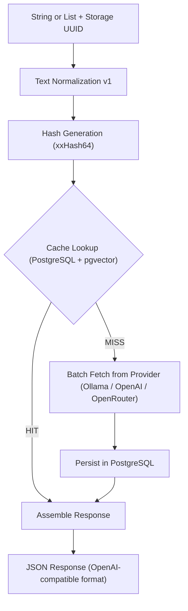

# LA Referencia Embedding Service Architecture

## 1. Overview

The **LA Referencia Embedding Service** is a high-performance microservice designed to optimize the semantic indexing pipeline. It acts as a deterministic proxy between the indexing system and an embedding model provider — **Ollama**, **OpenAI**, or **OpenRouter** — selected at configuration time. By caching embeddings in a persistent backend, the system eliminates redundant computations for identical strings, significantly reducing infrastructure costs and increasing overall throughput.

---

## 2. Core Features

### 🚀 Performance & Efficiency

- **Deterministic Caching:** Guarantees that identical input strings always yield the same cached vector.
- **Batch Processing:** Supports array-based inputs in a single request while maintaining strict order preservation.
- **In-Memory Storage Cache:** Registered storages are loaded into a `ConcurrentHashMap` at startup and kept in sync on writes, eliminating database round-trips on the hot embedding path.
- **PostgreSQL + pgvector:** Uses PostgreSQL with the pgvector extension for persistent, scalable vector storage with native SQL queryability.

### 🛠️ Data Integrity

- **Text Normalization (v1):** Pre-processes text (trimming, Unicode normalization, whitespace collapsing) to ensure hashing is resistant to minor formatting variations.
- **xxHash64:** Uses `XXHashFactory.fastestInstance().hash64()` to derive deterministic cache keys from normalized UTF-8 input.
- **Model Isolation:** Embeddings are strictly scoped to the specific model used, preventing incompatible vector reuse.

### 🔍 Observability

- **Provider URL in Errors:** Error messages include the embedding provider endpoint URL for debugging connection issues.
- **Configurable Timeouts:** HTTP connection and request timeouts are independently configurable for the external embedding provider.

---

## 3. Data Flow Architecture

The following diagram illustrates the lifecycle of an embedding request:

---

## 4. Normalization Rules (v1)

To ensure deterministic hashing, the following rules are applied in order:

1.  **Trim:** Remove leading and trailing whitespace.
2.  **Replace Line Breaks:** Replace `\n`/`\r` sequences with a single space.
3.  **Collapse Spaces:** Replace multiple consecutive spaces with a single one.
4.  **Unicode Normalization (NFC):** Standardize character composition (e.g. ensures `ç` is stored as one code point, not `c` + combining cedilla).
    _Note: Case and accents are preserved in version 1._

---

## 5. API Strategy

The application follows a versioned API approach (`/api/v1`) to ensure long-term stability. Embedding generation is storage-scoped: callers first create a named storage (which resolves dimensions from the provider and creates the pgvector table), then submit embedding requests referencing the storage's UUID as the `model` field.

- **`POST /api/v1/storages`**: Create a named storage binding a model string to a dedicated pgvector table. The embedding provider is contacted at creation time to resolve model dimensions. Accepts an optional `createVectorIndex` boolean (default `false`) — set to `true` to create a pgvector index for similarity searches.
- **`GET /api/v1/storages`**: List all registered storages.
- **`POST /api/v1/embeddings`**: Main entry point for embedding generation/caching. The `model` field must be the UUID of an existing storage. The request body follows the OpenAI embeddings API format — a single string or an array of strings.

---

## 6. Storage & Scalability (PostgreSQL + pgvector)

PostgreSQL with `pgvector` provides:

- **Native vector operations:** HNSW indexing, cosine distance, L2 distance
- **SQL queryability:** Direct SQL access to embeddings and metadata for auditing and analysis
- **Scalability:** Horizontal scaling through PostgreSQL replication, proven at 15+ million vectors
- **Dimension flexibility:** Per-storage tables created with the actual model's vector dimensions

**Estimated Resource Requirements:**

| Quantity   | Disk Space | Recommended RAM |
| :--------- | :--------- | :-------------- |
| 1 Million  | ~10 GB     | ~2 GB           |
| 15 Million | ~150 GB    | ~24 GB - 32 GB  |

---

## 7. Configuration & Observability

### HTTP Timeouts

External provider calls (Ollama, OpenAI, OpenRouter) are protected by configurable timeouts:

- `app.embedding.provider.connect-timeout` (default: 5 seconds) – Maximum time to establish a connection
- `app.embedding.provider.request-timeout` (default: 30 seconds) – Maximum time to receive a response

These can be overridden via environment variables or `application.yml`.

### Operational Benefits

- **Auditability:** PostgreSQL provides SQL-based audit trails for all embeddings and lookups.
- **Observability:** Error messages include provider URLs for debugging.
- **Reliability:** Configurable HTTP timeouts prevent hanging requests to external providers.
- **Consistency:** PostgreSQL ensures data consistency and recovery across restarts.

## References

- [PostgreSQL pgvector Extension](https://github.com/pgvector/pgvector)
- [Ollama API Documentation](https://docs.ollama.com/api/openai-compatibility)
- [OpenAI Embeddings API](https://platform.openai.com/docs/guides/embeddings)
